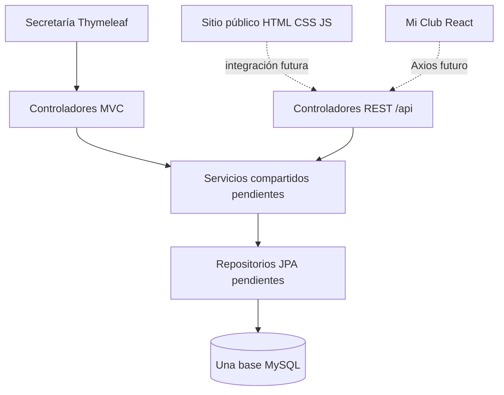

# Arquitectura inicial — Prompt 01

## Monorepo y responsabilidades

El PDF exige tres directorios de aplicación: `sitio-publico/`, `backend/` y `app-socios/`. `database/`, `postman/`, `Docs/` y `.vscode/` son auxiliares. Se conserva `Docs/` y el PDF original; Windows no distingue `docs/` de `Docs/` en este workspace. Los enlaces usan el nombre real para mantener portabilidad a Linux.

| Interfaz | Tecnología | Responsabilidad futura | Estado inicial |
| --- | --- | --- | --- |
| Sitio público | HTML5, CSS3, JavaScript | Información, catálogo, filtros y preinscripción | Tres páginas navegables, sin funciones de negocio |
| Secretaría | Spring MVC y Thymeleaf | Gestión interna | Página inicial y fragmentos comunes |
| Mi Club | Create React App, React Router, Axios, PropTypes | Ingreso por DNI, actividades e inscripciones del socio | Pantalla inicial, sin consultas reales |

Un solo proyecto Maven contiene MVC y REST. Ningún controlador ni vista accederá al repositorio. RN1–RN5 se implementarán una vez en servicios; RN6 en una función JavaScript probada con Jest y RN7 en validación cliente. No se implementan reglas, entidades, tablas, datos ni endpoints de negocio en esta etapa.

Se preparan paquetes `model`, `repository`, `service`, `controller.mvc`, `controller.api`, `dto`, `exception` y `config`. Los `package-info.java` conservan y documentan los paquetes aún sin clases funcionales. Los DTO permitirán evitar ciclos de serialización al implementar el modelo; no se afirma haber observado ese error.

## Elección de herramientas

Java 21 no se encontró instalado; se utiliza el JDK 25 disponible, sin modificar software global. Spring Initializr proporcionó una versión estable compatible de Spring Boot y Maven Wrapper. Las versiones definitivas y validaciones se documentan en [validación inicial](validacion-inicial.md) y en los manifiestos.

Create React App se conserva por requisito docente aunque está [deprecado oficialmente](https://react.dev/blog/2025/02/14/sunsetting-create-react-app). No se sustituye por Vite. Axios quedará centralizado en `src/servicios/api.js`; la URL de API se inyecta al compilar mediante `REACT_APP_API_URL`. Esta variable es pública, no debe contener secretos.

La plantilla generó React 19, que [ignora las comprobaciones PropTypes](https://react.dev/blog/2024/04/25/react-19-upgrade-guide#removed-proptypes-and-defaultprops-for-functions). Se fijan React y React DOM 18.3.1 para conservar esa validación exigida en TarjetaActividad y ResumenCuota. Este ajuste local no modifica Node ni herramientas globales.

No se agregan Lombok, Redux, Next.js ni un framework de estilos. Las dependencias transitivas del generador CRA no implican su uso en el código del proyecto.

## Configuración y alojamiento futuro

El backend usa `application.properties` con `DB_URL`, `DB_USERNAME`, `DB_PASSWORD`, `PORT` y `CORS_ALLOWED_ORIGINS`. Sin credenciales reales versionadas. Spring no carga automáticamente archivos `.env`; PowerShell o el proveedor deben establecer las variables. Hibernate no crea ni modifica tablas (`ddl-auto=none`), y la inicialización SQL está desactivada.

Se prepara un Dockerfile multietapa y `render.yaml` para un servicio gratuito de Render, sin ejecutarlos. Thymeleaf permanece en Render dentro del backend. El arranque completo requiere MySQL disponible y credenciales correctas. Las pruebas MVC aisladas no acreditan conexión a la base.

Cloudflare Pages recibirá dos proyectos estáticos: sitio público sin compilación, y CRA con salida `build/`. El fallback SPA se prepara en `public/_redirects`; se usa BrowserRouter sin implementar aún las cuatro rutas de negocio. Para Aiven se prevé `DB_URL` JDBC con TLS y verificación del certificado (`sslMode=VERIFY_IDENTITY`), usando el certificado CA del servicio y un truststore configurado en el entorno si la CA no está incluida en Java.

Ver [alojamiento futuro](alojamiento.md) para parámetros y fuentes oficiales. No se crean cuentas, recursos ni despliegues.
