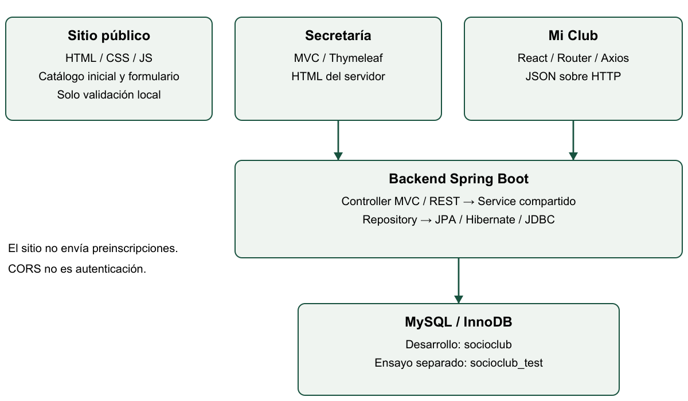
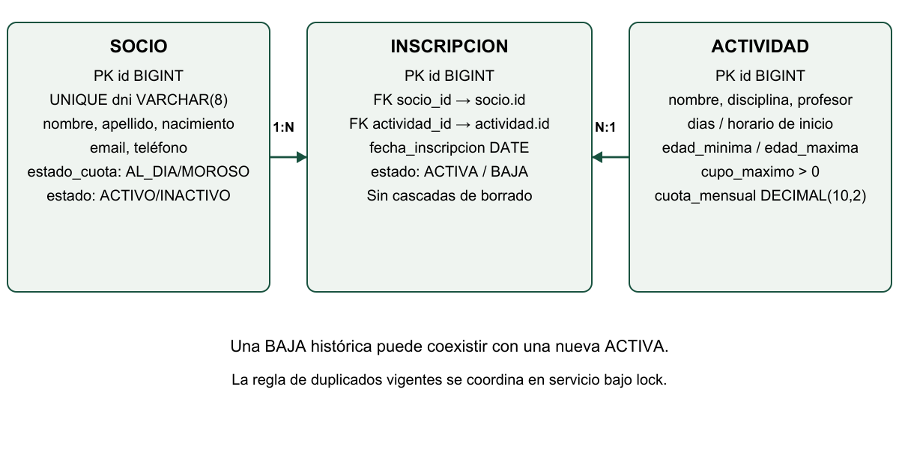
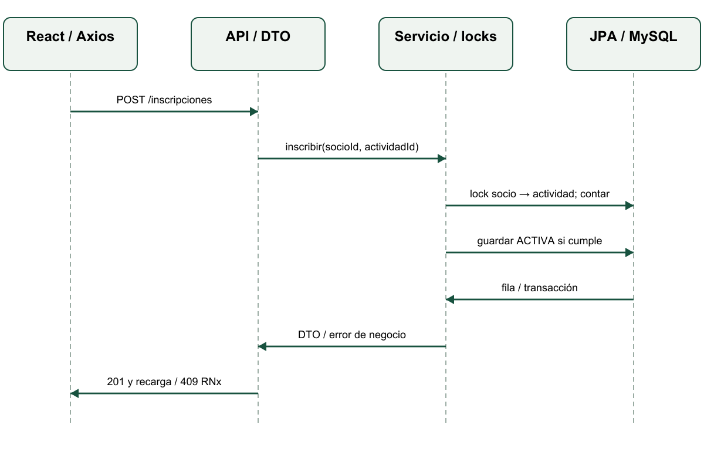

# Guía Integral de Estudio y Defensa Técnica — SocioClub

Universidad Siglo 21 · Taller de Construcción de Software. Elaboración: 8 de noviembre de 2026. Destinatarios: Hernán, Mateo, Matías y Fernando; nombres completos restantes, grupo y fecha de entrega pendientes por decisión del usuario.

Versión de aplicación estudiada: dev `874c6bb3e3346f2a55720c799d6da69300643750`. Repositorio: https://github.com/hernandanielzamora/TPIntegradorSocioClub. La versión incluye el ajuste UI/UX 76fce8e y su merge 874c6bb, revisados por diff: estilos, indicadores y presentación de templates, sin nuevas reglas/API/SQL. Los resultados de tests citados preceden a ese ajuste; su validación visual y regresión posterior siguen sin acreditarse aquí. Este documento fue generado por Codex a solicitud del usuario y requiere lectura del equipo. No acredita por sí mismo estudio, exposición o revisión humana realizados.

## Cómo estudiar y localizar las fuentes

Primero recorran una inscripción sin memorizar anotaciones: quién llama, qué datos envía, dónde se decide, qué se guarda y qué vuelve. Después abran cada archivo citado y expliquen un fragmento al compañero. Finalmente ensayen los casos negativos y las preguntas del módulo 18. Una respuesta correcta debe distinguir lo que el código hace de lo que efectivamente se probó.

Las rutas Java abreviadas de esta guía parten de `backend/src/main/java/ar/edu/siglo21/socioclub/`; las de React, de `app-socios/src/`, salvo indicación contraria. Los fragmentos en bloques son extractos reales del árbol examinado; cuando se muestra un mensaje HTTP ilustrativo o una consulta propuesta, se lo identifica. No ejecutar automáticamente ejemplos de escritura.

Índice de estudio:

1. Conocer SocioClub.
2. Arquitectura.
3. Estructura y mapa del repositorio.
4. MySQL y JPA.
5. Backend Spring Boot.
6. Secretaría MVC y Thymeleaf.
7. Reglas de negocio.
8. API REST.
9. React.
10. Axios y recorrido completo.
11. Sitio público.
12. Testing y evidencia.
13. Git y colaboración.
14. IA y responsabilidad.
15. Mejoras futuras.
16. Arranque en Windows.
17. Demostración en vivo.
18. Sesenta preguntas de defensa y repreguntas.
19. Cambios pequeños en vivo.
20. Glosario, resumen y repaso.

## 1. Conocer SocioClub

### Qué problema resolvemos y para quién

La consigna describe un club de Córdoba con unos 650 socios y ocho actividades. La administración manual produjo cupos excedidos, duplicación, edades incompatibles y altas de morosos. Digitalizar significa convertir esas condiciones en decisiones reproducibles, no solamente dibujar pantallas. Los 650 pertenecen al caso; no son el número de filas cargadas en nuestra base de ejemplo.

El vecino consulta el sitio público y prepara un formulario local. Secretaría administra socios, actividades e inscripciones con HTML del servidor. El socio se identifica por DNI y usa React para consultar, inscribirse y darse de baja. El DNI es un mecanismo académico de identificación; conocerlo no demuestra ser su titular.

### Alcance obligatorio y extras

RF1–RF3 se relacionan con catálogo, filtros y preinscripción; RF4–RF7 con administración y altas controladas; RF8–RF10 con acceso por DNI, baja y cuota estimada. Las RN1–RN5 pertenecen a InscripcionService; RN6 es cálculo JavaScript y RN7 valida formato del DNI. La baja lógica de socio, distinta de la baja de inscripción RF9, es un extra aprobado por el usuario. No se implementaron RN8 ni panel React administrativo autenticado.

RF3 dice recibir preinscripciones; la Parte A describe validación del formulario sin endpoint específico. El código actual hace validación local y explica que no envía ni guarda. Esa diferencia debe consultarse con el docente y nunca disimularse como persistencia implementada.

### Ejemplo real y recorrido

En `service/InscripcionService.java` el alta termina con:

```java
return inscripciones.save(new Inscripcion(socio, actividad, hoy, EstadoInscripcion.ACTIVA));
```

Antes de esa línea se buscaron y bloquearon recursos y se validaron condiciones. Después JPA persiste dentro de la transacción y la fachada construye el DTO. Así una pantalla está conectada a una regla y a una fila real, en lugar de limitarse a cambiar un arreglo local.

**Pregunta para practicar:** ¿qué aporta el sistema frente a Excel? Centraliza operaciones y rechaza condiciones inválidas antes de guardar mediante un servicio compartido. No afirma resolver identidad, pagos, seguridad productiva o agenda horaria completa. **Error común:** presentar extras propuestos como parte terminada o mostrar los datos iniciales como inventario actual de la base.

## 2. Arquitectura: seguir responsabilidades

### Conceptos y uso concreto

Cliente-servidor significa que el navegador solicita un recurso y el backend responde. HTTP transporta método, ruta, encabezados, estado y cuerpo; JSON representa datos, no objetos Java vivos. MVC produce vistas HTML; REST expone representaciones de recursos para un cliente como React. Persistencia significa que el estado confirmado sobrevive al proceso, en MySQL.



La capa Controller adapta HTTP. La capa Service decide y coordina la transacción. Repository consulta entidades; JPA/Hibernate realiza el mapeo ORM y JDBC habla con MySQL. Una entidad representa información persistente, no un formulario ni una respuesta pública. Esta distinción evita que la vista conozca repositorios o que el JSON recorra todo un grafo bidireccional.

### Un mismo servicio desde dos interfaces

Extracto de `service/ApiConsultaService.java`:

```java
@Transactional(isolation = Isolation.READ_COMMITTED)
public InscripcionResponse inscribir(Long socioId, Long actividadId) {
    return inscripcionDto(altas.inscribir(socioId, actividadId));
}
```

`altas` es InscripcionService inyectado. La fachada no vuelve a programar edad ni cupo: delega. Secretaría también usa ese servicio. Paso a paso: el controlador interpreta la entrada; el servicio común decide; la fachada convierte; cada interfaz representa el resultado como HTML o JSON. No son dos motores de negocio.

**Pregunta:** ¿por qué no contar cupos en React? La lista puede haber quedado vieja y otro usuario puede tomar la última plaza. El servidor cuenta nuevamente bajo lock. **Error común:** llamar a la interfaz “base de datos” o creer que CORS conecta MySQL con React. CORS se aplica al acceso HTTP entre orígenes del navegador.

## 3. Estructura del repositorio y navegación

| Carpeta o archivo | Qué contiene y cuándo abrirlo |
| --- | --- |
| sitio-publico/ | Tres HTML, css/estilos.css, js/script.js, ilustración y tests Node; preguntas sobre DOM, filtros y formulario |
| backend/pom.xml | Dependencias y build Maven; no contiene reglas de cupo |
| backend/src/main/java/.../model | Socio, Actividad, Inscripcion y enums; mapeo y estados |
| .../repository | JpaRepository, consultas derivadas, JPQL y locks |
| .../service | Reglas, transacciones, formularios y DTO de consulta |
| .../controller/mvc y controller/api | Rutas HTML y JSON, con advice separados |
| .../dto y config | Formularios/respuestas; reloj, CORS y configuración |
| backend/src/main/resources/templates | Thymeleaf y fragments/comunes.html |
| backend/src/test/java | Tests unitarios, MockMvc y MySQL optativos protegidos |
| backend/scripts/load-env.ps1 | Carga privada de entorno de proceso |
| app-socios/src | App, paginas, componentes, contexto, servicios, utils y tests |
| database/ | schema, seed, migración 001 aplicada y fixture de ensayo |
| database/propuestas/ | 002/003 de extras postergados; no ejecutarlos |
| postman/ | Colección, entorno e instrucciones por escenarios |
| Docs/ | Enunciado, decisiones, resultados y material académico |

### Ejercicio de búsqueda

Si preguntan por “máximo de tres”, busquen `MAXIMO_ACTIVIDADES` en InscripcionService. Si preguntan “por qué el error es 409”, abran ErroresApiController. Para “por qué el botón está gris”, TarjetaActividad y estilos. Para “cómo se calculan las vacantes”, ApiConsultaService y contarActivasDeActividad. La misma palabra aparece en capas diferentes: expliquen la responsabilidad de cada aparición.

El archivo `App.js` contiene, entre otras, esta ruta real:

```jsx
<Route path="*" element={<NoEncontrada />} />
```

Significa que una URL React no reconocida muestra la pantalla de no encontrada. No crea un endpoint backend ni convierte cualquier error HTTP en esa pantalla. **Pregunta:** ¿dónde está la configuración secreta? En el .env privado del backend, ignorado; se usa la plantilla versionada para documentar variables, sin abrirlo en la defensa. **Error común:** incluir target, node_modules o respaldos en la explicación de los fuentes publicables.

## 4. MySQL y JPA: del objeto a la fila

### Esquemas, datos y relaciones

Desarrollo utiliza `socioclub` con `socioclub_app`; pruebas utilizan `socioclub_test` con `socioclub_tests`. La separación evita ejecutar bajas o tests de integración sobre datos de desarrollo. Las cuentas de aplicación no requieren ALTER ni deben ser root. El esquema se crea manualmente: Hibernate valida y no actualiza tablas automáticamente.



Socio y Actividad tienen muchas inscripciones. Inscripcion tiene una FK hacia cada una y conserva su propia identidad y fecha. Esto modela el vínculo con atributos, no una ManyToMany opaca. PK identifica la fila; FK obliga a que el destino exista. UNIQUE(dni) evita dos socios con el mismo documento. CHECK protege valores posibles. Un índice ayuda a encontrar o contar filas, pero no reemplaza la regla de negocio.

Extracto real de `model/Inscripcion.java`:

```java
@ManyToOne(fetch = FetchType.LAZY, optional = false)
@JoinColumn(name = "socio_id", nullable = false)
private Socio socio;
```

LAZY permite diferir la carga de la relación hasta accederla. No significa que la FK sea opcional; optional=false y nullable=false expresan lo contrario. Las colecciones inversas mappedBy no crean una segunda tabla de relaciones. Como open-in-view=false, la fachada adapta a DTO mientras la transacción sigue abierta, antes de serializar.

### Repositorios: tres clases de operación

`SocioRepository extends JpaRepository<Socio, Long>` hereda operaciones de persistencia y paginación. El parámetro Long es el tipo del ID, no del DNI. Este método real es una consulta derivada:

```java
Page<Socio> findByApellidoContainingIgnoreCase(String apellido, Pageable pageable);
```

Spring Data interpreta propiedades y operadores del nombre: apellido contiene el texto sin distinguir mayúsculas; Pageable limita y ordena. No hay que escribir manualmente un SQL equivalente en el controlador.

Para un conteo expresivo se usa JPQL en InscripcionRepository:

```java
@Query("""
        select count(i) from Inscripcion i
        where i.actividad.id = :actividadId
          and i.estado = ar.edu.siglo21.socioclub.model.EstadoInscripcion.ACTIVA
        """)
long contarActivasDeActividad(@Param("actividadId") Long actividadId);
```

JPQL usa entidad Inscripcion y atributos Java, no el nombre SQL inscripcion ni actividad_id. Contar todas las filas restaría plazas ocupadas por bajas históricas, lo cual sería incorrecto.

### Transacción, locks y dirty checking

Una transacción agrupa lecturas y escrituras que deben confirmarse de forma coherente. READ_COMMITTED permite leer lo confirmado por otras transacciones; el lock pesimista coordina las filas relevantes mientras se decide. `@Lock(PESSIMISTIC_WRITE)` en buscarParaInscribir serializa altas sobre el mismo socio o actividad. El orden común socio → actividad reduce ciclos de espera; no equivale a afirmar que jamás puede existir un deadlock en cualquier operación futura.

Dirty checking detecta cambios en entidades gestionadas y genera el UPDATE al sincronizar. Por eso `i.setEstado(BAJA)` puede persistir sin invocar save otra vez. flush envía cambios y permite detectar errores; no confirma la transacción. Si un error de ejecución interrumpe la baja del socio, toda la unidad se revierte.

### Estados, seed y migración

Socio.estadoCuota informa AL_DIA/MOROSO; estadoSocio informa ACTIVO/INACTIVO. Inscripcion.estado informa ACTIVA/BAJA. Una BAJA histórica no ocupa lugar. Reinscribir crea otra fila; no borra ni reactiva la anterior. Borrar una actividad con historial está protegido por servicio y FK.

`schema.sql` describe instalaciones nuevas. `seed.sql` incorpora datos ficticios faltantes, no repara ni reactiva registros existentes. `001_estado_socio.sql` se aplicó manualmente a ambas bases tras respaldo confirmado; no debe ejecutarse otra vez para iniciar la aplicación. Su ALTER es aditivo, con default ACTIVO y CHECK sensible a representación canónica mediante CAST AS BINARY. Si se repite, omite el ALTER al detectar columna/constraint; no corrige automáticamente una migración parcial ni fuerza un INACTIVO a ACTIVO.

**Pregunta:** ¿un backup existente garantiza recuperación? No: hay confirmación de archivos generados, sin restauración de ensayo documentada. **Errores comunes:** prometer rollback de DDL MySQL; confundir flush con commit; poner UNIQUE al par socio/actividad y perder reinscripciones; ejecutar seed para “reiniciar” datos; llamar prueba actual a un XML viejo.

## 5. Spring Boot: objetos administrados y contratos

### Qué aporta y dónde está

Spring Boot inicia el contexto y configura componentes según dependencias y propiedades. `SocioClubApplication.java` es la entrada. @Controller, @RestController, @Service y repositorios permiten a Spring administrar objetos llamados beans. La inyección por constructor expresa dependencias y facilita sustituirlas por mocks en pruebas. No es necesario crear un repositorio con new dentro del controlador.

En `controller/api/ApiController.java`:

```java
private final ApiConsultaService servicio;
public ApiController(ApiConsultaService servicio) { this.servicio = servicio; }
```

Spring proporciona el bean. El campo final evita cambiar esa dependencia después de construir el controlador. Paso a paso: el contexto localiza componentes; crea el grafo de dependencias; aplica proxies transaccionales donde corresponde; atiende solicitudes con los beans preparados.

### DTO, validaciones y errores

DTO significa objeto de transferencia. En `dto/ApiDtos.java`, un record delimita campos JSON y evita exponer colecciones inversas o contactos. El formulario no enlaza una entidad entera: solo los campos permitidos pasan por @Valid. En particular, editar datos del socio no permite reactivar su vigencia indirectamente.

```java
public record SocioResponse(Long id, String dni, String nombre, String apellido,
        LocalDate fechaNacimiento, EstadoCuota estadoCuota, EstadoSocio estadoSocio) { }
```

Bean Validation comprueba forma y límites del request; el servicio comprueba reglas que dependen del estado persistente; MySQL garantiza restricciones estructurales. Son defensas complementarias. Una excepción de negocio no es lo mismo que una conexión caída. El advice REST asigna RN1–RN5 con switch sobre enum, no comparando mensajes, y responde 409. DataAccessException produce mensaje público genérico 503; no imprime el SQL al cliente.

### Configuración real

Extracto de `backend/src/main/resources/application.properties`:

```properties
spring.jpa.hibernate.ddl-auto=validate
spring.jpa.open-in-view=false
spring.sql.init.mode=never
```

validate exige correspondencia con el esquema, sin migrarlo. never impide ejecutar schema/seed por iniciar Boot. Las credenciales llegan por DB_URL, DB_USERNAME y DB_PASSWORD; las pruebas registran MYSQL_TEST_* con DynamicPropertySource sin fallback a desarrollo. `load-env.ps1` lee texto, separa por el primer = y conserva # y = en valores; no usa el archivo como código ni cambia variables del sistema permanentemente.

**Pregunta:** ¿poner un dialecto corrige 1045? No. El error real es rechazo de autenticación; el fallo de metadatos/dialecto es consecuencia. **Error común:** copiar contraseña a application.properties o anunciar que @Transactional protege una llamada que nunca pasó por el proxy. En el flujo real, la fachada llama al servicio inyectado y ambos usan un límite de transacción compatible.

## 6. Secretaría: MVC y Thymeleaf

### Model, vista y formulario

MVC separa la adaptación de la solicitud, los datos presentados y el HTML. Thymeleaf procesa templates en el servidor; el navegador recibe HTML ya renderizado. Model lleva atributos a la vista: no es una tabla SQL ni una entidad obligatoria. `controller/mvc/SecretariaController.java` delega en servicios; `resources/templates/secretaria/` contiene listas y formularios; `fragments/comunes.html` comparte elementos.

Extracto real del controlador:

```java
@GetMapping("/socios/{id}/baja")
public String confirmarBajaSocio(@PathVariable Long id, Model model) {
    model.addAttribute("socio", socios.prepararBaja(id));
    return "secretaria/socio-baja";
}
```

El GET prepara una confirmación y no modifica datos. El POST correspondiente invoca darDeBaja, añade un flash de éxito y redirige al listado. Este patrón POST/Redirect/GET evita reenviar accidentalmente el formulario al refrescar la página de resultado; no es protección CSRF ni autenticación.

En `backend/src/main/resources/templates/secretaria/socio-formulario.html`, estos atributos reales enlazan el dato y su error:

```html
<small class="error-campo" th:if="${#fields.hasErrors('dni')}" th:errors="*{dni}">
</small>
```

`th:if` evita mostrar un contenedor de error cuando no corresponde; `th:errors` obtiene mensajes del BindingResult del campo. El texto no es un resultado de una consulta SQL en la vista. Los fragmentos `th:replace` reutilizan cabecera, mensajes y pie, evitando duplicar su marcado entre páginas.

### Recorrido de guardado

1. El GET carga formulario nuevo o datos existentes.
2. Thymeleaf enlaza `th:object`/`th:field`; `th:each` recorre listas, `th:text` muestra texto y `th:if` decide mensajes.
3. El POST recibe @ModelAttribute y @Valid. BindingResult conserva errores de campo.
4. Si hay errores se presenta nuevamente el formulario; si no, el servicio valida y guarda.
5. El controlador maneja conflictos previstos sin exponer SQL y redirige tras éxito.

Socios se buscan por apellido con PageRequest de diez registros ordenados por apellido/nombre/id. Actividades se filtran por disciplina. Inscripciones pueden filtrarse por actividad y estado; ACTIVA es nómina vigente y BAJA es historial. Los selectores de altas excluyen socios INACTIVOS, pero el servicio igualmente rechaza una llamada fabricada.

**Pregunta:** ¿por qué confirmar antes de baja? Cambia vigencia e inscripciones y no hay reactivación implementada. La confirmación es una decisión de interacción; la atomicidad depende del servicio. **Errores comunes:** afirmar que existe login admin por tener una URL /secretaria; creer que un formulario POST sin token implementa CSRF; introducir llamadas Repository en una plantilla. No hay autenticación, autorización ni protección CSRF específica implementadas; solo uso local.

## 7. Reglas de negocio explicadas con escenarios

### RN1 — Cupo

Su objetivo es impedir sobreocupación, no ocultar una tarjeta. En validarInscripciones se compara contarActivasDeActividad con cupoMaximo usando >=, bajo lock de actividad. Si una actividad de cupo cinco tiene cinco ACTIVAS, otro alta se rechaza con “La actividad no tiene cupo disponible”; la API responde 409, regla RN1. La tarjeta puede mostrar “Sin cupo”, pero una llamada directa también debe fallar. Unitarios prueban último cupo y completo/excedido; MySQL histórico ejercitó transacciones reales. Para demostrar manualmente, verificar primero que no se incumpla morosidad, edad, duplicado o máximo.

### RN2 — Duplicación

El servicio consulta existsBySocioIdAndActividadIdAndEstado con ACTIVA. Si ya existe, lanza INSCRIPCION_DUPLICADA y mensaje “El socio ya está inscripto en esta actividad”. Una BAJA no impide reinscribir; la nueva ACTIVA tiene ID y fecha propios, conservando la antigua. El lock de socio serializa altas simultáneas del mismo socio. Tests cubren rechazo y no reactivación del historial. **Error común:** borrar una inscripción para permitir otra o exigir unicidad de todas las filas del par.

### RN3 — Edad inclusiva

El cálculo real es `Period.between(socio.getFechaNacimiento(), hoy).getYears()`; hoy se obtiene con Clock inyectado. Se rechaza si edad < mínima o edad > máxima, así ambas fronteras se aceptan. Una persona de 17 años no entra a 18–65, una de 65 sí. La respuesta 409 RN3 indica el rango. Los tests fijan reloj, cumpleaños y bisiestos; no basta restar años calendarios. El filtro del sitio ayuda a buscar, pero no reserva ni valida una fecha de nacimiento de una operación persistente.

### RN4 — Morosidad

MOROSO no puede crear nuevas inscripciones y recibe “Debe regularizar su cuota en secretaría” con RN4. Puede consultar y dar de baja. Un socio AL_DIA pero INACTIVO también es rechazado, por otra condición anterior. El estado económico no se calcula a partir de RN6 ni cambia al dar de baja. El test rechazaSocioMoroso y los contratos MVC/API cubren esta decisión. **Error común:** impedir a un moroso cancelar una actividad o permitir el alta solo porque el botón React estaba habilitado.

### RN5 — Tres ACTIVAS como máximo

`MAXIMO_ACTIVIDADES = 3` se compara con countBySocioIdAndEstado(ACTIVA). La tercera se permite y la cuarta se rechaza con “Alcanzó el máximo de 3 actividades”, 409 RN5. Las BAJAS no cuentan. El lock sobre socio evita que dos altas a actividades distintas observen simultáneamente dos y terminen en cuatro. Hay tests de tercera, cuarta y conteo excedido; se preparan datos aptos para no activar otra regla antes. Cambiar el límite implica revisar texto, tests y RN6; no es solo cambiar un número en una tarjeta.

### RN6 — Cuota estimada y centavos

Está en `utils/calcularCuotaMensual.js` y `componentes/ResumenCuota.js`. Con cero ACTIVAS devuelve cero; con una suma sin descuento, dos aplica 10% y tres 15%. La función sumariza importes en centavos y redondea después de bonificar. Ejemplo didáctico: 18.000 + 20.000 = 38.000; dos actividades producen 34.200. Dos cuotas de 10,25 producen 18,45, no 18 pesos. Jest cubre cantidades y centavos. La API filtra ACTIVAS y el cliente vuelve a filtrarlas por defensa; una BAJA no aumenta el total. No es una factura ni proceso de pago.

```javascript
const subtotalCentavos = actividades.reduce(
  (suma, actividad) => suma + Math.round(Number(actividad.cuotaMensual || 0) * 100),
  0
);
```

### RN7 — DNI válido

`utils/esDniValido.js`, Ingreso y validarPreinscripcion del sitio usan siete u ocho dígitos sin puntos, letras ni espacios. El sitio aplica `/^\d{7,8}$/` y presenta error junto al campo; React no debe consultar la API si el formato falla. El backend repite el patrón y SQL agrega CHECK y UNIQUE. Un DNI bien formado puede no existir: eso es 404, distinto de formato 400. La validación no consulta un padrón ni prueba identidad. Jest y tests del sitio incluyen 6/9 dígitos, letras y puntos.

### Mejora de baja del socio y RN8 futura

SocioService.darDeBaja bloquea socio, obtiene ACTIVAS, bloquea actividades distintas ordenadas y cambia estados en una sola transacción. Repetir la baja conserva el resultado: idempotencia no significa que no existan lecturas o locks. La API adicional responde SocioResponse INACTIVO; un nuevo alta recibe 409/SOCIO_INACTIVO. La UI MVC pide confirmación. No hay borrado físico ni reactivación.

RN8 sería incompatibilidad horaria y no existe en la implementación. Con días libres y hora de inicio no se conoce intervalo final; inventar duración produciría decisiones falsas. **Pregunta de cierre:** ¿qué regla se muestra primero si hay varias? La secuencia real es vigencia, cuota, edad, duplicado, máximo, cupo. Las pruebas deben aislar la regla y verificar que no se guardó nada.

## 8. API REST: contrato, verbos y errores

### Recursos y operaciones reales

REST organiza recursos identificables y representaciones sobre HTTP. No significa simplemente “usar JSON”. GET consulta sin ordenar escrituras; POST crea una inscripción o actividad; PUT modifica o fija un estado; DELETE elimina una actividad cuando el historial lo permite. La API no implementa un login seguro ni una sesión de autorización del socio.

| Operación obligatoria | Entrada o ejemplo ilustrativo | Respuesta y revisión |
| --- | --- | --- |
| GET /api/actividades | ?disciplina=Bienestar | 200 array; no página Spring Data |
| GET /api/actividades/{id} | ID real elegido del catálogo | 200 objeto, 404 inexistente, 400 inválido |
| POST /api/actividades | JSON con nombre/disciplina/profesor/dias/horario/edades/cupo/cuota | 201 y Location del detalle |
| PUT /api/actividades/{id} | Mismos campos completos del formulario | 200; 400 validación; 409 conflicto |
| DELETE /api/actividades/{id} | Solo una actividad descartable sin historial | 204 sin cuerpo; 409 si tiene referencias |
| GET /api/socios/dni/{dni} | DNI ficticio obtenido por lectura | 200 DTO sin contactos; 404 si no existe |
| GET /api/socios/{id}/inscripciones | ID de ese socio | 200 array ACTIVA, [] si no tiene; 404 si no existe |
| POST /api/inscripciones | {"socioId":1,"actividadId":8}, IDs ilustrativos | 201 o 409 RN1–RN5/SOCIO_INACTIVO |
| PUT /api/inscripciones/{id}/baja | ID de inscripción propio del ensayo | 200 DTO BAJA; 404 si no existe |

Los IDs de la tabla son ejemplos y no instrucciones para modificar desarrollo. El extra PUT /api/socios/{id}/baja no debe confundirse con la baja de una inscripción. No existe GET /api/inscripciones/{id}, por lo que el alta no inventa un Location a una ruta inexistente.

### Cómo Spring interpreta una petición

@PathVariable extrae el identificador de la ruta; @RequestParam recibe filtros; @RequestBody convierte JSON en formulario; @Valid aplica restricciones. @RestController serializa el retorno como JSON. @Controller de MVC, por el contrario, devuelve el nombre de template. Las claves JSON no tienen que coincidir con columnas snake_case: las define el DTO.

Extracto real de alta de inscripción:

```java
@PostMapping(value = "/inscripciones", consumes = MediaType.APPLICATION_JSON_VALUE)
public ResponseEntity<InscripcionResponse> inscribir(@Valid @RequestBody InscripcionFormulario formulario) {
    return ResponseEntity.status(HttpStatus.CREATED)
            .body(servicio.inscribir(formulario.socioId(), formulario.actividadId()));
}
```

### Estados y CORS

200 representa lectura/modificación satisfactoria; 201 creación; 204 éxito sin cuerpo; 400 entrada inválida; 404 recurso inexistente; 409 conflicto con estado actual. Un error de acceso a persistencia previsto devuelve 503. No convertir cualquier excepción de programación en “sin cupo”.

Ejemplo ilustrativo compatible con el código, no respuesta real capturada:

```json
{"error":"La actividad no tiene cupo disponible","regla":"RN1","detalles":[],"codigo":null}
```

CORS en WebConfig autoriza orígenes configurados y métodos bajo /api/**. Origen incluye protocolo, host y puerto: localhost:3000 no equivale a localhost:8080 ni a 127.0.0.1:3000. Un preflight OPTIONS puede ocurrir antes de un POST JSON. No es una contraseña ni bloquea clientes que no son navegadores. No solucionar un error con wildcard indiscriminado.

### Postman con evidencia honesta

Importar colección y entorno local; revisar baseUrl e IDs; ejecutar lecturas primero. Preparar cada caso negativo de forma aislada y autorizar sus escrituras en testing. El runner es una ejecución real que puede cambiar datos: no se debe pulsar Run sobre todos los escenarios con IDs ilustrativos. JSON parseable demuestra estructura del archivo, no resultados. **Pregunta:** ¿qué diferencia tiene con SOAP? Aquí se usan recursos y verbos HTTP con JSON, sin envelopes XML ni contratos SOAP implementados.

## 9. React: conceptos dentro de cada pantalla

### Componentes, JSX y datos

React describe la UI con componentes funcionales. JSX combina expresiones JavaScript y estructura visual; no es una cadena HTML que se envía a MySQL. Props son entradas del padre; estado es memoria local que React conserva entre renders. No se debe modificar directamente el arreglo de props para simular una inscripción. PropTypes documenta/verifica formas durante desarrollo, pero no valida la respuesta HTTP con garantía: por eso api.js revisa también el DTO recibido.

TarjetaActividad recibe actividad, onInscribir y bloqueado; ListaActividades usa map y key estable; DetalleActividad muestra información; Encabezado/Pie comparten estructura. ResumenCuota recibe actividades para mostrar la estimación. La clase CSS cambia según disponibilidad y el botón se deshabilita si no hay cupo o hay una operación pendiente. Eso evita errores de interacción, sin sustituir RN1 del servidor.

Extracto auténtico de `componentes/TarjetaActividad.js`:

```javascript
TarjetaActividad.propTypes = {
  actividad: actividadPropType.isRequired,
  onInscribir: PropTypes.func.isRequired,
  bloqueado: PropTypes.bool,
};
```

`actividadPropType` concentra la forma del objeto en tiposActividad.js. El callback requerido permite al padre decidir la operación y bloqueado es opcional. El evento JSX real `onClick={() => onInscribir(actividad)}` no ejecuta el alta al renderizar: crea una función que la ejecutará al hacer clic. El estado `disabled={sinCupo || bloqueado}` distingue capacidad y procesamiento.

### Hooks aplicados

useState guarda listas, filtros, carga y mensajes. Al llamar al setter, React vuelve a evaluar el componente y reconcilia la representación con el DOM. useEffect realiza consultas después del render y declara dependencias; su limpieza marca vigente=false para no aplicar respuestas de una pantalla anterior. Esto descarta el resultado tardío, no cancela necesariamente la petición de red. useContext comparte al socio sin pasar props por toda la jerarquía. useRef conserva enCurso para bloquear un segundo clic antes de que el estado visual se haya actualizado.

Extracto real de `paginas/Catalogo.js`:

```javascript
useEffect(() => {
  let vigente = true;
  obtenerActividades()
    .then((datos) => { if (vigente) setActividades(datos); })
    .catch((err) => { if (vigente) setError(mensajeDeError(err)); })
    .finally(() => { if (vigente) setCargando(false); });
  return () => { vigente = false; };
}, []);
```

El array vacío expresa una carga al montar en ese uso; en desarrollo, StrictMode puede repetir efectos para detectar errores. No afirmar que [] garantiza una única petición en toda circunstancia. En detalle cambian dependencias cuando cambia el ID; hay que descartar datos anteriores.

### Las cuatro pantallas

Ingreso captura DNI, valida RN7 y consulta buscarSocioPorDni. Si el formato es válido y no hay socio, muestra error 404, sin crear uno automáticamente. El contexto guarda al socio en memoria; sessionStorage conserva únicamente su DNI y al recargar vuelve a consultarlo. No persiste todo el DTO ni se genera token seguro.

Catálogo carga actividades, extrae disciplinas únicas con Set y filtra localmente. Al tocar Inscribirme usa socio.id y actividad.id, espera el POST y vuelve a pedir actividades para mostrar cupos actuales. Si el POST fue confirmado pero falla la recarga, avisa que se registró y debe actualizarse la pantalla: no dice que el alta falló ni la repite ciegamente.

Detalle usa el parámetro de URL y muestra una actividad. Si el ID no existe se maneja el error; no se presenta el detalle anterior como si fuera el nuevo. MisActividades consulta ACTIVAS del socio, permite baja con window.confirm y recalcula RN6 usando la respuesta actualizada. Si hay cero, muestra estado vacío y cuota cero. Un MOROSO conserva consulta y baja.

### Rutas y errores comunes

App envuelve en SocioProvider y BrowserRouter. RutaProtegida exige identificación en la UI; no autoriza peticiones HTTP en el servidor. Hay ruta * para pantalla no encontrada. Una recarga de SPA en alojamiento futuro necesitaría fallback; no se afirma despliegue realizado.

**Pregunta:** ¿qué ocurre si el socio cambia en otra pestaña o queda INACTIVO después del ingreso? El DTO en memoria puede quedar viejo; el servidor vuelve a decidir y devuelve 409. La UI debe mostrarlo. **Errores comunes:** tratar contexto como base de datos; decir que PropTypes autentica; hacer una llamada en el cuerpo del render; poner dependencias incorrectas que disparen un bucle; confundir mocks de Jest con datos de producción.

## 10. Axios: del clic al dato y de regreso



### Recorrido exitoso por archivos exactos

1. `componentes/TarjetaActividad.js` invoca onInscribir con la actividad. La prop conecta la tarjeta con la función del catálogo; no abre JDBC.
2. `paginas/Catalogo.js`, manejarInscribir, usa enCurso/procesando para impedir doble envío y limpia el aviso anterior.
3. `servicios/api.js`, inscribir, valida IDs y ejecuta Axios. El cliente central tiene baseURL configurable, timeout de diez segundos y Accept JSON.
4. `controller/api/ApiController.java` interpreta JSON como InscripcionFormulario validado y llama a ApiConsultaService.
5. `service/ApiConsultaService.java` entra en transacción READ_COMMITTED y delega a InscripcionService.
6. `service/InscripcionService.java` busca con locks socio y actividad; calcula fecha con reloj; aplica condiciones de vigencia y RN1–RN5.
7. Los repositorios ejecutan consultas y guardan una Inscripcion ACTIVA; Hibernate/JDBC sincroniza con MySQL dentro de la transacción.
8. La fachada transforma a InscripcionResponse con actividad y cupo. El controlador devuelve 201. No serializa las colecciones de la entidad.
9. Axios recibe data y comprueba estructura, IDs y estado esperado. React recarga el catálogo; el setter actualiza la pantalla y finally libera el bloqueo visual.

Extracto real de `servicios/api.js`:

```javascript
export async function inscribir(socioId, actividadId) {
  comprobar(idValido(socioId) && idValido(actividadId));
  const { data } = await api.post('/inscripciones', { socioId, actividadId });
  comprobar(inscripcionValida(data) && data.socioId === socioId && data.actividadId === actividadId && data.estado === 'ACTIVA');
  return data;
}
```

await suspende esa función asíncrona hasta resolver la promesa; no bloquea toda la página. catch maneja el rechazo. Que el servidor devuelva un cuerpo no implica que sea válido: comprobar detecta contratos inesperados con codigo RESPUESTA_INVALIDA.

### Tres recorridos negativos importantes

**No hay cupo:** el servicio lanza SIN_CUPO antes de save. El advice mapea a 409/RN1. Axios rechaza por HTTP; mensajeDeError traduce un mensaje seguro; React conserva estado y muestra alerta. Para asegurar ausencia de escritura se necesita observar repositorio/DB en la prueba, no solo el texto.

**DNI inexistente:** buscarSocioPorDni hace GET con encodeURIComponent. El formato se comprobó, pero Repository devuelve vacío y el servicio lanza RecursoNoEncontradoException. El advice devuelve 404; Ingreso no establece socio y muestra error. No es RN7: un DNI con puntos se habría rechazado antes de consultar.

**Baja de inscripción:** MisActividades pide confirmación. Si se cancela no llama Axios. Si se acepta, api.put invoca /inscripciones/{id}/baja; el servicio bloquea socio/actividad y fija BAJA, manteniendo fecha y FK. La respuesta se valida, se recarga la lista ACTIVA y se calcula otra cuota. Si falla solo la recarga, el mensaje diferencia baja ya registrada de fallo de operación. Repetir un PUT tiene efecto idempotente; no elimina una fila.

**Pregunta:** ¿por qué no restar cupo manualmente en React sin consultar? Puede haber actividad concurrente y no hay garantía de que ese valor represente la base. **Error común:** capturar cualquier error y mostrar éxito o usar datosLocales como fallback silencioso. El flujo productivo no usa esos datos históricos.

## 11. Sitio público: DOM sin React

### Estructura, estilo y acceso

`index.html`, `actividades.html` y `preinscripcion.html` utilizan estructura semántica, navegación compartida, hoja CSS externa y script externo. header/nav/main/section/article/aside/footer expresan organización; no son etiquetas elegidas para cambiar el tamaño de letra. alt describe la ilustración, que no pretende ser foto real del club. La jerarquía de títulos y labels permite entender el contenido con tecnologías de asistencia.

`css/estilos.css` combina selectores de tipo, clase, ID y atributo. Una clase puede aplicarse a varias tarjetas; un ID identifica un elemento del documento. El catálogo pasa de tres a dos y luego una columna en media queries de 60rem y 40rem. Las pruebas inspeccionan declaraciones, pero falta comprobar layout real en navegador móvil y uso con teclado.

### Clase, objetos y filtro

`js/script.js` define clase Actividad, crea ocho objetos iniciales y valida su coherencia. Su método real:

```javascript
esAptaParaEdad(edad) {
  return Number.isInteger(edad) && edad >= this.edadMinima && edad <= this.edadMaxima;
}
```

La clase JavaScript no es entidad JPA: comparte la idea de actividad, pero no persiste. Al cambiar disciplina o edad, addEventListener llama actualizar; filtrarActividades valida y combina criterios; replaceChildren retira tarjetas anteriores y createElement/textContent construye resultados. textContent trata valores como texto, evitando interpretarlos como HTML. Filtro vacío muestra todo; un rango sin resultados muestra estado vacío; entrada inválida informa error y no finge coincidencias.

El enlace lleva el slug de actividad en query string; location.search lo usa para preseleccionar una opción válida. No contiene DNI ni datos personales. No confundir esos slugs con IDs autoincrementales MySQL. Ocho actividades iniciales del sitio no significan que la API siempre devuelva ocho: la consulta registrada devolvió nueve.

### Formulario y límite funcional

validarPreinscripcion comprueba nombre, apellido, email, DNI RN7 y actividad conocida. Los errores se escriben junto al campo con aria-invalid/aria-describedby y foco al primero inválido. El submit usa preventDefault; no hay fetch/Axios, almacenamiento ni endpoint de preinscripción. Incluso válido informa que no se envió ni guardó y deriva a Secretaría. Esto debe defenderse como límite de la implementación actual y pendiente de interpretación RF3, sin afirmar que representa recepción remota.

**Pregunta:** ¿por qué no alert? Se requieren errores por campo, persistentes y accesibles, sin bloquear toda la ventana. **Errores comunes:** decir que preventDefault guarda datos; confundir clase JS con clase CSS; tomar una prueba jsdom como inspección visual de Chrome.

## 12. Testing: qué demuestra cada prueba

### Tipos y herramientas del proyecto

Unitarias aíslan lógica: JUnit/Mockito prueba servicios y Jest funciones RN6/RN7. MockMvc ejecuta adaptación HTTP/controlador/validación con dependencias controladas; no acredita MySQL real. Tests MySQL levantan contexto y usan socioclub_test con transacciones y conexiones auténticas, incluyendo concurrencia. RTL renderiza componentes en un entorno de prueba y comprueba comportamiento observable con roles, texto y eventos. Node/jsdom comprueba DOM del sitio sin navegador gráfico. Sistema E2E exige recorrer interfaces y persistencia reales y registrar esperado/obtenido.

Un mock reemplaza una dependencia para controlar respuestas; no es un servidor ni una “base más rápida”. Permite provocar un 409 de forma repetible, pero no prueba que una FK o un lock exista en MySQL. En el cliente de producción Axios sigue siendo real; solo los tests lo simulan.

Ejemplo real de `backend/src/test/java/ar/edu/siglo21/socioclub/service/InscripcionServiceTests.java`:

```java
@Test
void inactivoAlDiaNoSePuedeInscribir() {
    socio.setEstadoSocio(EstadoSocio.INACTIVO);
    assertThrows(ar.edu.siglo21.socioclub.exception.SocioInactivoException.class,
            () -> servicio.inscribir(1L, 2L));
    verify(inscripciones, never()).save(any());
}
```

La preparación conserva cuota AL_DIA y fija vigencia INACTIVO para aislar esa condición. assertThrows comprueba la excepción concreta y verify comprueba que no se intentó guardar. Esto prueba la decisión del servicio con mocks; no sustituye comprobar rollback de una transacción MySQL. Los IDs 1/2 pertenecen a objetos del test, no son instrucciones de escritura sobre la base viva.

### Evidencia registrada y no repetida aquí

| Familia | Resultado | Cómo interpretarlo |
| --- | --- | --- |
| Backend histórico, verify humano | 128 aprobadas, 0 fallos/errores/omitidas | Incluye 17 MySQL; anterior al fixture poblado |
| Backend regresión segura | 111 aprobadas, 0 fallos/errores/omitidas | Ocho suites, goal test; mismo conjunto sin las 17 MySQL |
| React | 58 aprobadas, 0 fallidas/omitidas; 5 suites | Funciones, componentes, contrato e integración simulada |
| Sitio | 25 aprobadas, 0 fallos/omisiones | Node/jsdom, sin layout real |
| React build | Compiled successfully, exit 0 | Bundles compilados; no prueba de producción segura |
| HTTP/CORS | GET 200, entradas 400/404 y OPTIONS permitido | Transporte/contrato de lectura; no POST/PUT reales de ese cierre |
| Postman | 22 solicitudes, JSON válido | Runner pendiente, ejemplos no ejecutados |

Las 111 no se suman a las 128 como independientes. Los XML Surefire se conservan en target, ignorado; una corrida seleccionada puede dejar XML antiguos de MySQL. Leer atributos tests/failures/errors/skipped y fecha por suite, más comando y log. No usar únicamente el total de todos los archivos para atribuir una nueva ejecución completa.

Maven test ejecuta tests; verify recorre fases anteriores y verificaciones del ciclo hasta verify. Un BUILD SUCCESS sin activar MySQL puede tener omitidos; siempre leer la cuenta. En esta tarea documental no se volvieron a correr esas suites y no se ejecutó SQL.

### Seis escenarios de sistema y criterio de evidencia

PS01 alta habilitada; PS02 RN1 cupo completo; PS03 RN2 duplicado; PS04 RN3 fuera de rango; PS05 RN4 moroso; PS06 RN5 cuarta. Cada uno necesita precondiciones, pasos, esperado, obtenido y evidencia del antes/después. Siguen **PENDIENTES DE VALIDACIÓN manual integral** en Docs/pruebas-sistema.md. Un Yoga con 14/15 no sirve para demostrar RN1 lleno. Un INACTIVO intercepta el alta antes de RN1–RN5. La fecha de hoy puede cambiar el escenario de edad respecto de un documento viejo.

**Pregunta:** ¿por qué no repetir verify ahora? La suite MySQL exige tablas vacías y la base contiene un fixture manual que no debemos borrar. Se conserva la prueba histórica y se usa regresión seleccionada sin MySQL, hasta acordar un ambiente aislado adecuado. **Error común:** limpiar filas automáticamente, contar omitidas como aprobadas o marcar E2E aprobado por tener unitarios.

## 13. Git y trabajo del equipo

### Qué preserva el historial

Un repositorio registra versiones; un commit identifica un árbol y sus padres, no una cantidad de horas ni una autoría manual garantizada. Una rama es una referencia móvil. dev integra etapas; feature/* aísla trabajo; main se conserva fuera de los cierres recientes. Hubo PR al inicio y luego el usuario decidió integrar directamente por Git, manteniendo validaciones y merge commits para trazabilidad.

Para revisar sin modificar:

```powershell
git status
git log --graph --oneline --decorate --all
git show --stat 4570207
git diff --check
git check-ignore -v backend/.env
git ls-files -- backend/.env
```

El último comando debe no listar el .env. No abrirlo para demostrar exclusión. Una rama con nombre de persona no prueba su aporte; revisar commits, diffs y confirmación humana.

### Aportes y cierres localizables

Git registra a Mateo Hernandez en `4268ffb`, `ec53dfb`, `dba8ac7` para pantallas/contexto/componentes React, y a Matias Jure en `856b66b`, `a0f3d7f`, `7428e8c`, `00b5041`, entre otros, para sitio/documentación. Son nombres de autor Git; el usuario pidió dejar nombres completos de portada pendientes. No se inventa un apellido de Fernando ni contribuciones sin evidencia. Los commits posteriores bajo la cuenta del usuario pueden incluir código generado por Codex y se identifican como tal en la bitácora.

La API quedó en d58094c y merge 3ace199; React en 5771ffe/e09dffe y merge bb7d51f; sitio en 7bb4f02 y merge e7fe985; cierre final documental en 4570207. Son puntos de navegación, no reparto completo de tareas. La nueva rama de estos documentos no se integra automáticamente.

Un conflicto significa que Git no decide una combinación. En el flujo acordado, se explica antes de resolver, sin sobrescribir ni force push. El merge commit conserva padres; squash o rebase reescribirían otra forma de historial y no se usan sin acuerdo. **Pregunta:** ¿un git status limpio demuestra pruebas aprobadas? No, solo ausencia de cambios locales detectados. **Error común:** alterar autorías, completar commits ficticios o resolver conflictos eligiendo todo “ours” sin comprender.

## 14. IA: incidentes, revisión y responsabilidad

### Uso verificable

El usuario usó ChatGPT/Codex para análisis, implementación, pruebas y documentación. La bitácora separa propuesta, generación, corrección y validación. Si el docente elige un archivo, cualquier integrante debe poder explicar su lógica aunque lo haya generado una herramienta. “Lo hizo la IA” no responde por qué se acepta una edad o se hace rollback.

El original completo tiene 14 páginas: secciones F/7 dicen Anexo D, pero el encabezado real de formato es Anexo C en páginas 13–14. Es una inconsistencia interna, no falta del equipo. Sus columnas son N.º, Parte, qué pedimos, qué devolvió y qué estaba mal/qué cambiamos/por qué. La consigna pide cinco entradas y en tres un error o ajuste detectado por el grupo; **no exige literalmente tres ediciones manuales de código**. No podemos garantizar interpretación o puntuación docente; sí evitar inventar modificaciones para llenar la tabla.

### Casos reales para explicar

AH-1: las siete JPA fallaban por MySQL 1045/28000 de testing. El usuario revisó cuenta en Workbench, restableció contraseña y comprobó cliente. Codex analizó la cadena y eliminó fallback de test a desarrollo; ese cambio automático no fue el restablecimiento humano.

El test CHECK esperaba DataIntegrityViolationException y recibió UncategorizedSQLException. La causa SQL real era 3819/HY000 por ck_actividad_cuota ante cuota -1: la base funcionaba. Codex cambió aserción para exigir SQLException, código, SQLSTATE y CHECK; mantuvo escenarios. No se atribuye al equipo un arreglo manual del helper.

AH-2: el usuario corrigió credenciales de socioclub_app después de 1045 de arranque y confirmó MySQL/JPA/Tomcat. AH-3: propuso .env, plantilla y script para persistir configuración local entre sesiones; Codex implementó cargador seguro. La corrección manual de marcadores en la plantilla sí se comunicó, sin convertirla en tres ediciones Java.

IH-MIG-01: propuesta funcional humana de baja, aprobación del modelo, backups mysqldump y migraciones manuales test → validación 128 → autorización → desarrollo. No consta restore de prueba. Codex no ejecutó ALTER. El error 1064 de CREATE PROCEDURE coincidía con el final enviado; no se demostró causa definitiva del delimitador. El usuario confirmó alternativa convencional con commit manual; Codex actualizó el archivo para reflejarla.

El usuario propuso y luego postergó RN8/admin para priorizar entrega. Decisión de diseño y alcance no equivale a implementación ni código manual. **Pregunta:** ¿qué aprendieron de IA? Que un diagnóstico debe apoyarse en la excepción original y que resultados generados necesitan revisión y ejecución separadas. **Error común:** describir una propuesta de Codex como acción humana ya realizada, o marcar todo aprobado por haber recibido SQL plausible.

## 15. Mejoras futuras: qué falta y por qué

FE-ADMIN-01 propone autenticación administrativa, hash de contraseña, sesión/rol y autorización en todos los caminos MVC/REST. Actualmente /secretaria y rutas de escritura no tienen esa defensa. Añadir una pantalla login sin proteger backend daría falsa seguridad. CSRF debe diseñarse con el mecanismo de sesión y clientes; CORS con credenciales requiere revisión explícita. No se añadió Spring Security en esta entrega.

RN8 necesitaría días normalizados, hora inicio/fin, intervalos y definición de límites de solapamiento. El modelo actual guarda dias y horario como String sin fin; no se puede deducir duración de un texto. La propuesta considera ActividadHorario y tipos temporales; se deben revisar inventario, concurrencia, datos históricos y decisiones humanas antes de migrar.

`database/propuestas/002_cuenta_administrativa.sql` y `003_actividad_horario.sql` son borradores no ejecutados. No equivalen a dos migraciones listas o pendientes por obligación. `Docs/mejoras-futuras.md` y `propuesta-admin-rn8.md` describen alternativas y riesgos. Se postergaron por decisión humana para cumplir el alcance original sin seguridad o horarios parciales.

**Pregunta:** ¿por qué no exponer hoy en Internet? Falta identidad y autorización real, protección de operaciones, revisión de datos y dependencias y validación operativa. Localhost reduce exposición, pero no reemplaza controles si se cambia el despliegue. **Error común:** decir “faltaba solo un formulario de login” o “RN8 ya está porque tenemos horario”.

## 16. Levantar el proyecto en Windows

### Preparación y separación de terminales

VS Code abre la raíz del monorepo. Usar JDK 25, Node/npm y MySQL operativo según README; Maven Wrapper evita instalar Maven global. `npm.cmd` evita el bloqueo de npm.ps1 sin cambiar políticas. Las instalaciones de dependencias requieren red la primera vez; antes de una exposición tenerlas resueltas. No ejecutar schema/seed/migraciones sobre bases existentes para “iniciar”.

Verificar .env ignorado; completar localmente desde .env.example si falta, sin mostrar sus valores. El script no se carga solo al abrir VS Code. No ejecutar un .env como PowerShell ni imprimir variables sensibles. Cuentas aplicación/test no son root.

Terminal backend, desde la raíz:

```powershell
Get-Service -Name MySQL84
Set-Location .\backend
.\scripts\load-env.ps1
if (-not $?) { throw 'No se cargó el entorno.' }
$env:PORT = '8080'
.\mvnw.cmd '-Dspring-boot.run.arguments=--server.port=8080' spring-boot:run
```

Esperar Started SocioClubApplication. Si MySQL está detenido, iniciarlo desde Servicios de Windows o una terminal administradora autorizada, sin cambiar claves a ciegas. Si otro servicio tiene el puerto, revisar procesos antes de terminar alguno; no matar un PID desconocido.

Terminal React, desde raíz:

```powershell
Set-Location .\app-socios
npm.cmd ci
$env:PORT = '3000'
$env:REACT_APP_API_URL = 'http://localhost:8080/api'
npm.cmd start
```

PORT explícito importa: un entorno heredado con PORT=8080 hizo que React arrancara en ese puerto durante un incidente. REACT_APP_API_URL configura destino, no el puerto del servidor React. Reiniciar CRA después de cambiar variables compiladas en el bundle.

Terminal sitio, desde raíz:

```powershell
python -m http.server 5500 --bind 127.0.0.1 --directory .\sitio-publico
```

Abrir localhost:5500/index.html, localhost:8080/secretaria, localhost:8080/api/actividades y localhost:3000. No mezclar localhost con otro hostname si CORS solo permite los orígenes configurados. Detener cada servidor con Ctrl+C.

### Lecturas de conectividad y selección de datos

```powershell
(Invoke-WebRequest -UseBasicParsing 'http://localhost:8080/secretaria').StatusCode
(Invoke-WebRequest -UseBasicParsing 'http://localhost:3000').StatusCode
Invoke-RestMethod 'http://localhost:8080/api/actividades' |
  Select-Object id,nombre,cupoMaximo,cupoDisponible
```

Consulta propuesta de **solo lectura** en Workbench; no se ejecutó en esta tarea:

```sql
SELECT DATABASE() AS catalogo;
SELECT id, dni, estado, estado_cuota FROM socioclub.socio ORDER BY id;
```

Elegir exclusivamente datos ficticios. No asumir que 1 es un socio particular. Para demo de escrituras ver protocolo de testing en módulo 17 y Docs/validacion-manual-baja-socios.md.

### Regresión segura, verify y errores frecuentes

Desde backend, selección sin MySQL ya utilizada:

```powershell
.\mvnw.cmd -B '-Dtest=ApiControllerTests,ApiConsultaServiceTests,SecretariaControllerTests,SecretariaServiceTests,SocioBajaServiceTests,InscripcionServiceTests,IntegridadModeloTests,SocioClubApplicationTests' test
```

Desde app-socios: `npm.cmd test -- --watchAll=false --runInBand` y `npm.cmd run build`. Desde raíz, después de instalar dependencias de app-socios: `node --test sitio-publico/tests/script.test.cjs`.

`mvnw.cmd -B verify` autenticado requiere .env cargado y testing vacío según sus guardas. **No ejecutarlo sobre el fixture poblado actual ni borrar datos para prepararlo.** Solo repetir tras acordar una base test adecuada y revisar precondiciones, sin usar desarrollo. La cifra histórica 128 no autoriza esa ejecución hoy.

1045 indica autenticación: revisar cuenta/clave local sin imprimirla; no agregar dialecto para disimular. Connection refused puede ser servicio o puerto; CORS puede ser origen no permitido; un 404 de DNI bien formado es dato inexistente. Advertencias deprecated del stack CRA no son por sí mismas BUILD FAILURE. **Pregunta:** ¿por qué una terminal sí conecta y otra no? Variables process-only no se heredan retrospectivamente entre terminales independientes.

## 17. Demostración en vivo y contingencias

### Plan de doce minutos, editable

El enunciado completo exige 2 minutos de presentación, 7 demo, 3 recorrido técnico; después prevé 6 defensa individual y 2 devolución. Los primeros doce no reemplazan los posteriores. Todos deben poder explicar cualquier módulo. Esta distribución es propuesta de exposición, no atribución de quién programó cada parte.

| Tiempo | Participante propuesto | Acción y frase orientadora |
| --- | --- | --- |
| 0:00–1:00 | Hernán | Problema del club y objetivo; versión local, alcance y estado real |
| 1:00–2:00 | Fernando | Tres interfaces, servicio común y límites de seguridad; aportes personales solo si confirmados |
| 2:00–3:30 | Matías | Sitio, filtro disciplina/edad y formulario inválido/local; no fingir envío |
| 3:30–5:30 | Hernán | Secretaría: búsqueda, cupos y formulario de inscripción; evitar bajas de socio irreversibles |
| 5:30–8:00 | Mateo | React: DNI ficticio, catálogo, detalle, ACTIVAS/cuota; operación solo en ensayo aprobado |
| 8:00–9:00 | Fernando | Rechazo de una regla previamente preparado, observar alerta/HTTP y ausencia de nueva fila |
| 9:00–12:00 | Los cuatro | Seguir funcionalidad elegida: tarjeta/callback, Axios, controller/DTO, servicio/locks/repositorio |

### Preparar datos sin alterar originales

Primero revisar por lectura catálogo, vigencia, cuota, edad y ACTIVAS. Para demo de alta/baja usar exclusivamente socioclub_test con fixture descartable ya aprobado, en backend puerto 8081; no ejecutar bajas sobre desarrollo. La baja de Martín 87654321 ya pudo haberlo dejado INACTIVO: comprobar antes, no reactivarlo ni repetir fixture automáticamente. Si no hay candidato apto, pedir preparar un ensayo separado por el procedimiento documentado antes de la clase, nunca improvisar DELETE o reset de seed.

En una terminal **exclusiva de ensayo**, desde backend, después de detener otra instancia de ensayo con Ctrl+C:

```powershell
.\scripts\load-env.ps1
if (-not $?) { throw 'No se cargó el entorno.' }
if ($env:MYSQL_TEST_DB_USERNAME -ne 'socioclub_tests' -or
    $env:MYSQL_TEST_DB_URL -notmatch '^jdbc:mysql://localhost:3306/socioclub_test(?:\?|$)') {
    throw 'No se confirmó la configuración exclusiva de testing.'
}
$env:DB_URL = $env:MYSQL_TEST_DB_URL
$env:DB_USERNAME = $env:MYSQL_TEST_DB_USERNAME
$env:DB_PASSWORD = $env:MYSQL_TEST_DB_PASSWORD
$env:PORT = '8081'
.\mvnw.cmd '-Dspring-boot.run.arguments=--server.port=8081' spring-boot:run
```

Este comando propuesto no se ejecutó en esta tarea. Verificar catálogo por la conexión de ensayo y permisos exclusivos antes de cualquier escritura. No usar root desde Boot. React debe reiniciarse con REACT_APP_API_URL=http://localhost:8081/api y PORT=3000; abrir Secretaría en :8081. Cerrar esa terminal al terminar evita reutilizar DB_* de testing como configuración normal. No repetir load-env después de copiar variables y asumir que seguirá apuntando a test: volvería a desarrollo.

Para un rechazo fácil de aislar, preferir duplicado de una ACTIVA de socio ACTIVO/AL_DIA y edad apta, o MOROSO ACTIVO. No usar el INACTIVO para demostrar RN4/RN1. Acordar IDs por lectura y registrar precondiciones. Para éxito, elegir actividad distinta con cupo y menos de tres ACTIVAS; no hay ID universal seguro.

### Si algo falla

Sin Internet: usar dependencias instaladas y servidores locales; no prometer contenido remoto. Si falta un paquete, pasar al código/diagramas y declarar que no se ejecutó el paso. MySQL detenido: mostrar diagnóstico de servicio y logs públicos sin secretos; si no se recupera, continuar arquitectura y evidencia automática ya identificada, sin simular alta. React sin conexión: comprobar backend GET y URL/puerto/CORS; usar Secretaría solo si el entorno está confirmado. Si un escenario da otra regla, explicar prioridad y no tocar datos apresuradamente. Capturas futuras reales pueden apoyar el relato, pero no reemplazan el demo en vivo exigido.

**Pregunta:** ¿quién realizó cada tarea? Responder desde registro y experiencia comprobada, sin confundir el reparto de exposición con autoría. El guion breve está en guion-presentacion.md.

## 18. Banco de sesenta preguntas con respuestas y seguimiento

### Nivel fácil

### P01. ¿Qué problema concreto resuelve SocioClub?

Centraliza catálogo, administración e inscripción y evita decisiones inconsistentes que aparecían con cuadernos y planillas. Las condiciones de cupo, edad y cuota se aplican antes de guardar, desde un servicio común. No resuelve todavía autenticación segura ni pagos. **Repregunta:** ¿dónde se ve el límite? En InscripcionService y en las limitaciones documentadas del formulario público.

### P02. ¿Cuáles son las tres interfaces?

El sitio público informa con HTML/CSS/JS; Secretaría usa MVC/Thymeleaf; Mi Club usa React y Axios. Las últimas dos acceden a los mismos servicios del backend y a MySQL. El sitio tiene catálogo inicial estático. **Repregunta:** ¿todos sus datos son vivos? No, el catálogo público no es una consulta de disponibilidad.

### P03. ¿Qué es un controlador?

Es el adaptador de una solicitud HTTP a una operación de aplicación. Interpreta ruta y entrada y decide representación o respuesta, sin contar cupos por cuenta propia. ApiController entrega JSON y SecretariaController nombres de vistas. **Repregunta:** ¿inyecta repositorios? No en este diseño; delega a servicios.

### P04. ¿Qué es un servicio?

Es donde se coordinan reglas y operaciones que representan una acción del negocio. InscripcionService cuenta ACTIVAS y valida bajo transacción antes de crear. Así la API y MVC comparten comportamiento. **Repregunta:** ¿por qué no copiar reglas en cada controller? Se separarían al cambiar una condición y permitirían resultados diferentes.

### P05. ¿Qué es un repositorio?

Es la abstracción de acceso a entidades persistentes. JpaRepository ofrece operaciones comunes y los métodos propios expresan consultas o locks. No debe decidir si un moroso tiene permiso funcional para inscribirse. **Repregunta:** ¿qué representa Long en JpaRepository? El tipo del identificador de entidad.

### P06. ¿Para qué sirve una clave foránea?

Garantiza que un vínculo apunte a una fila existente. inscripcion.socio_id y actividad_id relacionan las tres tablas y evitan referencias huérfanas. No hay cascada de borrado que destruya historial. **Repregunta:** ¿una FK limita el cupo? No, cupo requiere contar ACTIVAS y aplicar una regla.

### P07. ¿Qué es JSON?

Es un formato textual de datos con objetos, arreglos y valores. La API serializa DTO a JSON y Axios lo recibe como datos JavaScript. No transmite una entidad Java con métodos ni una conexión a la base. **Repregunta:** ¿la fecha tiene tipo LocalDate en React? Llega representada como string ISO.

### P08. ¿Qué diferencia tienen GET y POST?

GET consulta y no debe ordenar cambios de negocio. POST crea, por ejemplo una inscripción con socioId y actividadId. La respuesta exitosa del alta es 201, no una página de catálogo. **Repregunta:** ¿el GET de confirmación de baja ya da de baja? No, el POST confirmado ejecuta esa operación.

### P09. ¿Qué significa 404?

El recurso solicitado no existe, por ejemplo un DNI bien formado no encontrado. No significa necesariamente que el backend esté detenido; en ese caso puede no haber respuesta HTTP. Formato inválido se responde 400. **Repregunta:** ¿creamos socio al no encontrarlo? No, el ingreso no realiza alta automática.

### P10. ¿Qué es un componente React?

Una función que describe una parte de la UI mediante JSX y puede recibir props y usar hooks. TarjetaActividad presenta una actividad y comunica un evento al padre. No debe modificar la base directamente. **Repregunta:** ¿dónde se comunica con backend? En el servicio Axios centralizado.

### P11. ¿Qué son props?

Son entradas que un componente recibe de su padre. Actividad y onInscribir permiten reutilizar la tarjeta con distintos datos y acciones. Se tratan como valores de entrada, sin mutarlos para producir cambios persistentes. **Repregunta:** ¿PropTypes persiste algo? No, describe y comprueba la forma de props en desarrollo.

### P12. ¿Qué es estado en React?

Es información conservada por el componente entre renders, como filtro, carga y mensajes. useState devuelve el valor y un setter que provoca una nueva evaluación de UI. Asignar una variable común no tiene el mismo contrato de actualización. **Repregunta:** ¿estado significa MySQL? No; estado local puede perderse al cerrar la página.

### P13. ¿Qué es el DOM?

Es la representación de elementos del documento que el navegador expone como objetos. El sitio busca el contenedor del catálogo y crea tarjetas con createElement y textContent. Cambiar un filtro dispara un evento que redibuja esa lista. **Repregunta:** ¿es igual al DOM virtual de React? No, React usa una representación y reconciliación para actualizar el DOM real.

### P14. ¿Para qué sirve una media query?

Aplica estilos según condiciones como ancho del viewport. El catálogo del sitio cambia a una columna en pantallas pequeñas usando el CSS existente ampliado. No modifica las reglas de edad o cupo. **Repregunta:** ¿jsdom prueba que se ve bien en celular? No, falta revisión visual real del layout.

### P15. ¿Qué valida RN7?

Exige siete u ocho dígitos sin puntos ni letras. Rechaza un formato antes de enviar el formulario y presenta error junto al campo. Un número que cumple la forma aún puede no corresponder a un socio. **Repregunta:** ¿comprueba identidad? No, no consulta padrón ni autentica titularidad.

### P16. ¿Qué es una baja lógica?

Cambia un estado sin eliminar la fila. BAJA de inscripción conserva fecha y relaciones y deja de ocupar cupo. INACTIVO de socio impide nuevas altas y además cierra sus ACTIVAS mediante una operación atómica. **Repregunta:** ¿podemos reactivar socio desde UI? No se implementó esa función.

### P17. ¿Qué es un commit?

Es una versión identificada por hash y relacionada con sus padres. Permite revisar qué cambió y localizar una implementación. No demuestra por sí solo horas trabajadas ni que todo fuera escrito a mano por el autor configurado. **Repregunta:** ¿cómo verificamos aportes? Con historial, diffs y registros humanos reales.

### P18. ¿Para qué se usa .env.example?

Documenta variables y valores ficticios para preparar cada equipo. El .env real se completa localmente, queda ignorado y el cargador lo lee sin ejecutar su contenido. Las contraseñas nunca deben publicarse. **Repregunta:** ¿VS Code lo carga automáticamente? No en esta configuración; hay que invocar load-env.ps1 por terminal.

### P19. ¿Qué es una prueba unitaria?

Verifica una unidad de lógica con dependencias controladas. Jest puede comprobar RN6 sin servidor y JUnit puede aislar un servicio con mocks. Es rápida y repetible, pero no acredita que una conexión JDBC real funcione. **Repregunta:** ¿cómo probamos MySQL? Con la suite protegida de integración y un ambiente apto.

### P20. ¿Qué quedó pendiente de evidencia?

Las capturas reales, seis casos integrales de sistema y ejecución del runner Postman no están acreditados. Hay regresiones automáticas y consultas HTTP de lectura reales, que son evidencia diferente. La portada también conserva datos pendientes. **Repregunta:** ¿está listo para subir al aula? No debe afirmarse eso hasta completar esas partes.

### Nivel intermedio

### P21. ¿Por qué una entidad no se devuelve directamente como JSON?

Socio tiene inscripciones y cada inscripción vuelve a tener socio, formando un grafo bidireccional. Serializarlo sin límite puede producir ciclos, consultas inesperadas o exposición de contacto. Los DTO fijan una representación finita y adecuada al cliente. **Repregunta:** ¿qué dato se omitió? Email y teléfono no forman parte de SocioResponse.

### P22. ¿Cómo funciona una consulta derivada?

Spring Data interpreta el nombre del método según propiedades de entidad y operadores conocidos. findByApellidoContainingIgnoreCase busca una parte del apellido y acepta Pageable para límite y orden. No es una función implementada mágicamente en el controlador. **Repregunta:** ¿qué pasa con una propiedad mal nombrada? Puede impedir crear el repositorio al iniciar y necesita corrección.

### P23. ¿JPQL y SQL son iguales?

JPQL consulta entidades y atributos Java; SQL consulta tablas y columnas. contarActivasDeActividad usa Inscripcion y i.actividad.id, y Hibernate genera el acceso SQL correspondiente. Una consulta nativa tendría otro contrato. **Repregunta:** ¿por qué filtrar estado? Las BAJAS históricas no ocupan plaza.

### P24. ¿Para qué inyectamos Clock?

Permite que el servicio obtenga hoy de una dependencia sustituible. Los tests fijan fecha y comprueban cumpleaños y límites sin depender del día del equipo. Period calcula años cumplidos correctamente frente a restar solo números de año. **Repregunta:** ¿la edad se guarda? No como valor fijo del socio; se deriva del nacimiento.

### P25. ¿Cómo se protege el último cupo?

La operación bloquea la actividad antes de contar y crear. Otra alta que necesite esa fila espera y después observa lo confirmado, con READ_COMMITTED. Así contar y guardar no son dos acciones independientes sin coordinación. **Repregunta:** ¿la UI deshabilitada alcanza? No, otro cliente puede llamar directamente a la API.

### P26. ¿Qué significa inyección por constructor?

Las dependencias necesarias se reciben al crear el objeto administrado por Spring. Permite expresar requisitos con campos final y facilita construir una instancia con mocks en tests. El controller no instancia implementaciones concretas de Repository. **Repregunta:** ¿qué es un bean? Un objeto administrado por el contenedor, con ciclo de vida e integración configurados.

### P27. ¿Qué hace @Valid y qué no hace?

Activa restricciones de entrada del formulario, como campos obligatorios, formato o valores positivos. No puede por sí sola asegurar que aún quede cupo en una tabla que cambia concurrentemente. Esa validación de negocio ocurre después en servicio. **Repregunta:** ¿por qué conservar CHECK? Protege integridad también frente a escrituras fuera del formulario.

### P28. ¿Por qué 409 para una regla?

La petición puede ser sintácticamente válida pero entrar en conflicto con el estado actual, como una actividad completa. El error identifica RNx mediante enum y switch, para que el cliente no adivine comparando textos. 400 se reserva para entrada inválida. **Repregunta:** ¿todos los 409 son RN1? No: duplicado, máximo e integridad tienen motivos diferentes.

### P29. ¿Qué demuestra CORS?

Configura qué orígenes de navegador pueden leer respuestas de la API según política. El preflight real registrado permitió localhost:3000 para métodos concretos. No autentica ni impide que un cliente PowerShell envíe una operación. **Repregunta:** ¿y CSRF? Es otra protección y no está implementada en este MVP.

### P30. ¿Cómo funciona POST/Redirect/GET?

Después de guardar por POST, el controlador redirige a un GET de listado y comunica éxito con flash. Así refrescar el resultado no reenvía el mismo formulario de escritura. No reemplaza idempotencia, seguridad o transacción. **Repregunta:** ¿qué ocurre con errores de campo? Se vuelve a renderizar el formulario con BindingResult, sin confirmar el guardado.

### P31. ¿Para qué sirve useEffect con limpieza?

Inicia cargas relacionadas con montaje o dependencias y marca que ya no corresponde aplicar resultados cuando el componente cambia o se desmonta. El patrón vigente evita mostrar un detalle anterior al cambiar de ID. No cancela automáticamente el HTTP ni garantiza una única llamada bajo StrictMode. **Repregunta:** ¿por qué no llamar Axios en render? Cada render podría disparar otra solicitud y un ciclo de cambios.

### P32. ¿Por qué contexto para el socio?

Varias pantallas necesitan la identificación y las acciones de ingreso/salida. El provider evita pasar esa información manualmente por componentes intermedios. El contexto guarda el DTO en memoria y conserva solo DNI en sessionStorage para reconsultar. **Repregunta:** ¿es autorización? No, una ruta protegida React no protege el endpoint backend.

### P33. ¿Qué hace async/await en Axios?

Expresa de manera secuencial el trabajo con promesas: esperar la respuesta y luego validar y actualizar. Un rechazo HTTP o de contrato llega al catch y finally libera el estado de procesamiento. No bloquea todo el navegador. **Repregunta:** ¿timeout siempre implica que no se guardó? No, la respuesta puede perderse después del commit; no hay que repetir ciegamente un POST.

### P34. ¿Por qué RN6 suma centavos?

Se evita redondear cada subtotal a pesos enteros y perder decimales del DECIMAL de backend. La función convierte importes, suma enteros y aplica el descuento antes del redondeo final. Jest incluye casos con 10,25. **Repregunta:** ¿es contabilidad completa? No, es cuota estimada y no procesa cobros ni cambia estado de deuda.

### P35. ¿Qué pasa si el alta funciona y falla recargar?

La pantalla conserva una bandera registrada y comunica que la inscripción ya se registró, pero no se actualizaron cupos. No presenta la operación como rechazada ni vuelve a crear automáticamente. El usuario puede recargar para reconciliar estado con backend. **Repregunta:** ¿un éxito optimista local garantiza persistencia? No, la confirmación del servidor y posterior consulta son las referencias.

### P36. ¿Por qué el sitio usa textContent?

Inserta datos como texto en nodos y evita interpretarlos como markup. El catálogo se construye mediante createElement y enlaces conocidos. Es una práctica que reduce riesgos de inyección al generar UI, aunque no equivale a una auditoría de seguridad completa. **Repregunta:** ¿innerHTML siempre está prohibido? No por definición, pero exige controlar y sanear contenido; aquí no es necesario.

### P37. ¿Qué valida un test de componente?

RTL comprueba resultados visibles e interacción, como nombre, “Sin cupo” y botón deshabilitado. Evita depender solo de detalles internos del componente. Su DOM de pruebas no demuestra que MySQL rechazó un alta real. **Repregunta:** ¿por qué buscar por rol? Se aproxima a la interacción accesible y evita ambigüedad de texto repetido.

### P38. ¿Por qué no sumar 128 y 111?

Las 128 históricas incluyen las mismas familias unitarias/MVC más las 17 MySQL. Las 111 posteriores corresponden a una selección del mismo conjunto sin acceso a base. Sumarlas como casos únicos inflaría cobertura. **Repregunta:** ¿cuál es el total nuevo de verify? No se ejecutó un verify completo nuevo con el fixture actual.

### P39. ¿Qué cambió en el flujo Git?

Al principio se integraron módulos por PR; después el usuario decidió trabajo individual e integración directa validada. Se conservaron feature/dev y merge commits, sin tocar main. El cambio de flujo no borra contribuciones anteriores. **Repregunta:** ¿ahora toda rama se mergea sola? No, esta rama documental se publica sin merge ni PR por instrucción expresa.

### P40. ¿Qué pruebas faltarían para RF3 remoto?

Primero habría que acordar que se requiere recepción y definir un contrato, persistencia y manejo de datos. Después verificar envío real, validación servidor, errores, almacenamiento y seguridad. Hoy el código solo valida localmente y lo avisa. **Repregunta:** ¿tener un formulario válido ya cubre recepción? No, son comportamientos distintos y hay una brecha de alcance que declarar.

### Nivel difícil

### P41. ¿Por qué bloquear también al socio?

El cupo de una actividad no impide que dos altas del mismo socio a actividades distintas superen tres en conjunto. El lock de socio serializa el conteo global de ACTIVAS y protege duplicación; el de actividad protege cupo compartido por socios distintos. Se necesitan ambos para las invariantes del flujo. **Repregunta:** ¿en qué orden? Socio primero y luego actividad; varias actividades se ordenan por ID en la baja del socio.

### P42. ¿READ_COMMITTED por sí solo evita el sobrecupo?

No: dos transacciones podrían leer el mismo conteo confirmado antes de escribir. El aislamiento se combina con bloqueo de la fila actividad y transacción que contiene conteo y alta. Después de esperar el lock, la siguiente operación observa lo confirmado. **Repregunta:** ¿qué demuestra concurrencia real? Los tests MySQL históricos con transacciones separadas, no un mock secuencial.

### P43. ¿Flush es igual a commit?

Flush sincroniza cambios gestionados con la base y puede disparar restricciones, pero la transacción sigue abierta. Commit confirma la unidad; si ocurre un error antes, el rollback puede revertir DML de esa transacción. No se debe extender esta conclusión al ALTER de MySQL. **Repregunta:** ¿por qué usar flush en baja del socio? Para detectar fallos dentro del límite transaccional y no declarar éxito anticipado.

### P44. ¿Qué se revierte si falla la baja del socio?

La vigencia del socio y los cambios a sus ACTIVAS pertenecen a la misma transacción. Una excepción de ejecución debe impedir que se confirme solo la mitad. No se modifican BAJAS históricas y tampoco se borra ninguna fila. **Repregunta:** ¿cómo lo prueban? Tests de baja y fallo/rollback, con evidencia MySQL histórica para persistencia; no afirmar un ensayo manual nuevo sin registro.

### P45. ¿Por qué no usar UNIQUE(socio_id, actividad_id)?

Impediría una nueva inscripción de un socio que ya conserva una BAJA histórica en esa actividad. La restricción deseada afecta solo ACTIVAS, mientras el esquema conserva múltiples episodios. El servicio bajo lock aplica esa condición; escrituras administrativas fuera del servicio deben estar controladas. **Repregunta:** ¿el CHECK puede contar otras filas? No es el mecanismo adecuado de esa regla entre filas.

### P46. ¿Qué protege la idempotencia y qué no?

Fijar BAJA repetidas veces deja el mismo estado final y conserva fecha/vínculo. Eso permite reintentar PUT sin crear nuevas bajas históricas. No implica cero consultas, cero locks ni que POST de inscripción sea idempotente. **Repregunta:** ¿debemos reactivar al repetir baja? No, no hay reactivación implementada ni debe inferirse del estado de cuota.

### P47. ¿Cómo evita ciclos el DTO y qué costo queda?

La representación anidada se corta en ActividadResponse, que no vuelve a contener inscripciones o socio. Se mapea dentro de una transacción para acceder relaciones LAZY sin open-in-view. Sin embargo, contar cupos por actividad puede producir varias consultas en un catálogo; DTO no elimina por sí mismo todo problema de rendimiento. **Repregunta:** ¿es bloqueo para entrega? No se midió un fallo en este volumen, pero sería un punto de optimización con medición futura.

### P48. ¿Qué garantiza ddl-auto=validate?

Comprueba compatibilidad del mapeo con el esquema que ve Hibernate y puede impedir iniciar si falta una columna. No aplica migraciones ni sustituye verificar CHECK ENFORCED, conservación de datos o backups. El SQL 001 fue una operación manual separada. **Repregunta:** ¿si Boot arranca ya sabemos que todas las restricciones están bien? No, se requieren pruebas y consultas específicas.

### P49. ¿Por qué 3819 terminó en UncategorizedSQLException?

El CHECK de MySQL rechazó un valor con código 3819 y SQLSTATE HY000, pero la traducción Spring no lo clasificó como la subclase que el test esperaba. La base estaba funcionando; la aserción dependía de una clasificación demasiado estrecha. Codex conservó validación de causa SQL, código, estado y nombre de restricción. **Repregunta:** ¿se aceptó cualquier excepción? No, el helper exige esos indicadores concretos.

### P50. ¿Qué se sabe realmente del 1064 del fixture?

Se observó rechazo en CREATE PROCEDURE cerca del final, primero near '' y luego near '//'. La coincidencia con cierre del bloque sugiere investigar lo enviado por el cliente, pero no demuestra causa definitiva del delimitador. La alternativa convencional con transacción y commit manual funcionó según confirmación humana. **Repregunta:** ¿quién reescribió el archivo final? Codex; no se adjudica esa edición al usuario.

### P51. ¿Por qué un ALTER no se protege con el mismo rollback?

MySQL puede producir commits implícitos para DDL, de modo que no se debe prometer deshacer el cambio de esquema con ROLLBACK. Se respalda, se detiene la app, se migra testing primero y se valida antes de desarrollo. La migración detecta existencia, pero no repara cualquier estado parcial automáticamente. **Repregunta:** ¿se probó restaurar? No hay evidencia de restore de ensayo.

### P52. ¿Un sessionStorage con DNI es seguro?

Reduce lo guardado frente a conservar todo el DTO, pero sigue siendo identificación manipulable por cliente. El backend no verifica titularidad mediante credenciales ni autoriza acciones por usuario autenticado. La app solo se plantea local académica. **Repregunta:** ¿RutaProtegida alcanza? No; habría que proteger cada endpoint y su autorización real.

### P53. ¿CORS y CSRF se pueden intercambiar?

No. CORS regula acceso de JavaScript a respuestas entre orígenes; CSRF atiende solicitudes inducidas aprovechando credenciales enviadas automáticamente. No hay protección CSRF implementada ni seguridad integral en este MVP. Al diseñar sesión admin deben revisarse conjuntamente cookies, tokens, autorización y cliente. **Repregunta:** ¿quitar CORS permite seguridad? No: incluso clientes no navegador pueden invocar API.

### P54. ¿Qué harían si el docente pide pasar de 3 a 4?

Localizar constante y mensaje RN5, adaptar bordes y concurrencia de tests, y revisar semántica RN6 para cuatro. La función actual retorna 15 para >=3, lo que no define por sí solo una nueva regla aceptada. El cambio debe ser acotado y verificado, sin tocar datos para aparentar éxito. **Repregunta:** ¿basta habilitar un botón? No, la autoridad está en servicio.

### P55. ¿Por qué no implementar RN8 con strings actuales?

Los días pueden escribirse distinto y horario no tiene fin. Sin un intervalo acordado se inventaría duración y podrían rechazarse actividades compatibles o aceptarse superpuestas. La propuesta de normalización se conserva, pero su implementación y migración están postergadas. **Repregunta:** ¿SQL 003 prueba que existe la función? No, es un diseño no ejecutado en propuestas.

### P56. ¿Qué pasa si varios errores son posibles?

La primera validación que falla determina la respuesta en la secuencia del servicio. INACTIVO se comprueba antes de morosidad y edad; después vienen duplicado, máximo y cupo. Un caso manual tiene que satisfacer las anteriores para aislar su regla. **Repregunta:** ¿RN1 no funciona si aparece RN4? No necesariamente; el escenario estaba mal aislado y RN1 pudo no alcanzarse.

### P57. ¿El orden de locks elimina cualquier deadlock?

Reduce la posibilidad de ciclos entre operaciones que respetan el mismo protocolo y orden de múltiples actividades. No es una garantía universal frente a nuevas rutas, consultas o escrituras externas. Debe conservarse al ampliar servicios y verificarse con transacciones reales. **Repregunta:** ¿por qué no bloquear toda la base? Sería una solución desproporcionada que limita concurrencia sin justificar el volumen y las invariantes.

### P58. ¿Cómo defender tres ajustes humanos sin mentir?

Explicar AH-1 autenticación test, AH-2 corrección de desarrollo y AH-3 propuesta de entorno, con ejecución y evidencia concreta. El enunciado pide errores o ajustes detectados por el grupo, no declara literalmente tres diffs manuales de fuente. Aun así, las correcciones operativas pueden agruparse y el docente debe valorar el alcance; no garantizamos aceptación. **Repregunta:** ¿qué no atribuir? Código del helper, cargador o servicio generado por Codex como programación manual del equipo.

### P59. ¿Cómo responder por contribuciones sin inventarlas?

Usar commits y registros, explicar intervención real propia y reconocer asistencia. Un nombre de rama o autor configurado no prueba quién tecleó el código ni que una captura se validó. Los nombres de exposición son una propuesta editable, no reparto histórico. **Repregunta:** ¿qué hacemos con Fernando sin apellido verificado? Dejarlo pendiente y pedir confirmación, sin completar datos por inferencia.

### P60. ¿Qué falta para considerar listo el informe final?

Completar identidad/grupo/fecha, capturas auténticas, observados de sistema y Postman, además de revisar formato después de insertar imágenes. El PDF generado puede cumplir páginas y estructura sin satisfacer todavía toda evidencia de entrega. La guía ayuda a estudiar, pero no certifica comprensión individual. **Repregunta:** ¿qué hacemos si algo sigue pendiente? Declararlo y acordar validación; nunca convertir una expectativa en resultado obtenido.

## 19. Cambios en vivo: localizar, razonar y verificar

Estos son ejercicios de preparación, no cambios realizados durante esta tarea. Antes de editar: git status, rama de ensayo, comprender el pedido y anunciar qué comportamiento cambiaría. Después: diff acotado, tests pertinentes, demo controlada y revisión de efectos. No alterar base ni credenciales para compensar un cambio de código.

| Pedido | Archivo / función | Cambio conceptual y efectos | Tests y verificación |
| --- | --- | --- | --- |
| Límite 3 → 4 | service/InscripcionService.java, MAXIMO_ACTIVIDADES y mensaje | Mantener conteo ACTIVA y lock; revisar especificación RN5 y descuento RN6 para 4; no solo número visual | InscripcionServiceTests, API RN5 y concurrencia MySQL en ambiente apto; aceptar cuarta y rechazar quinta |
| Dato existente en tarjeta | componentes/TarjetaActividad.js y tiposActividad.js | Mostrar, por ejemplo, ID de referencia ya incluido en DTO; profesor ya se muestra y no sería un campo nuevo. Conservar accesibilidad/props y responsive | TarjetaActividad.test.js e integraciónApi; comprobar texto y cupo cero sin romper callback |
| Mensaje de validación | ReglaNegocioException/InscripcionService o dto/SecretariaDtos.java según origen; utils/mensajeDeError.js | Distinguir mensaje de campo, de negocio y traducción de UI; no cambiar codigo/regla para solo redacción | MockMvc y Jest de mensajes; comprobar que HTTP y regla siguen iguales |
| Filtro público | sitio-publico/js/script.js, filtrarActividades/iniciarCatalogo | Validar criterio y combinar con disciplina/edad; preservar estado vacío y error; no interpretar nombres libres como IDs | sitio-publico/tests/script.test.cjs; probar bordes y combinación visual |
| Campo visual nuevo no existente | ApiDtos/ApiConsultaService y servicios/api.js más componente | Primero definir origen y contrato; si requiere columna nueva, no improvisar migración en vivo. Si solo derivado, no persistir sin necesidad | Tests DTO, contrato cliente y UI; verificar que no expone contacto privado |
| Descuento o redondeo RN6 | utils/calcularCuotaMensual.js y ResumenCuota.js | Acordar nuevos porcentajes, cantidades y criterio de centavos; ACTIVAS siguen siendo única base | calcularCuotaMensual.test.js e integraciónApi; 0/1/2/3, centavos y después de baja |

### Ejemplo de razonamiento oral

“Para añadir un ID de referencia visible a la tarjeta primero verifico que ActividadResponse ya lo entrega y api.js lo valida. Cambio el JSX y compruebo PropTypes, sin migrar MySQL porque el campo ya existe. Ejecuto pruebas de tarjeta y reviso que el diseño no se corte en móvil”. Esta respuesta conecta contrato y vista y evita editar varias capas sin necesidad; sería un ejercicio pedido por el docente, no una mejora implementada ahora.

**Pregunta:** ¿cómo sabemos que no rompimos otra regla? Seleccionar pruebas que ejerciten comportamiento cercano, revisar diff y hacer un recorrido controlado. Una compilación sola no demuestra RN1–RN5 ni formato de todos los mensajes. **Error común:** hacer un cambio frente al docente sin poder explicar dónde se aplica y qué queda pendiente de verificar.

## 20. Repaso final

### Glosario conectado al código

| Término | Significado práctico en SocioClub |
| --- | --- |
| Bean / DI | Objeto de Spring y dependencia recibida por constructor |
| Controller / Service / Repository | Adaptación HTTP / decisión de negocio / persistencia |
| Entidad / ORM / JPA | Modelo persistente / traducción objeto-relacional / API de persistencia |
| Hibernate / JDBC | Implementación ORM / comunicación con MySQL |
| DTO / record | Contrato de transferencia acotado / forma Java usada en respuestas |
| PK / FK / UNIQUE / CHECK | Identidad / referencia / unicidad / condición SQL |
| JPQL / Pageable | Consulta de entidades / límite, página y orden |
| Transacción / flush / commit | Unidad coherente / sincronización / confirmación |
| Lock / aislamiento | Coordinación de filas / visibilidad entre transacciones |
| ACTIVA / BAJA | Vigencia de la inscripción; solo ACTIVA ocupa plaza |
| ACTIVO / INACTIVO | Vigencia del socio independiente de cuota |
| AL_DIA / MOROSO | Situación de cuota, no resultado automático del resumen |
| MVC / Thymeleaf / Model | Flujo de HTML servidor / motor de templates / atributos de vista |
| REST / JSON / HTTP | Recursos y operaciones / representación / protocolo |
| CORS / CSRF | Política entre orígenes / defensa distinta contra solicitudes inducidas |
| Props / estado / contexto | Entradas / memoria local / dato compartido React |
| Hook / efecto / ref | API React / trabajo tras render / valor mutable persistente entre renders |
| Promesa / await / Axios | Resultado asíncrono / espera local / cliente HTTP |
| DOM / evento / media query | Árbol del navegador / interacción / condición CSS |
| Mock / integración / E2E | Sustituto controlado / colaboración real / recorrido completo |
| Commit / rama / merge | Versión / referencia / integración con padres |
| Evidencia / pendiente | Resultado realmente observado / comprobación no acreditada |

### Resumen de una página para la última lectura

El problema es administrar socios y actividades sin sobrecupos, duplicados ni altas inválidas. Hay tres interfaces, pero MVC y REST comparten servicios y MySQL. El sitio público es estático con DOM; React consume JSON por Axios y Secretaría recibe HTML Thymeleaf. El formulario público no guarda preinscripciones. El acceso por DNI no es autenticación.

Las tablas son socio, actividad e inscripcion. Las FK conservan vínculos; las BAJAS quedan como historial. Cupo disponible = máximo menos ACTIVAS, calculado al consultar y validado otra vez al guardar. EstadoSocio es ACTIVO/INACTIVO y estadoCuota AL_DIA/MOROSO. La baja del socio cambia sus ACTIVAS y su vigencia de forma atómica, sin borrar ni reactivar.

RN1 cupo; RN2 no duplicado ACTIVA; RN3 edad inclusiva; RN4 no altas de morosos; RN5 máximo tres. Se ejecutan en InscripcionService con READ_COMMITTED y locks socio → actividad. RN6 JavaScript calcula descuento 10% para dos y 15% para tres, con centavos. RN7 exige DNI de siete u ocho dígitos. RN8 y admin seguro son futuros, no implementados.

El clic viaja tarjeta → callback → api.js/Axios → ApiController → ApiConsultaService → InscripcionService → Repository → MySQL → DTO → estado React. Errores: 400 entrada, 404 inexistente, 409 conflicto, 503 acceso a datos; éxitos 200/201/204 según operación. DTO evita ciclos y limita datos. CORS permite orígenes del navegador, no autentica ni sustituye CSRF.

Evidencia: 128 backend históricos autenticados antes del fixture; 111 posteriores sin MySQL; 58 React y 25 sitio; build y HTTP/CORS registrados. No sumar 128+111. Runner Postman y seis casos E2E/capturas siguen pendientes. No repetir MySQL que exige vacío ni limpiar test. No hay seguridad de producción ni despliegue. IA ayudó a implementar; los humanos decidieron, corrigieron entorno y migraron con respaldo. Explicar lo propio sin inventar edición manual.

### Diez preguntas fundamentales para responder sin mirar

1. ¿Dónde se valida el cupo y por qué no basta la pantalla?
2. ¿Qué protege cada lock y cuál es su orden?
3. ¿Qué diferencia hay entre estadoSocio, estadoCuota y estado de inscripción?
4. ¿Cómo viaja un clic de alta hasta MySQL y vuelve?
5. ¿Por qué hay DTO y no entidades JSON?
6. ¿Qué hacen useState, useEffect y contexto en nuestras pantallas?
7. ¿Cómo RN6 conserva centavos y excluye BAJAS?
8. ¿Qué devuelve 400/404/409 y cómo se muestra?
9. ¿Qué evidencia existe y qué sigue pendiente?
10. ¿Qué hizo efectivamente el usuario y qué generó Codex?

### Checklist previo a exposición y entrega

- [ ] Confirmar nombres, grupo y fecha; no completar por inferencia de Git.
- [ ] Leer el original y aclarar RF3; reconocer que la referencia D corresponde al formato rotulado C.
- [ ] Repartir intervenciones y ensayar los doce minutos; preparar defensa individual posterior.
- [ ] Levantar servidores antes del turno y fijar PORT 8080/3000/5500 o ensayo test 8081 deliberado.
- [ ] Identificar catálogo, credenciales de cuenta sin mostrarlas y datos ficticios aptos; no ejecutar pruebas en desarrollo.
- [ ] Revisar que el fixture no haya quedado INACTIVO antes de una nueva demo.
- [ ] Preparar un caso exitoso y una regla aislada en testing autorizado; registrar observado real.
- [ ] Abrir archivos clave y resultados con fecha/alcance; no mostrar secretos ni dumps.
- [ ] Completar Postman y seis casos con evidencia antes de declararlos aprobados.
- [ ] Aportar cuatro capturas reales y revisar PDF final tras insertarlas.
- [ ] Revisar bitácora y distinguir intervención operativa/diseño de código automático.
- [ ] No presentar login admin, RN8, persistencia pública o restauración de backup inexistentes.

### Qué estudiar primero y qué respuestas evitar

Con poco tiempo: módulos 1–2 para el mapa, 7 y 10 para reglas/recorrido, 4 para transacción y estados, 9 para hooks y 12/14 para evidencia y autoría. Cada integrante debe explicar luego un fragmento de cada aplicación, no solo su parte preferida. Hagan preguntas de seguimiento entre compañeros y abran el archivo al responder.

Evitar “lo hizo la IA”, “CORS es login”, “si compila está probado”, “128 más 111”, “el fixture prueba producción”, “el rollback deshace el ALTER”, “el formulario ya guarda”, “el estado MOROSO es INACTIVO”, “no sabemos qué devolvió pero debe ser correcto”. Sustituirlo por explicación de responsabilidad, fuente y límite comprobado. Si no hay evidencia, decir qué se espera y cómo se comprobaría; esa honestidad es parte de la defensa técnica.
