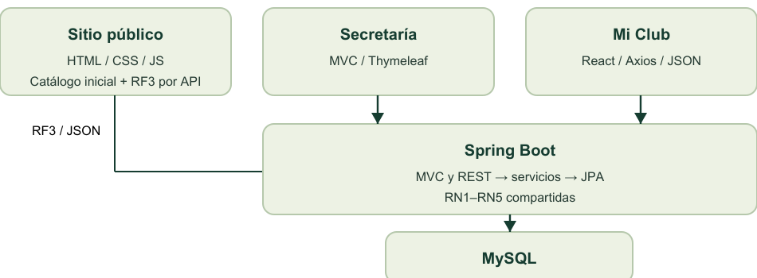
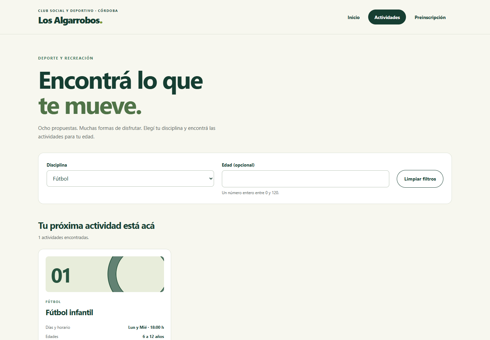
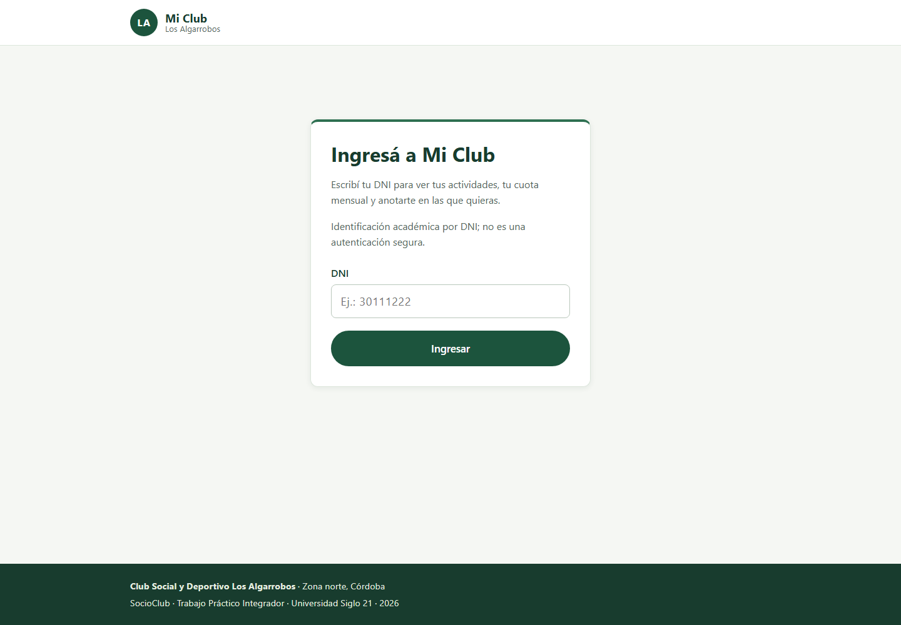
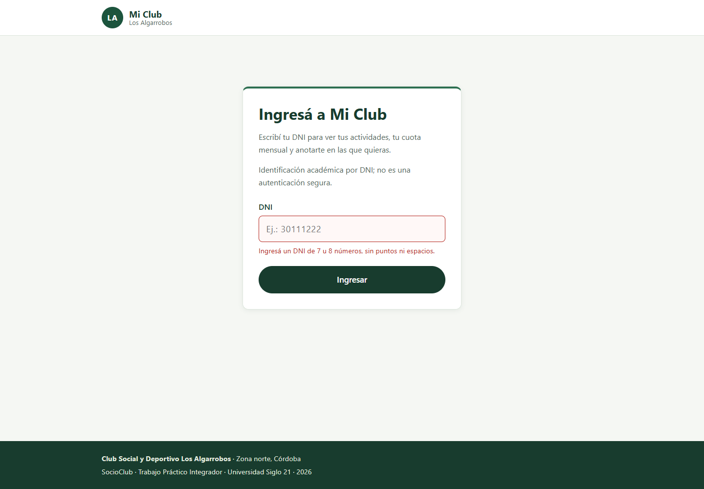

# SocioClub

Universidad Siglo 21 · Taller de Construcción de Software

Trabajo Práctico Integrador

Grupo 3

Hernán Zamora · Matias Jure · Mateo Hernandez · Fernando Oliva · Joaquín Mazza

Repositorio GitHub: https://github.com/hernandanielzamora/TPIntegradorSocioClub

Versión candidata basada en dev, con cierre en feature/entrega-final. La referencia definitiva y el estado remoto se verifican en entrega-final/manifest-entrega.txt y en Git. main conserva la versión inicial; no es la versión candidata.

## Estado de esta entrega

NO LISTO POR UN REQUISITO BLOQUEANTE. RF3 todavía no recibe ni almacena preinscripciones. El informe y el paquete existen, pero también requieren completar evidencias de Secretaría, casos de sistema y ejecución de Postman antes de presentarse como entrega final terminada.

Integrantes y grupo confirmados por el usuario. Se omite la fecha de entrega por su indicación. Este documento distingue pruebas nuevas, antecedentes y validaciones pendientes.

# 2. Introducción y 3. Arquitectura

El Club Social y Deportivo Los Algarrobos, en el caso académico, reúne aproximadamente 650 socios en la zona norte de Córdoba. La gestión mediante cuadernos, planillas y mensajes produce cupos excedidos, duplicados, inscripciones fuera de edad y dificultades para detectar cuotas impagas. SocioClub concentra la consulta y la gestión de actividades para reducir esos errores.

La solución tiene tres interfaces: un sitio público con HTML, CSS y JavaScript; un sistema de Secretaría con MVC y Thymeleaf; y Mi Club, una aplicación React para socios. Secretaría y React comparten un backend Spring Boot y una base MySQL. El sitio público consulta un catálogo inicial en JavaScript; no debe interpretarse como disponibilidad en vivo.

## Un recorrido que comparte reglas

Cuando un socio solicita una inscripción, React envía JSON mediante Axios. El controlador REST delega en los servicios; InscripcionService verifica las reglas y los repositorios JPA persisten la operación en MySQL. Secretaría usa la misma capa de servicio desde controladores MVC. De esta forma el cupo, la edad y la morosidad se controlan igual en ambos canales.

## Límites de integración

RF3 constituye el límite actual: el formulario público valida campos y DNI, pero no envía ni guarda solicitudes. La consigna usa “recibir preinscripciones” (páginas 2–3); por eso no se declara cumplimiento integral. Se propone un receptor adicional y una tabla independiente, previa aprobación de la migración. No es un endpoint del Anexo A. No se ejecutó SQL nuevo.

# 4. Modelo de datos

Socio identifica a cada persona mediante un DNI único e incluye nombre, apellido, fecha de nacimiento, contactos, estado de cuota y estado de vigencia. AL_DIA/MOROSO expresa la situación de pago; ACTIVO/INACTIVO expresa la vigencia del socio. Son conceptos distintos.

Actividad contiene disciplina, profesor, días y horario, rango de edad, cupo máximo y cuota mensual. Inscripcion relaciona un socio con una actividad y registra fecha y estado ACTIVA/BAJA. Las claves foráneas preservan el historial. Una baja lógica cambia el estado; no elimina los vínculos históricos.

## Persistencia y datos reproducibles

Las tres entidades usan JPA y relaciones OneToMany/ManyToOne. Los repositorios extienden JpaRepository, contienen búsquedas derivadas, consultas @Query y paginación Pageable. schema.sql define PK, FK, unicidad y restricciones; seed.sql prepara ocho actividades, 21 socios sintéticos, dos MOROSOS y Yoga con 14 de 15 plazas. Son propiedades del script revisado, no conteos nuevos de una base activa.

La migración 001 corresponde a estado de socio en bases anteriores. Debe aplicarse solo si falta esa columna, con respaldo y autorización. Un esquema nuevo ya la contiene. Los SQL 002 y 003 se conservan como propuestas no ejecutadas. Hibernate usa ddl-auto=validate y la inicialización SQL automática está desactivada.

# 5. Funcionalidades y reglas de negocio

La experiencia pública cubre la presentación del club, catálogo con días, horarios, edades, profesor y precios (RF1) y filtros combinados por disciplina y edad (RF2). La preinscripción valida nombre, apellido, correo, actividad y DNI, con errores junto a cada campo; RF3 permanece parcial porque no existe recepción remota.

Secretaría administra actividades y socios, ofrece búsqueda por apellido y paginación, y muestra inscriptos activos y cupo disponible (RF4, RF5 y RF7). Las altas de inscripción reutilizan las reglas del servicio (RF6). El socio ingresa por DNI, consulta sus ACTIVAS, solicita inscripciones o bajas y ve la cuota estimada (RF8–RF10). La identificación por DNI es académica y no acredita autenticación segura.

| Regla | Control implementado | Dónde se verifica |
| --- | --- | --- |
| RN1 | Rechazar alta sin cupo disponible. | InscripcionService; tests de servicio y API. |
| RN2 | Impedir dos ACTIVAS del socio en la misma actividad. | Servicio; conserva historial BAJA. |
| RN3 | Edad actual dentro del rango inclusivo. | Servicio; límites, cumpleaños y bisiesto. |
| RN4 | MOROSO no puede realizar nuevas inscripciones. | Servicio; permite consultas y bajas. |
| RN5 | Máximo tres inscripciones ACTIVAS. | Servicio; prueba de cuarta actividad. |
| RN6 | Suma mensual, 10 % con dos y 15 % con tres actividades. | Función pura JavaScript y Jest. |
| RN7 | DNI de siete u ocho dígitos sin puntos. | Formulario público e ingreso React. |

## Presentación y accesibilidad

El cierre mejora el sitio público con una portada deportiva vectorial, títulos jerárquicos, paleta verde y fondo cálido, tarjetas diferenciadas por disciplina y un formulario con guía de pasos. El catálogo sigue siendo dinámico. Las vistas móviles usan una columna, la navegación indica la página actual y los controles mantienen foco visible, mensajes accesibles y enlace para saltar al contenido.

Los SVG y los detalles gráficos se construyeron en el proyecto y no representan instalaciones reales. No se incorporaron fuentes remotas, fotografías externas ni dependencias de interfaz. No se implementaron RN8 ni un panel administrativo React.

React 18 con Create React App conserva componentes funcionales, PropTypes, hooks y Context API. Axios concentra la comunicación en servicios/api.js. RN6 se calcula en JavaScript y RN7 valida el DNI en el cliente. El sitio público utiliza una clase Actividad, eventos y manipulación del DOM sin frameworks adicionales.

# 6. API REST y 7. Implementación

Los nueve endpoints mínimos del Anexo A se implementan en ApiController, bajo /api. Las consultas devuelven representaciones JSON; la API recibe DTO y delega a servicios compartidos. La lista de actividades acepta el parámetro opcional disciplina.

| Verbo | Ruta obligatoria | Respuestas del anexo |
| --- | --- | --- |
| GET | /api/actividades | 200 |
| GET | /api/actividades/{id} | 200 / 404 |
| POST | /api/actividades | 201 |
| PUT | /api/actividades/{id} | 200 / 404 |
| DELETE | /api/actividades/{id} | 204 / 404 / 409 |
| GET | /api/socios/dni/{dni} | 200 / 404 |
| GET | /api/socios/{id}/inscripciones | 200 / 404 |
| POST | /api/inscripciones | 201 / 404 / 409 |
| PUT | /api/inscripciones/{id}/baja | 200 / 404 |

## Contrato y errores

POST /api/inscripciones recibe socioId y actividadId. Una violación de negocio produce HTTP 409 con error y regla RN1–RN5. Un ID inexistente devuelve 404; entradas inválidas, 400. Crear devuelve 201, y borrar una actividad sin historial devuelve 204 sin cuerpo. Un fallo técnico de persistencia se trata sin publicar SQL ni credenciales.

Las respuestas de actividades incluyen cupoDisponible. Las inscripciones devuelven la actividad anidada, sin colecciones inversas ni ciclos infinitos. El alta de actividad usa Location hacia su detalle implementado. La baja de inscripción conserva el vínculo y puede repetirse de forma idempotente.

## React, Axios y CORS

React centraliza GET, POST y PUT con Axios, muestra los errores de la API y actualiza sus consultas después de altas o bajas. El contexto comparte al socio entre las cuatro rutas: /, /actividades, /actividades/:id y /mis-actividades. CORS admite los orígenes locales configurados y métodos explícitos; MockMvc comprueba un origen permitido y rechaza uno ajeno.

## Postman y extensión existente

La colección y el entorno local se analizaron como JSON y se contrastaron contra los nueve contratos. Sus ejemplos y scripts no son prueba de ejecución de Postman. El runner no se ejecutó en este cierre. PUT /api/socios/{id}/baja es una extensión existente del proyecto; no se cuenta entre los nueve mínimos ni resuelve RF3.

## 7. Implementación

Java 25 y Spring Boot 4.1.2 organizan MVC, REST, servicios y JPA. Thymeleaf utiliza fragmentos y formularios enlazados a DTO. RN1–RN5 permanecen en el servicio transaccional para evitar duplicaciones entre canales y validar antes de persistir. Los DTO JSON evitan serializar las relaciones JPA bidireccionales.

# 8. Pruebas y evidencia de resultados

Las nuevas ejecuciones se separan de los antecedentes de 128 pruebas backend completos comunicados en etapas anteriores. En este cierre no se ejecutaron suites MySQL, migraciones, seed ni limpiezas de bases.

| Verificación nueva | Resultado | Alcance |
| --- | --- | --- |
| Backend sin MySQL | 111 aprobadas; 0 fallos/errores/omisiones. | Ocho clases; servicios, modelo, MVC y API. |
| React Jest / RTL | 58 aprobadas; cinco suites. | RN6/RN7, componentes e integración simulada. |
| Sitio Node / jsdom | 25 aprobadas. | Catálogo, filtros, DOM, formularios. |
| Build React | Compiled successfully; salida 0. | Build local de producción. |
| Chrome real | 10 capturas; 0 desbordes y excepciones JS detectadas. | Sitio desktop/móvil e ingreso React. |
| REST y CORS | MockMvc aprobado en la selección backend. | No sustituye llamadas con MySQL real. |
| Postman / sistema | Pendiente de ejecución real. | JSON revisado; no equivale a runner. |

## Seis casos de sistema preparados

| Caso | Precondición / datos | Pasos | Esperado |
| --- | --- | --- | --- |
| PS01 | Socio apto, al día, <3 ACTIVAS; vacante. | Inscribir y releer ACTIVAS/cupo. | 201, una nueva ACTIVA. |
| PS02 / RN1 | Cupo completo; socio apto. | POST con IDs verificados. | 409 RN1, sin alta. |
| PS03 / RN2 | Misma pareja ya ACTIVA. | Repetir alta y consultar. | 409 RN2, sin duplicado. |
| PS04 / RN3 | Edad fuera del rango. | Intentar alta y consultar. | 409 RN3, sin alta. |
| PS05 / RN4 | Socio ACTIVO/MOROSO. | Intentar alta y consultar. | 409 RN4, sin alta. |
| PS06 / RN5 | Tres ACTIVAS; destino distinto. | Intentar cuarta y consultar. | 409 RN5, conserva tres. |

Resultado obtenido en PS01–PS06: no ejecutado E2E en este cierre. Evidencia disponible: unitarios, MockMvc y RTL; no se usa esa evidencia como resultado de sistema. Docs/pruebas-sistema.md contiene los procedimientos detallados y las consultas previas para seleccionar IDs y capturar condiciones actuales.

La base de ensayo contiene fixtures manuales según registros anteriores. Sin una base aislada aprobada no se ejecutan escrituras para construir estos escenarios. El botón React se deshabilita sin vacantes; PS02 se prepara para API/Postman. No se modifica cuota, edad ni cupo para forzar una regla sin autorización.

# 9. Evidencia visual · Sitio público

Capturas auténticas de Chrome local sobre los archivos actuales. La ilustración de la portada forma parte de la interfaz; las imágenes de esta sección son capturas de ejecución, no pantallas generadas artificialmente.

También se incluyen capturas completas del formulario, errores de validación, catálogo general y vistas móviles de 390 px en Docs/entrega/evidencias. El registro verificacion-navegador.json identifica URL, dimensiones y comprobación de ancho. El filtro se accionó en el navegador real.

# 9. Evidencia visual · Mi Club y Secretaría

## Evidencia de Secretaría pendiente

Backend y MySQL no estaban escuchando en los puertos locales al inspeccionar el entorno. No se fabrican capturas de Thymeleaf ni se usan servicios simulados como evidencia de MySQL. Faltan panel, socios, actividades e inscripciones; también catálogo autenticado, Mis actividades y resumen de cuota React.

Procedimiento: iniciar MySQL configurado sin ejecutar seed; cargar backend/.env con scripts/load-env.ps1 e iniciar backend en 8080. Abrir /secretaria y capturar panel, búsqueda de socios, actividades e inscripciones usando solo datos ficticios. Iniciar React con API en 8080, ingresar un DNI del seed vigente y capturar catálogo, ACTIVAS y cuota. Guardar en evidencias y regenerar el informe. Ver instrucciones exactas en evidencias/README.md.

# 10. Conclusiones y control de entrega

SocioClub integra las tecnologías de la materia en un flujo común de gestión. Compartir servicios entre MVC y REST permite mantener las reglas en un lugar; usar DTO evita ciclos al serializar; separar estados de cuota y vigencia permite conservar historial con bajas lógicas. React y el sitio público aplican estado, eventos, filtros y validación de entradas.

El trabajo conserva un historial colaborativo verificable. Git registra contribuciones de Hernán Zamora, Matias Jure y Mateo Hernandez; los cinco integrantes fueron confirmados por el usuario. No se atribuyen commits ni tareas técnicas a Fernando Oliva o Joaquín Mazza sin evidencia adicional. Las decisiones humanas, las tareas automáticas y los ensayos manuales se distinguen en la bitácora y el registro de trabajo.

## Rúbrica: evidencia y riesgos, sin calificación

| Categoría | Evidencia disponible | Pendiente o riesgo |
| --- | --- | --- |
| A · Público · 10 pts | Tres HTML, clase JS, filtros y validación; 25 tests. | RF3 sin recepción remota. |
| B · Spring · 25 pts | Capas, entidades, CRUD, RN, MVC probado. | Capturas y recorrido MySQL actuales. |
| C · REST · 15 pts | Nueve contratos, DTO, errores y CORS. | Runner Postman real. |
| D · React · 25 pts | Router, Axios, contexto, props/hooks y 58 tests. | Recorrido autenticado, ACTIVAS y cuota. |
| E · Pruebas · 10 pts | Automatizadas nuevas y PS01–PS06 preparados. | Seis resultados E2E con evidencia. |
| F · Docs/IA · 15 pts | Este PDF, editable, instalación y bitácora. | Completar capturas y revisión humana final. |

## Qué entregar cuando se resuelvan los pendientes

El aula virtual requiere un único PDF, TPI_SocioClub_Grupo3.pdf, con el enlace GitHub en su primera página. El docente debe poder consultar el repositorio; si es privado, requiere invitación. El ZIP es un complemento con fuentes, SQL, Postman y documentación. El paquete actual se rotula como candidato y no acredita cierre funcional completo.

RF3 requiere decidir una recepción persistente; la propuesta mínima está en rf3-decision-pendiente.md. No se actualizó main: solo puede integrarse allí con autorización expresa y una candidata validada. No se desplegó el sistema ni se cambiaron permisos del repositorio.

# 11. Bitácora de inteligencia artificial

Último capítulo del informe, conforme a Parte F. Se usa el formato real del Anexo C (páginas 13–14); la consigna menciona Anexo D en otros apartados. Las entradas se sintetizan de Docs/bitacora-ia.md, que conserva los registros extensos, evidencia y límites.

| N.º / Parte | Qué pedimos a la IA | Qué devolvió | Qué estaba mal / cambios y autoría |
| --- | --- | --- | --- |
| 9 / B,E | Ejecutar persistencia y diagnosticar errores. | Análisis del 1045 y protección de credenciales de tests. | AH-1: el usuario corrigió la cuenta de ensayo en Workbench y validó conexión. Codex escribió la protección. |
| 10 / E | Conservar prueba CHECK tras fallo de aserción. | Helper que comprueba SQLException 3819 y restricción. | El usuario detectó/comunicó el fallo y aprobó alcance; Codex corrigió la aserción. |
| 11 / B,F | Evitar reconfigurar variables por terminal. | Plantilla y cargador local de .env. | AH-3: propuesta y requisitos humanos; parsing y script programados por Codex. |
| Inc.6 / B | Revisar rechazo 1045 del arranque normal. | Diagnóstico de autenticación de desarrollo. | AH-2: el usuario corrigió contraseña local y confirmó arranque. No se cambió esquema. |
| Fixture / E | Investigar error SQL 1064 al cargar ensayo. | Revisión y sustitución por SQL convencional. | El usuario comunicó el error y confirmó alternativa con COMMIT manual; Codex actualizó el archivo. |
| 24 / A,E,F | Cerrar entrega y mejorar el frontend. | Rediseño, regresiones, capturas y documentos. | Codex ajustó Mockito con agente explícito tras fallo real; el usuario confirmó integrantes y Grupo 3. No se atribuye revisión humana de código. |

## Supervisión humana y autoría

Se registran más de cinco intervenciones reales y al menos tres problemas o ajustes humanos documentados: autenticación de testing (AH-1), autenticación de desarrollo (AH-2), configuración local .env (AH-3) y alternativa de carga tras 1064. Son correcciones operativas y decisiones de diseño. No se reinterpretan como programación manual ni se garantiza que la cátedra considere las dos cuentas como ajustes distintos.

La IA generó y corrigió código, pruebas y documentación por instrucciones del usuario. Las ejecuciones manuales de MySQL, respaldos y validaciones comunicadas pertenecen a antecedentes humanos; no se presentan como ejecuciones nuevas de Codex. La selección backend actual usa Mockito y las pruebas React usan mocks de Axios; el consumo productivo usa la API real.

El aprendizaje principal es revisar el resultado contra la consigna y contra evidencia ejecutada. Un build exitoso no prueba persistencia; un JSON válido no prueba Postman; una validación de formulario no prueba recepción de solicitudes. Los pendientes se mantienen visibles hasta contar con resultados verificables.
