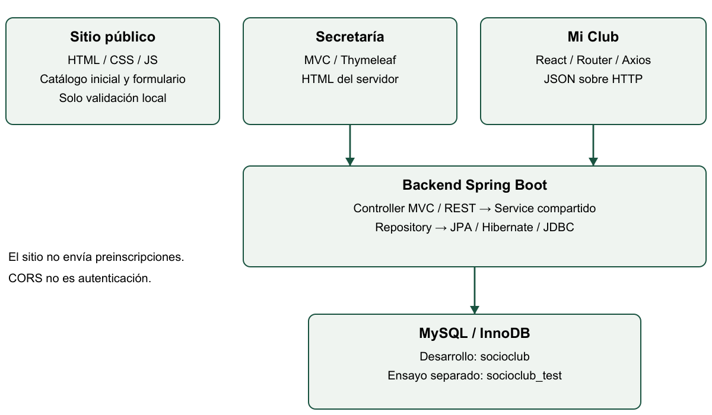
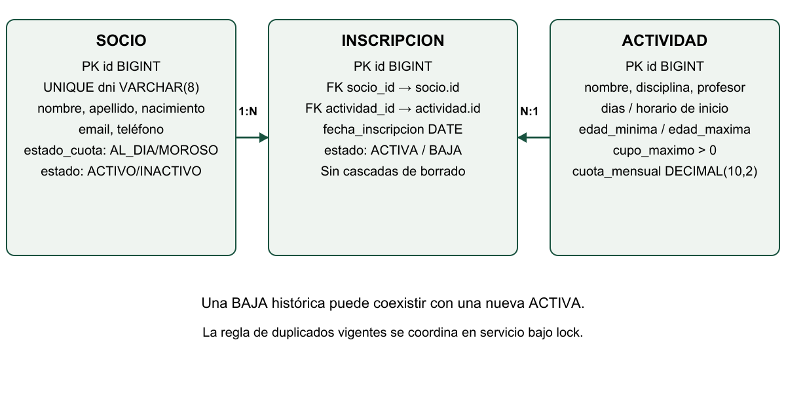

# Informe Técnico Final — SocioClub

Universidad Siglo 21 · Taller de Construcción de Software
Trabajo Práctico Integrador · Club Social y Deportivo Los Algarrobos

**Repositorio:** https://github.com/hernandanielzamora/TPIntegradorSocioClub

**Integrantes:** Hernán Zamora; Mateo [nombre completo pendiente]; Matías [nombre completo pendiente]; Fernando [nombre completo pendiente].

**Grupo:** N — pendiente de confirmar. **Fecha de entrega:** pendiente. Fecha de elaboración documental: 8 de noviembre de 2026.

**Versión de aplicación examinada:** dev `874c6bb3e3346f2a55720c799d6da69300643750`.

**Estado:** borrador académico revisable. Faltan datos de portada, capturas auténticas y validaciones manuales. No constituye certificación de producción ni entrega definitiva.

Índice: 1. Introducción; 2. Arquitectura; 3. Modelo de datos; 4. Funcionalidades y reglas; 5. API y frontend; 6. Pruebas; 7. Evidencias visuales; 8. Conclusiones y limitaciones; 9. Bitácora de IA (último capítulo).

<!-- pagebreak -->

## 1. Introducción y problemática

El caso del Club Social y Deportivo Los Algarrobos, ubicado en la zona norte de Córdoba, plantea la administración de aproximadamente 650 socios y ocho actividades iniciales. El registro mediante cuadernos, planillas y comunicaciones dispersas dificulta conocer la ocupación, evitar duplicados y aplicar condiciones de inscripción de manera uniforme. Es un escenario de la consigna, no un relevamiento de una organización real efectuado por el equipo.

SocioClub organiza el catálogo, la gestión de Secretaría y el autoservicio de socios. El objetivo es que las altas respeten cupos, edades y situación de cuota, y que las bajas liberen plazas sin borrar el historial. Una misma operación debe recibir las mismas reglas tanto desde un formulario administrativo como desde la API.

La solución tiene tres interfaces: sitio informativo HTML/CSS/JavaScript, Secretaría Spring MVC/Thymeleaf y aplicación React para socios. El backend conserva los datos en MySQL. La preinscripción del sitio público tiene validación local y comunica expresamente que no envía ni guarda datos; la inscripción persistente corresponde a los flujos de socios y Secretaría. Este límite de RF3 requiere aclaración docente si se interpreta que debe existir recepción remota.

### Método de reconstrucción y alcance de la evidencia

Se contrastaron el enunciado, las matrices de requisitos, los registros de incidentes y los archivos finales de dev. Las fuentes primarias de implementación son `database/schema.sql`, las entidades y servicios Java, los controladores, `app-socios/src/servicios/api.js` y `sitio-publico/js/script.js`. El historial Git permite localizar cambios; el nombre del autor de un commit no acredita que haya escrito personalmente todo su contenido cuando intervino Codex.

Se distinguen implementación, prueba automática, confirmación humana, validación pendiente y propuesta futura. Los resultados de la etapa anterior se citan como antecedentes; en esta tarea documental no se ejecutaron SQL ni nuevas pruebas funcionales. El código prevalece sobre párrafos históricos de documentos que describen etapas anteriores. La base actual incorpora el merge UI/UX 874c6bb: CSS y presentación Thymeleaf, sin cambios en servicios, API, JavaScript funcional ni SQL. Las pruebas citadas preceden a ese ajuste visual; su revisión visual y regresión posterior no se acreditan en este informe.

Fuentes de lectura ampliada: `Docs/cierre-desarrollo.md`, `Docs/requerimientos.md`, `Docs/pruebas-sistema.md`, `Docs/bitacora-ia.md` y `Docs/registro-trabajo.md`. La guía integral complementaria explica archivos, recorridos y preguntas de defensa sin aumentar la extensión de este informe.

<!-- pagebreak -->

## 2. Solución propuesta y arquitectura

El sitio público presenta información inicial y genera tarjetas y filtros con JavaScript. No consulta disponibilidad en vivo. Secretaría entrega HTML generado en el servidor mediante Thymeleaf. React recibe JSON por Axios y actualiza componentes en el navegador. React no conoce credenciales JDBC ni accede directamente a MySQL.

`SecretariaController` adapta formularios a servicios. `ApiController` expone recursos REST y delega en `ApiConsultaService`, que transforma entidades en DTO dentro de la transacción. `InscripcionService`, `SocioService` y `ActividadService` concentran las escrituras. Los repositorios Spring Data JPA encapsulan las consultas; Hibernate traduce el modelo y utiliza JDBC para acceder a InnoDB.

Esta división evita duplicar RN1–RN5 entre MVC y REST. Un botón deshabilitado mejora la experiencia, pero la decisión final se toma en el servicio transaccional. Las restricciones SQL protegen además la integridad estructural. El catálogo muestra una fotografía del cupo: el alta vuelve a comprobarlo bajo bloqueo.

Tecnologías del árbol examinado: Java 25, Spring Boot 4.1.2, Spring MVC, Thymeleaf, JPA, Bean Validation y MySQL 8.4.13 confirmado por el usuario; React 18.3.1, React Router, PropTypes, Axios y react-scripts 5.0.1. Se conserva el stack docente, sin migrar a otro framework en el cierre.

Fuentes: `backend/pom.xml`, `backend/src/main/java/ar/edu/siglo21/socioclub/{controller,service,repository,config}`, `app-socios/package.json` y su lockfile. En adelante, las rutas Java abreviadas se entienden bajo ese paquete base.

<!-- pagebreak -->

## 3. Modelo de datos y preservación del historial

`Socio` tiene PK BIGINT autoincremental, DNI único de 7/8 dígitos, datos personales, nacimiento, contacto y dos estados independientes: `estado_cuota` AL_DIA/MOROSO y `estado` ACTIVO/INACTIVO. En Java, este último se llama `estadoSocio`. La cuota informa situación económica; la vigencia permite nuevas inscripciones. No son equivalentes.

`Actividad` conserva nombre, disciplina, profesor, días y horario textual de inicio, límites de edad, cupo máximo y cuota mensual DECIMAL(10,2), representada por BigDecimal. Los CHECK exigen cupo positivo, cuota no negativa, rango etario coherente y horario válido. No existe hora final ni control de superposición RN8.

`Inscripcion` vincula un socio y una actividad mediante FK obligatorias, fecha y estado ACTIVA/BAJA. JPA utiliza ManyToOne LAZY; las colecciones inversas son OneToMany mappedBy. No hay cascadas de borrado. No se impone UNIQUE sobre el par socio/actividad: una BAJA histórica debe coexistir con una reinscripción nueva. El servicio impide duplicar ACTIVAS.

La baja de una inscripción cambia su estado sin eliminarla. La baja lógica adicional del socio bloquea primero al socio y luego sus actividades por ID ascendente; cambia sus ACTIVAS a BAJA y su vigencia a INACTIVO en una misma transacción. Si falla una escritura, se revierte la unidad de trabajo. No altera bajas anteriores ni implementa reactivación.

Desarrollo usa socioclub/socioclub_app y testing socioclub_test/socioclub_tests. La migración aditiva 001 incorpora `estado VARCHAR(8) NOT NULL DEFAULT 'ACTIVO'` y `ck_socio_vigencia`. El usuario confirmó respaldos mysqldump, aplicación inicial en testing y aplicación posterior autorizada en desarrollo. Codex preparó el SQL; no lo ejecutó. No consta restauración de ensayo. ALTER puede bloquear y producir commits implícitos; ROLLBACK no lo deshace.

Fuentes: `model/Socio.java`, `Actividad.java`, `Inscripcion.java`, `service/SocioService.java`, `database/schema.sql`, `seed.sql` y `migrations/001_estado_socio.sql`. El seed inicial prevé 21 socios, 8 actividades y 19 inscripciones; esos números no certifican el contenido vivo posterior.

<!-- pagebreak -->

## 4. Funcionalidades y reglas de negocio

| Requisito | Implementación comprobable |
| --- | --- |
| RF1 / RF2 | Catálogo y filtros: clase Actividad/DOM del sitio; catálogo API y filtro React |
| RF3 | Formulario público validado localmente; sin recepción remota ni persistencia |
| RF4 | ABM de actividades: ActividadService, MVC y REST; protección de historial |
| RF5 | Alta/edición de socios y búsqueda paginada por apellido en Secretaría |
| RF6 / RF7 | Inscripciones mediante servicio compartido; nómina ACTIVA y cupo calculado |
| RF8 / RF9 | Consulta por DNI, listado de ACTIVAS y baja lógica de inscripción |
| RF10 | Resumen mensual de actividades ACTIVAS con bonificación RN6 |

| Regla | Decisión y ubicación |
| --- | --- |
| RN1 | No superar cupo; conteo de ACTIVAS bajo bloqueo de actividad en InscripcionService |
| RN2 | No duplicar una ACTIVA para el mismo socio/actividad; permite nueva fila tras BAJA |
| RN3 | Edad mínima y máxima inclusivas: Period y Clock en servicio; filtro público orientativo |
| RN4 | MOROSO no puede inscribirse; puede consultar y dar de baja |
| RN5 | Máximo tres ACTIVAS por socio; conteo bajo bloqueo de socio |
| RN6 | JavaScript: dos actividades 10%, tres 15%; cálculo monetario en centavos |
| RN7 | DNI de 7/8 dígitos sin puntos: sitio, React y validación backend/SQL |

Las RN1–RN5 son autoridad del backend. `@Transactional(READ_COMMITTED)` y los locks PESSIMISTIC_WRITE coordinan contar y guardar. El orden común socio → actividad protege el último cupo y el máximo de actividades; varias actividades se bloquean ordenadas en la baja del socio. Las validaciones de interfaz no reemplazan esta coordinación.

El servicio verifica primero vigencia, luego morosidad y edad; después duplicado, máximo y cupo. Por eso un escenario que incumple varias condiciones puede recibir una regla anterior a la que se pretendía demostrar. Las pruebas deben aislar precondiciones. La mejora de socio INACTIVO devuelve 409 con `codigo=SOCIO_INACTIVO`, sin inventar una RN de la consigna.

RN6 usa importes de los DTO de ACTIVAS: dos cuotas de $10,25 producen $18,45 al aplicar 10%. No es un módulo de cobro ni cambia la morosidad. Fuentes: `service/InscripcionService.java`, `SocioService.java`, `app-socios/src/utils/calcularCuotaMensual.js`, `esDniValido.js` y `sitio-publico/js/script.js`.

<!-- pagebreak -->

## 5. API REST y frontend

Los nueve endpoints obligatorios del Anexo A se verifican en `controller/api/ApiController.java`. El décimo, PUT de baja de socio, es una mejora autorizada, no un requisito original.

| Método y ruta | Finalidad | Respuestas principales |
| --- | --- | --- |
| GET /api/actividades | Catálogo; disciplina opcional | 200 / 400 |
| GET /api/actividades/{id} | Detalle | 200 / 400 / 404 |
| POST /api/actividades | Crear actividad | 201 + Location / 400 / 409 |
| PUT /api/actividades/{id} | Editar actividad | 200 / 400 / 404 / 409 |
| DELETE /api/actividades/{id} | Eliminar sin historial | 204 / 400 / 404 / 409 |
| GET /api/socios/dni/{dni} | Identificación académica | 200 / 400 / 404 |
| GET /api/socios/{id}/inscripciones | ACTIVAS del socio | 200 / 400 / 404 |
| POST /api/inscripciones | Alta con socioId y actividadId | 201 / 400 / 404 / 409 |
| PUT /api/inscripciones/{id}/baja | Baja idempotente | 200 / 400 / 404 |

Los records de `dto/ApiDtos.java` evitan serializar relaciones bidireccionales JPA y datos de contacto innecesarios. El error contiene `error`, `regla`, `detalles` y `codigo`. El advice traduce conflicto de negocio a 409, recurso inexistente a 404 y entrada inválida a 400; errores de acceso a datos devuelven 503 sin revelar SQL. La política CORS limita orígenes de navegador a localhost:3000 y localhost:5500 por defecto. CORS no autentica usuarios.

React Router separa ingreso, catálogo, detalle y mis actividades. Las props transportan actividad y callbacks; PropTypes documenta su forma. useState conserva cargas, mensajes y listas; useEffect consulta y descarta respuestas obsoletas; useContext comparte el socio. El renderizado condicional distingue espera, error, vacío y resultado. Axios centraliza URL, timeout y validación del JSON recibido.

El flujo de alta es clic → callback React → Axios POST → ApiController → ApiConsultaService → InscripcionService → Repository → MySQL → DTO → actualización del estado y recarga de cupos. Solo se conserva el DNI en sessionStorage; se consulta de nuevo el socio. Esto no es autenticación segura. La baja de inscripción solicita confirmación y recarga ACTIVAS y cuota.

Fuentes frontend: `App.js`, `contexto/SocioContext.js`, `paginas/{Ingreso,Catalogo,Detalle,MisActividades}.js` y `servicios/api.js`. MVC usa `Model`, formularios y fragmentos Thymeleaf; un GET de confirmación no ejecuta la baja, que se realiza por POST.

<!-- pagebreak -->

## 6. Pruebas y resultados verificables

| Ejecución registrada | Aprobadas | Fallos / errores / omitidas | Alcance |
| --- | --- | --- | --- |
| Verify histórico del usuario | 128 | 0 / 0 / 0 | Incluyó 17 MySQL antes del fixture manual |
| Regresión backend posterior | 111 | 0 / 0 / 0 | Ocho suites sin MySQL; goal test |
| React | 58 | 0 / no aplica / 0 | Cinco suites Jest/RTL, Axios simulado |
| Sitio público | 25 | 0 / no aplica / 0 | Node/jsdom; DOM y funciones |

Las 111 están contenidas en las 128 del árbol de suites; no se suman como casos independientes. Los reportes Surefire locales mezclan momentos si se ejecuta una selección: la fecha y el comando delimitan la corrida. Esta elaboración documental no vuelve a ejecutar Maven, React ni SQL.

La regresión registrada también acredita build React exitoso, seis recursos estáticos HTTP 200, GET del backend, Secretaría, API y React con 200, identificador inválido 400 e inexistente 404. El preflight real autorizó localhost:3000 y métodos explícitos. 201/204/409 se comprobaron con MockMvc; no son escrituras HTTP reales de esa sesión. La colección Postman contiene 22 solicitudes y JSON válido: el runner no se ejecutó.

### Matriz de seis casos de sistema

| Caso y preparación aislada | Esperado | Observado y estado E2E |
| --- | --- | --- |
| PS01: ACTIVO/AL_DIA, edad apta, sin duplicado, menos de 3 y plaza | 201; ACTIVA; un cupo menos | Alta cubierta por tests; manual PENDIENTE DE VALIDACIÓN |
| PS02 RN1: actividad realmente completa y demás reglas satisfechas | 409 RN1; ninguna alta | Rechazo automático; manual PENDIENTE DE VALIDACIÓN |
| PS03 RN2: socio ya tiene ACTIVA, edad y cuota aptas | 409 RN2; sin duplicar | Rechazo automático; manual PENDIENTE DE VALIDACIÓN |
| PS04 RN3: edad fuera de rango, socio habilitado | 409 RN3; sin alta | Bordes y rechazo automáticos; manual PENDIENTE DE VALIDACIÓN |
| PS05 RN4: MOROSO y ACTIVO | 409 RN4; sin alta | Rechazo automático; manual PENDIENTE DE VALIDACIÓN |
| PS06 RN5: tres ACTIVAS; cuarta distinta y apta | 409 RN5; conserva tres | Rechazo automático; manual PENDIENTE DE VALIDACIÓN |

El usuario confirmó arranque y ensayo de baja desde Secretaría en testing:8081. Eso no acredita individualmente cupos finales, conservación exacta, 409/SOCIO_INACTIVO ni idempotencia HTTP. La base test ya contiene un fixture: no ejecutar suites que exigen vacío ni borrar filas para hacerlas pasar. Fuentes: `Docs/cierre-desarrollo.md`, `pruebas-sistema.md`, `validacion-modelo-datos.md` y tests de servicio/controlador/cliente.

<!-- pagebreak -->

## 7. Evidencias visuales por incorporar

Los siguientes espacios son marcadores documentales, no capturas ni pruebas aprobadas. Incorporar imágenes reales, con fecha, entorno, acción y resultado. Evitar credenciales, datos personales reales y pestañas privadas. Al reemplazarlos, conservar el límite de páginas y revisar nuevamente la maquetación.

### EV-1 — Sitio público

**CAPTURA REAL PENDIENTE.** Abrir localhost:5500/actividades.html; mostrar tarjetas y filtros disciplina/edad. Complementar con formulario inválido y aviso de validación local. No etiquetar cupo máximo estático como vacantes actuales.

### EV-2 — Secretaría

**CAPTURA REAL PENDIENTE.** Abrir /secretaria; mostrar búsqueda paginada o listado de inscripciones. Para la baja de socio usar exclusivamente un ensayo autorizado en testing:8081, registrando confirmación previa y resultado.

### EV-3 — Aplicación React

**CAPTURA REAL PENDIENTE.** Mostrar localhost:3000/mis-actividades con registros ficticios obtenidos de API y resumen RN6. Registrar el entorno real; no usar una maqueta como evidencia de integración.

### EV-4 — Rechazo de negocio

**CAPTURA REAL PENDIENTE.** Mostrar aviso visible y respuesta Network/Postman 409 con regla RNx, más precondiciones del caso. El escenario debe incumplir esa regla sin ser rechazado por una validación anterior. No provocar escrituras sobre desarrollo para conseguir la captura.

### Qué evidencia existe y qué falta

Existen resultados automáticos, registros de consultas HTTP y confirmaciones humanas descritos en el capítulo anterior. No se incorporan pantallas fabricadas ni se confunden dibujos de arquitectura con capturas del sistema. Faltan el recorrido visual real en navegador, revisión móvil y teclado, los seis casos completos y la ejecución documentada del runner Postman. Una captura aislada tampoco demuestra rollback o concurrencia: esas propiedades requieren evidencia técnica específica.

<!-- pagebreak -->

## 8. Conclusiones, limitaciones y próximos pasos

SocioClub integra tecnologías diferentes sobre un modelo común. La separación de servicios permite reutilizar reglas desde MVC y REST; los DTO desacoplan la persistencia del JSON; las transacciones y bloqueos protegen decisiones dependientes de conteos. La baja lógica muestra por qué el historial no debe confundirse con la lista vigente. Las pruebas automatizadas aportan regresión reproducible, con límites explícitos frente a una demostración integral.

El proceso combinó aportes del equipo conservados en Git y trabajo posterior asistido por Codex bajo supervisión del usuario. Se pueden localizar commits de Mateo Hernandez y Matias Jure como autores registrados, pero estos metadatos no sustituyen la confirmación de nombres de portada ni prueban autoría manual de cada línea. La distribución de exposición se propone por separado y no se presenta como distribución histórica de tareas.

### Límites que deben expresarse en la defensa

- La preinscripción pública valida localmente y no llega a MySQL. Confirmar con la cátedra el alcance esperado de RF3.
- Secretaría y endpoints administrativos no tienen autenticación/autorización robusta ni protección CSRF implementada. El sistema es una demostración local, no está preparado para exposición pública.
- Conocer un DNI permite identificación académica, no verificación segura de identidad. CORS no corrige esta limitación.
- No hubo despliegue. El build exitoso no certifica seguridad de dependencias; el audit histórico informó vulnerabilidades del stack y requiere revisión separada.
- Postman runner, capturas y casos E2E permanecen pendientes. No consta restauración de prueba de los respaldos.
- RN8 y FE-ADMIN-01 no están implementadas. Los SQL 002/003 en database/propuestas son diseños futuros, no migraciones a ejecutar para esta entrega.

Antes de entregar: completar portada, aportar capturas, registrar observados reales de sistema y revisar la rúbrica de ajustes humanos. AH-1–AH-3 son intervenciones de configuración, operación y diseño; IH-MIG-01 es ejecución operativa supervisada. No se afirma que equivalgan a tres correcciones manuales de código generado por IA. Si se exige ese criterio específico, la evidencia disponible no alcanza para certificarlo.

### Referencias de consulta

Enunciado: `Docs/Enunciado/TPIntegradorSocioClubEnunciado.pdf`; cierre y requisitos: `Docs/cierre-desarrollo.md`, `requerimientos.md`; arquitectura y datos: `arquitectura.md`, `datos-modelo.md`; interfaz: `modulo-mvc.md`, `api-rest.md`, `react-integracion-api.md`, `sitio-publico.md`; resultados y autoría: `pruebas-sistema.md`, `registro-trabajo.md`, `bitacora-ia.md`. El código fuente del repositorio enlazado en portada es la referencia de implementación. No se agrega bibliografía de herramientas que no se haya consultado en esta reconstrucción.

<!-- pagebreak -->

## 9. Bitácora de IA — último capítulo

El PDF original denomina **Anexo C** al formato de bitácora, aunque el pedido lo referencia como D. Se conservan sus columnas N.º, Parte, solicitud, devolución y qué estaba mal/qué cambiamos y por qué; se amplían abajo con intervención y evidencia. Las solicitudes son resúmenes, no transcripciones literales. Fuente ampliada: `Docs/bitacora-ia.md`, incidentes y tabla de trazabilidad AH.

| N.º / Parte | Qué le pedimos a la IA | Qué nos devolvió | Qué estaba mal / qué cambiamos y por qué |
| --- | --- | --- | --- |
| 1 / B — AH-1 | Diagnosticar siete errores JPA sin arriesgar datos | Análisis de Surefire y de la conexión; protección sin fallback a desarrollo | 1045/28000 impedía conectar; el mensaje Dialect era secundario. El usuario revisó la cuenta testing, restableció su clave y comprobó conexión. Codex no cambió la contraseña |
| 2 / B — CHECK | Corregir únicamente la aserción fallida | Helper que verifica SQLException, 3819, HY000 y CHECK esperado | MySQL rechazaba cuota negativa correctamente; Spring envolvía como UncategorizedSQLException, no DataIntegrityViolationException. Codex corrigió el test y conservó cuota/estado inválidos |
| 3 / B — AH-2 | Diagnosticar arranque del backend | Lectura del error y pasos de conexión | 1045/28000 de socioclub_app. El usuario corrigió credenciales locales y confirmó JDBC, JPA y Tomcat. No hubo arreglo Java para ocultar autenticación |
| 4 / B/F — AH-3 | Mejorar entorno entre terminales/equipos | .env.example y load-env.ps1; .env privado | Variables temporales desaparecían. Propuesta y requisitos humanos; implementación Codex. Usuario completó claves y corrigió marcadores de plantilla. No se afirma migración completa a otro equipo |

Evidencia de entradas 1–4: reportes históricos y confirmaciones humanas en bitácora; `PersistenciaMySqlTests.java` para causa CHECK y credenciales exclusivas; `application.properties`, `.env.example`, `scripts/load-env.ps1`. El archivo .env real permanece ignorado: no se leyó ni se incluye en el informe. Commit de cierre de persistencia `51314f7`; los incidentes no se atribuyen a un commit anterior inexistente.

Aprendizajes: buscar el primer Caused by; diferenciar validación de base y traducción de excepción; separar credenciales de pruebas; no publicar secretos; reconocer la naturaleza de cada intervención. AH-1 y AH-2 son ajustes operativos diferentes, pero la rúbrica podría agruparlos; AH-3 es diseño asistido, no programación manual del script.

<!-- pagebreak -->

### 9. Bitácora de IA — continuación y responsabilidad

| N.º / Parte | Qué le pedimos a la IA | Qué nos devolvió | Qué estaba mal / qué cambiamos y por qué |
| --- | --- | --- | --- |
| 5 / B/C — IH-MIG-01 | Incorporar baja lógica preservando historial y preparar migración revisable | EstadoSocio, servicio transaccional, DTO/API/MVC, pruebas y SQL 001 | No había vigencia independiente de cuota. El usuario propuso la mejora, autorizó el diseño, respaldó y migró manualmente test y luego desarrollo. Codex implementó archivos; no ejecutó ALTER |
| 6 / B/F — fixture 1064 | Revisar CREATE PROCEDURE rechazado sin inventar causa | Auditoría del bloque y alternativas de carga | Error 1064 near '' y luego near '//' al final del bloque. No se probó causa raíz definitiva. El usuario confirmó SQL convencional y COMMIT manual exitosos; Codex reflejó esa alternativa en el fixture versionable |
| 7 / A–F — alcance | Cerrar requisitos obligatorios y postergar extras | Auditoría, documentación y traslado de borradores a propuestas | RN8 necesita horarios normalizados/hora fin; admin requiere seguridad integral. Decisión humana de postergar; Codex no implementó seguridad parcial ni ejecutó 002/003 |

Evidencia 5: `SocioService.java`, `EstadoSocio.java`, `migrations/001_estado_socio.sql`, plan de migración y confirmación de verify 128/0/0/0 anterior al fixture. El usuario comunicó respaldo mediante mysqldump y ejecución Workbench; no existe evidencia de restauración. Evidencia 6: `database/fixtures/ensayo-baja-socio.sql`, `Docs/validacion-manual-baja-socios.md` y registro del mensaje técnico. Evidencia 7: `Docs/mejoras-futuras.md`, `propuesta-admin-rn8.md` y `database/propuestas/002_cuenta_administrativa.sql`, `003_actividad_horario.sql`.

Los archivos de baja/API/fixture quedaron integrados en `d58094c` y merge `3ace199`; el cierre React y postergación en `e09dffe`, el sitio en `7bb4f02`, y el cierre documental de dev en `4570207`. Estos hashes permiten localizar el resultado, no afirmar que cada intervención humana produjo un diff manual propio.

### Supervisión y criterio académico

Las siete entradas describen episodios reales, con problemas y decisiones diferenciados. Codex generó código, tests, SQL revisable y documentos; el usuario realizó correcciones de credenciales, decisiones funcionales y operaciones autorizadas. La alternativa SQL exitosa fue humana y la reescritura del archivo fue automática. No se presenta lo segundo como edición personal del equipo.

La evidencia documenta al menos tres ajustes humanos en sentido operativo/diseño; no garantiza tres correcciones manuales de fuente. El original pide errores o ajustes detectados por el grupo, no exige literalmente tres ediciones manuales de código. La interpretación y aceptación de los casos debe revisarse con el docente, sin inventar atribuciones. La aprobación de tests no reemplaza comprender bloqueos, contratos o riesgos. Los integrantes deben revisar estos documentos y poder recorrer el código de la versión indicada antes de defenderlo.

Este capítulo cierra el informe. Los resultados pendientes deben completarse solo con ejecución y revisión reales; no se agregan anexos que conviertan una propuesta en evidencia.
