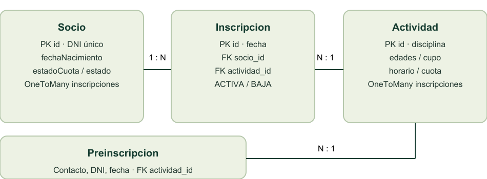
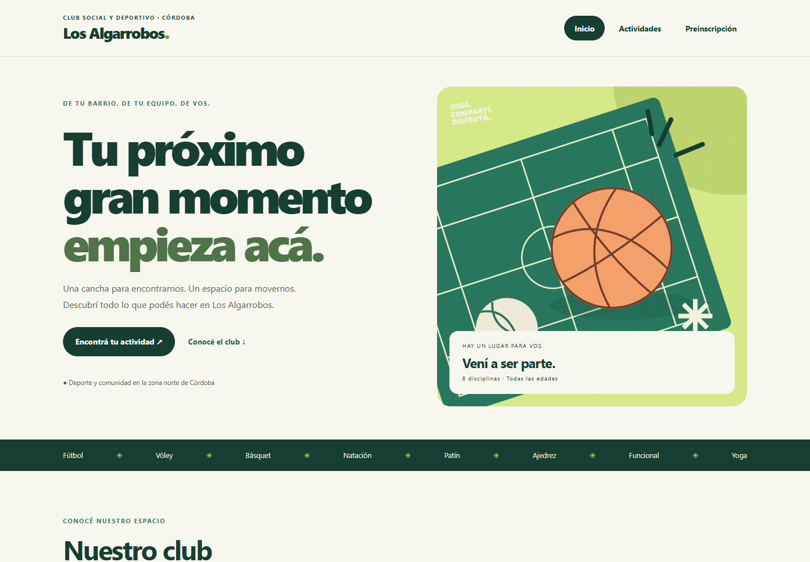
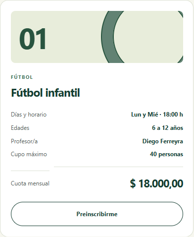
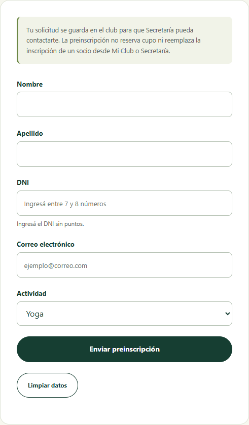
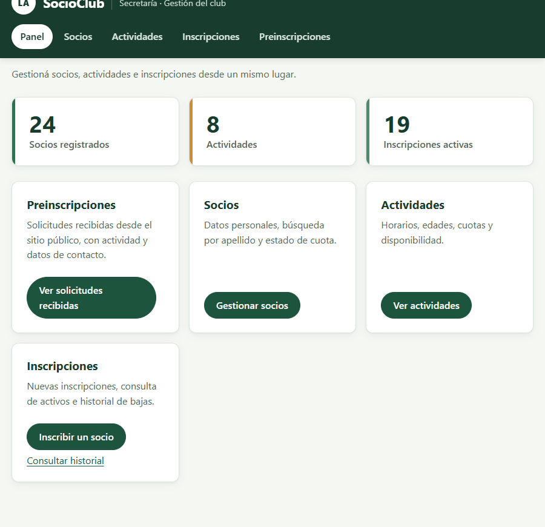
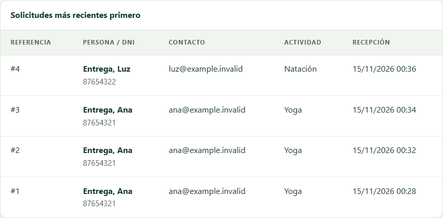
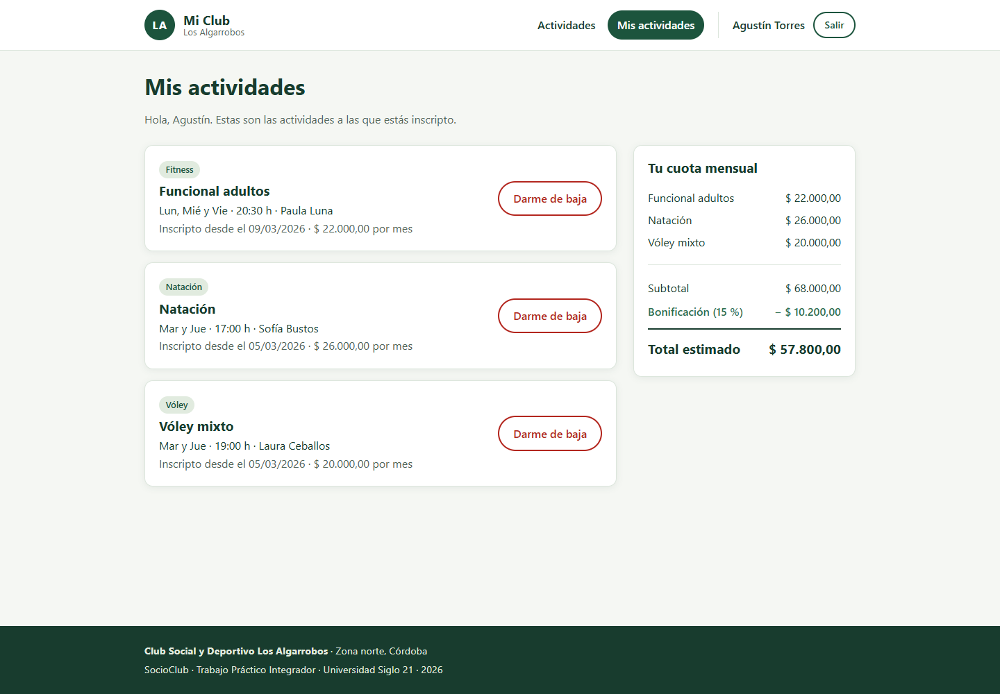
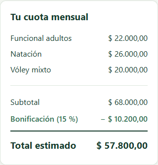

# SocioClub

Universidad Siglo 21 · Taller de Construcción de Software

Trabajo Práctico Integrador

Grupo 3

Hernán Zamora · Matias Jure · Mateo Hernandez · Fernando Oliva · Joaquín Mazza

Repositorio GitHub — versión de entrega: https://github.com/hernandanielzamora/TPIntegradorSocioClub/tree/dev

La versión de entrega se publica en dev. El manifiesto del ZIP identifica el commit exacto. main conserva la versión inicial y no debe utilizarse para evaluar esta entrega; actualizarla requiere autorización expresa.

## Estado de la entrega

LISTO PARA ENTREGAR, con salvedad académica de participación. RF1–RF10 y RN1–RN7 implementados; recepción pública persistente y bandeja de Secretaría verificadas con MySQL real. Se completaron pruebas automatizadas, seis casos de sistema, colección Postman y capturas de las tres interfaces.

El historial acredita aportes de Hernán Zamora, Matias Jure y Mateo Hernandez. El usuario confirmó que no hubo aportes de Fernando Oliva y Joaquín Mazza y pidió continuar así. Se conservan los cinco nombres del grupo sin inventar autoría o commits. Esta salvedad frente a la consigna se mantiene explícita.

Se omite la fecha de entrega por indicación del usuario. Todas las pruebas con escrituras se ejecutaron en una instancia MySQL nueva y aislada; las bases originales y el servicio MySQL84 permanecieron intactos.

# 2. Introducción y 3. Arquitectura

El Club Social y Deportivo Los Algarrobos, en el caso académico, reúne aproximadamente 650 socios en la zona norte de Córdoba. La gestión mediante cuadernos, planillas y mensajes produce cupos excedidos, duplicados, inscripciones fuera de edad y dificultades para detectar cuotas impagas. SocioClub concentra la consulta y la gestión de actividades para reducir esos errores.

La solución tiene tres interfaces: un sitio público con HTML, CSS y JavaScript; un sistema de Secretaría con MVC y Thymeleaf; y Mi Club, una aplicación React para socios. Secretaría y React comparten un backend Spring Boot y una base MySQL. El sitio público mantiene un catálogo inicial en JavaScript para consulta; el formulario carga los identificadores reales de la API y envía las solicitudes al mismo backend.

## Un recorrido que comparte reglas

Cuando un socio solicita una inscripción, React envía JSON mediante Axios. El controlador REST delega en los servicios; InscripcionService verifica las reglas y los repositorios JPA persisten la operación en MySQL. Secretaría usa la misma capa de servicio desde controladores MVC. De esta forma el cupo, la edad y la morosidad se controlan igual en ambos canales.

## Recepción pública integrada

El formulario envía POST /api/preinscripciones con datos validados y un actividadId real. El servicio guarda una Preinscripcion en MySQL y devuelve 201 con una referencia. Secretaría consulta las solicitudes más recientes en /secretaria/preinscripciones, con paginación. La solicitud no crea un socio ni consume cupo; esos pasos pertenecen a la inscripción formal.

# 4. Modelo de datos

Socio identifica a cada persona mediante un DNI único e incluye nombre, apellido, fecha de nacimiento, contactos, estado de cuota y estado de vigencia. AL_DIA/MOROSO expresa la situación de pago; ACTIVO/INACTIVO expresa la vigencia del socio. Son conceptos distintos.

Actividad contiene disciplina, profesor, días y horario, rango de edad, cupo máximo y cuota mensual. Inscripcion relaciona un socio con una actividad y registra fecha y estado ACTIVA/BAJA. Las claves foráneas preservan el historial. Una baja lógica cambia el estado; no elimina los vínculos históricos.

Preinscripcion agrega nombre, apellido, DNI, email, actividad solicitada y fecha de recepción. Su ManyToOne apunta a Actividad, sin relación con Socio: un vecino puede enviar una solicitud sin estar registrado. La bandeja solo se expone como vista de Secretaría; no existe un GET público de sus contactos.

## Persistencia y datos reproducibles

Las cuatro entidades usan JPA y relaciones OneToMany/ManyToOne. Los repositorios extienden JpaRepository, contienen búsquedas derivadas, consultas @Query y paginación Pageable. schema.sql define PK, FK, unicidad y restricciones; seed.sql prepara ocho actividades, 21 socios sintéticos, dos MOROSOS y Yoga con 14 de 15 plazas. El seed se ejecutó exclusivamente en la nueva instancia aislada para la demostración; sus 21 socios y ocho actividades se comprobaron antes de crear escenarios adicionales.

La migración 001 corresponde a estado de socio en bases anteriores. Debe aplicarse solo si falta esa columna, con respaldo y autorización. Un esquema nuevo ya la contiene. 004_preinscripcion agrega únicamente la nueva tabla; se ejecutó dos veces sobre el seed aislado y conservó los conteos existentes. En un esquema nuevo la tabla ya está incluida. 002/003 continúan sin ejecutar. Hibernate usa ddl-auto=validate y no ejecuta SQL automáticamente.

# 5. Funcionalidades y reglas de negocio

La experiencia pública cubre la presentación del club, catálogo con días, horarios, edades, profesor y precios (RF1) y filtros combinados por disciplina y edad (RF2). La preinscripción valida nombre, apellido, correo, actividad y DNI, con errores junto a cada campo, y confirma RF3 solo después de recibir HTTP 201 del backend. Un fallo de red conserva los datos y advierte que debe consultarse antes de reenviar.

Secretaría administra actividades y socios, ofrece búsqueda por apellido y paginación, y muestra inscriptos activos y cupo disponible (RF4, RF5 y RF7). Las altas de inscripción reutilizan las reglas del servicio (RF6). El socio ingresa por DNI, consulta sus ACTIVAS, solicita inscripciones o bajas y ve la cuota estimada (RF8–RF10). La identificación por DNI es académica y no acredita autenticación segura.

| Regla | Control implementado | Dónde se verifica |
| --- | --- | --- |
| RN1 | Rechazar alta sin cupo disponible. | InscripcionService; tests de servicio y API. |
| RN2 | Impedir dos ACTIVAS del socio en la misma actividad. | Servicio; conserva historial BAJA. |
| RN3 | Edad actual dentro del rango inclusivo. | Servicio; límites, cumpleaños y bisiesto. |
| RN4 | MOROSO no puede realizar nuevas inscripciones. | Servicio; permite consultas y bajas. |
| RN5 | Máximo tres inscripciones ACTIVAS. | Servicio; prueba de cuarta actividad. |
| RN6 | Suma mensual, 10 % con dos y 15 % con tres actividades. | Función pura JavaScript y Jest. |
| RN7 | DNI de siete u ocho dígitos sin puntos. | Formulario público e ingreso React. |

## Presentación y accesibilidad

El cierre mejora el sitio público con una portada deportiva vectorial, títulos jerárquicos, paleta verde y fondo cálido, tarjetas diferenciadas por disciplina y un formulario con guía de pasos. El catálogo sigue siendo dinámico. Las vistas móviles usan una columna, la navegación indica la página actual y los controles mantienen foco visible, mensajes accesibles y enlace para saltar al contenido.

Los SVG y los detalles gráficos se construyeron en el proyecto y no representan instalaciones reales. No se incorporaron fuentes remotas, fotografías externas ni dependencias de interfaz. No se implementaron RN8 ni un panel administrativo React.

React 18 con Create React App conserva componentes funcionales, PropTypes, hooks y Context API. Axios concentra la comunicación en servicios/api.js. RN6 se calcula en JavaScript y RN7 valida el DNI en el cliente. El sitio público utiliza una clase Actividad, eventos y manipulación del DOM sin frameworks adicionales.

# 6. API REST y 7. Implementación

Los nueve endpoints mínimos del Anexo A se implementan en ApiController, bajo /api. Las consultas devuelven representaciones JSON; la API recibe DTO y delega a servicios compartidos. La lista de actividades acepta el parámetro opcional disciplina.

| Verbo | Ruta obligatoria | Respuestas del anexo |
| --- | --- | --- |
| GET | /api/actividades | 200 |
| GET | /api/actividades/{id} | 200 / 404 |
| POST | /api/actividades | 201 |
| PUT | /api/actividades/{id} | 200 / 404 |
| DELETE | /api/actividades/{id} | 204 / 404 / 409 |
| GET | /api/socios/dni/{dni} | 200 / 404 |
| GET | /api/socios/{id}/inscripciones | 200 / 404 |
| POST | /api/inscripciones | 201 / 404 / 409 |
| PUT | /api/inscripciones/{id}/baja | 200 / 404 |

## Contrato y errores

POST /api/inscripciones recibe socioId y actividadId. Una violación de negocio produce HTTP 409 con error y regla RN1–RN5. Un ID inexistente devuelve 404; entradas inválidas, 400. Crear devuelve 201 y borrar una actividad sin referencias devuelve 204. Los errores técnicos no publican SQL ni credenciales.

Las respuestas de actividades incluyen cupoDisponible. Las inscripciones devuelven la actividad anidada, sin colecciones inversas ni ciclos infinitos. El alta de actividad usa Location hacia su detalle implementado. La baja de inscripción conserva el vínculo y puede repetirse de forma idempotente.

## React, Axios y CORS

React centraliza GET, POST y PUT con Axios, muestra los errores de la API y actualiza sus consultas después de altas o bajas. El contexto comparte al socio entre /, /actividades, /actividades/:id y /mis-actividades. CORS admite los orígenes locales configurados y métodos explícitos; MockMvc comprueba un origen permitido y rechaza uno ajeno.

## Postman y extensión existente

Newman ejecutó las 25 peticiones de la colección Postman: 34 aserciones, cero fallos. POST /api/preinscripciones recibe nombre, apellido, DNI, email y actividadId; devuelve 201, 400 o 404 según el caso. Esta ruta RF3 y PUT /api/socios/{id}/baja son adicionales a los nueve mínimos. La recepción devuelve solo ID y fecha, sin contactos.

## 7. Implementación

Java 25 y Spring Boot 4.1.2 organizan MVC, REST, servicios y JPA. Thymeleaf utiliza fragmentos y formularios enlazados a DTO. RN1–RN5 permanecen en el servicio transaccional para evitar duplicaciones entre canales y validar antes de persistir. Los DTO JSON evitan serializar las relaciones JPA bidireccionales.

# 8. Pruebas y evidencia de resultados

Las nuevas ejecuciones se realizaron contra MySQL Community 8.4 en 127.0.0.1:3308, inicializado en un directorio nuevo. Las bases socioclub y socioclub_test de esa instancia son independientes de las originales. No se inició MySQL84 ni se borraron sus datos. Las claves aleatorias permanecen fuera del repositorio.

| Verificación nueva | Resultado | Alcance |
| --- | --- | --- |
| Backend completo | 136 aprobadas; 0 fallos/errores/omisiones. | Incluye 18 pruebas MySQL; JAR empaquetado. |
| React Jest / RTL | 58 aprobadas; cinco suites. | RN6/RN7, componentes e integración simulada. |
| Sitio Node / jsdom | 29 aprobadas. | Envío, carga de IDs, red, errores y doble clic. |
| Build React | Compiled successfully; salida 0. | Build servido con rutas SPA para Playwright. |
| Playwright / Chrome | 33 PNG reales de las tres interfaces. | Vistas desktop/móvil sin desbordes finales. |
| REST y CORS | MockMvc y OPTIONS real aprobados. | Origen público 5500 y React 3000. |
| Postman / Newman | 25 peticiones; 34 aserciones aprobadas. | Nueve contratos, RN1–RN5, bajas y RF3. |

## Seis casos de sistema ejecutados

| Caso | Datos y precondición | Resultado real | Evidencia |
| --- | --- | --- | --- |
| PS01 | 10 años, AL_DIA, cero ACTIVAS; Fútbol con plazas | HTTP 201; ACTIVAS 0 → 1; cupo 39 → 38 | ps01-sistema.png |
| PS02 | Socio adulto apto, sin ACTIVAS; Yoga con 15 de 15 | HTTP 409; ACTIVAS 0 → 0; cupo 0 → 0 | ps02-sistema.png |
| PS03 | Fútbol ACTIVA previa, edad 11 y cupo libre | HTTP 409; ACTIVAS 1 → 1; cupo 38 → 38 | ps03-sistema.png |
| PS04 | Adulto de 25 años; Fútbol admite 6–12 | HTTP 409; ACTIVAS 1 → 1; cupo 38 → 38 | ps04-sistema.png |
| PS05 | ACTIVO/MOROSO; Natación apta y con cupo | HTTP 409; ACTIVAS 0 → 0; cupo 28 → 28 | ps05-sistema.png |
| PS06 | Tres ACTIVAS distintas; Ajedrez apta y con cupo | HTTP 409; ACTIVAS 3 → 3; cupo 16 → 16 | ps06-sistema.png |

PS01 y PS03–PS06 recorrieron React → Axios → REST → servicio → MySQL en Chrome real. PS02 comprobó el botón deshabilitado y realizó un POST HTTP real con Playwright para verificar 409/RN1. Después de cada caso se consultaron ACTIVAS y cupos para detectar escrituras indebidas. Todos aprobaron.

RF9 también se probó desde React: confirmación de baja, HTTP 200, lista de ACTIVAS vacía y conservación de la fila BAJA. RF3 se verificó mediante envío del formulario, HTTP 201, lectura SQL y aparición en Secretaría, sin crear socios ni cambiar cupos. Evidencia detallada en Docs/entrega/evidencias/.

# 9. Evidencia visual · Sitio público

Capturas auténticas obtenidas con Playwright y Chrome sobre la versión ejecutada. La ilustración vectorial es un recurso de la interfaz; estas figuras son capturas reales del navegador.

Se incluyen además filtros, errores RN7, confirmación con número de solicitud y vistas móviles. No se utilizan imágenes generadas para acreditar ejecución.

# 9. Evidencia visual · Preinscripción

El formulario obtiene las actividades de la API y envía los datos a MySQL. Playwright comprobó HTTP 201, referencia #3, fila SQL y aparición en la bandeja, sin modificar socios ni cupos.

# 9. Evidencia visual · Secretaría

El menú identifica la sección actual. El listado pagina diez solicitudes y conserva datos de contacto, actividad y fecha. Playwright verificó la vista móvil y llevó a corregir el desborde del menú al agregar el quinto enlace. También se capturaron socios, actividades e inscripciones.

# 9. Evidencia visual · Mi Club

El ingreso por DNI, el catálogo, el detalle, RN7 y los mensajes RN2–RN5 se verificaron en Chrome. Se comprobó la inscripción exitosa y su baja posterior con actualización de la lista. Los datos viajan por Axios hacia el backend; no se sustituyó la API por mocks en estos recorridos.

# 10. Conclusiones y control de entrega

SocioClub integra las tecnologías de la materia en un flujo común de gestión. Compartir servicios entre MVC y REST permite mantener las reglas en un lugar; usar DTO evita ciclos al serializar; separar estados de cuota y vigencia permite conservar historial con bajas lógicas. React y el sitio público aplican estado, eventos, filtros y validación de entradas.

El trabajo conserva un historial colaborativo verificable. Git registra contribuciones de Hernán Zamora, Matias Jure y Mateo Hernandez; los cinco integrantes fueron confirmados por el usuario. El usuario confirmó que Fernando Oliva y Joaquín Mazza no realizaron aportes y pidió continuar; no se crean commits ficticios ni se atribuyen tareas no realizadas. Las decisiones humanas, las tareas automáticas y los ensayos manuales se distinguen en la bitácora y el registro de trabajo.

## Rúbrica: evidencia y riesgos, sin calificación

| Categoría | Evidencia disponible | Pendiente o riesgo |
| --- | --- | --- |
| A · Público · 10 pts | Tres HTML, clase JS, filtros y recepción; 29 tests. | RF3 persistido y visible en Secretaría. |
| B · Spring · 25 pts | Capas, entidades, CRUD, RN, MVC probado. | Capturas y recorridos reales completados. |
| C · REST · 15 pts | Nueve contratos, DTO, errores y CORS. | Newman aprobado, 25 peticiones. |
| D · React · 25 pts | Router, Axios, contexto, props/hooks y 58 tests. | Ingreso académico, ACTIVAS y cuota reales. |
| E · Pruebas · 10 pts | Automatizadas nuevas y PS01–PS06 ejecutados. | Seis casos E2E aprobados con evidencia. |
| F · Docs/IA · 15 pts | Este PDF, editable, instalación y bitácora. | Salvedad: solo tres integrantes con aportes. |

## Archivos que se entregan

El aula virtual requiere un único PDF, TPI_SocioClub_Grupo3.pdf, con el enlace GitHub en su primera página. El repositorio es público y se comprobó acceso anónimo. El ZIP complementa al PDF con fuentes, SQL, Postman y documentación. Se entrega la rama dev y el manifiesto identifica su commit exacto.

RF3 está implementado y probado. Para una base anterior se aplica 004_preinscripcion antes de iniciar el nuevo backend; para una base nueva basta schema.sql. No se actualizó main, porque requiere autorización expresa. No se desplegó el sistema ni se cambiaron permisos. La demostración permanece local y el ingreso por DNI no es autenticación robusta.

npm audit del árbol actual informó 37 vulnerabilidades: 16 bajas, 8 moderadas y 13 altas, ninguna crítica. Se conserva Create React App por consigna y no se aplicó fix --force. Este resultado y la falta de autenticación robusta son límites para un futuro despliegue, no una acreditación de seguridad del demo académico.

# 11. Bitácora de inteligencia artificial

Último capítulo del informe, conforme a Parte F. Se usa el formato real del Anexo C (páginas 13–14); la consigna menciona Anexo D en otros apartados. Las entradas se sintetizan de Docs/bitacora-ia.md, que conserva los registros extensos, evidencia y límites.

| N.º / Parte | Qué pedimos a la IA | Qué devolvió | Qué estaba mal / cambios y autoría |
| --- | --- | --- | --- |
| 9 / B,E | Ejecutar persistencia y diagnosticar errores. | Análisis del 1045 y protección de credenciales de tests. | AH-1: el usuario corrigió la cuenta de ensayo en Workbench y validó conexión. Codex escribió la protección. |
| 10 / E | Conservar prueba CHECK tras fallo de aserción. | Helper que comprueba SQLException 3819 y restricción. | El usuario detectó/comunicó el fallo y aprobó alcance; Codex corrigió la aserción. |
| 11 / B,F | Evitar reconfigurar variables por terminal. | Plantilla y cargador local de .env. | AH-3: propuesta y requisitos humanos; parsing y script programados por Codex. |
| Inc.6 / B | Revisar rechazo 1045 del arranque normal. | Diagnóstico de autenticación de desarrollo. | AH-2: el usuario corrigió contraseña local y confirmó arranque. No se cambió esquema. |
| Fixture / E | Investigar error SQL 1064 al cargar ensayo. | Revisión y sustitución por SQL convencional. | El usuario comunicó el error y confirmó alternativa con COMMIT manual; Codex actualizó el archivo. |
| 24 / A,E,F | Cerrar entrega y mejorar el frontend. | Rediseño, regresiones, capturas y documentos. | Codex ajustó Mockito con agente explícito tras fallo real; el usuario confirmó integrantes y Grupo 3. No se atribuye revisión humana de código. |
| RF3 / A,B,E,F | Guardar solicitudes, mostrarlas en Secretaría y finalizar pruebas. | Entidad y tabla, API receptora, listado paginado y Playwright/Newman reales. | Codex corrigió el menú móvil y el bloqueo del JAR en Windows; el usuario eligió MySQL aislado y confirmó la salvedad de participación. |

## Supervisión humana y autoría

Se registran más de cinco intervenciones reales y al menos tres problemas o ajustes humanos documentados: autenticación de testing (AH-1), autenticación de desarrollo (AH-2), configuración local .env (AH-3) y alternativa de carga tras 1064. Son correcciones operativas y decisiones de diseño. No se reinterpretan como programación manual ni se garantiza que la cátedra considere las dos cuentas como ajustes distintos.

La IA generó y corrigió código, pruebas y documentación por instrucciones del usuario. Los respaldos y validaciones manuales comunicados pertenecen a antecedentes humanos; no se presentan como ejecuciones nuevas de Codex. Los unitarios usan Mockito y RTL usa mocks de Axios; las 18 pruebas MySQL y los recorridos Playwright/Newman de este cierre utilizaron persistencia y API reales.

El aprendizaje principal es revisar el resultado contra la consigna y contra evidencia ejecutada. Un build exitoso no prueba persistencia; un JSON válido no prueba Postman; una validación de formulario no prueba recepción. En este cierre se agregaron persistencia, comprobaciones SQL, recorridos de navegador y ejecución de la colección para acreditar ese flujo de extremo a extremo.
