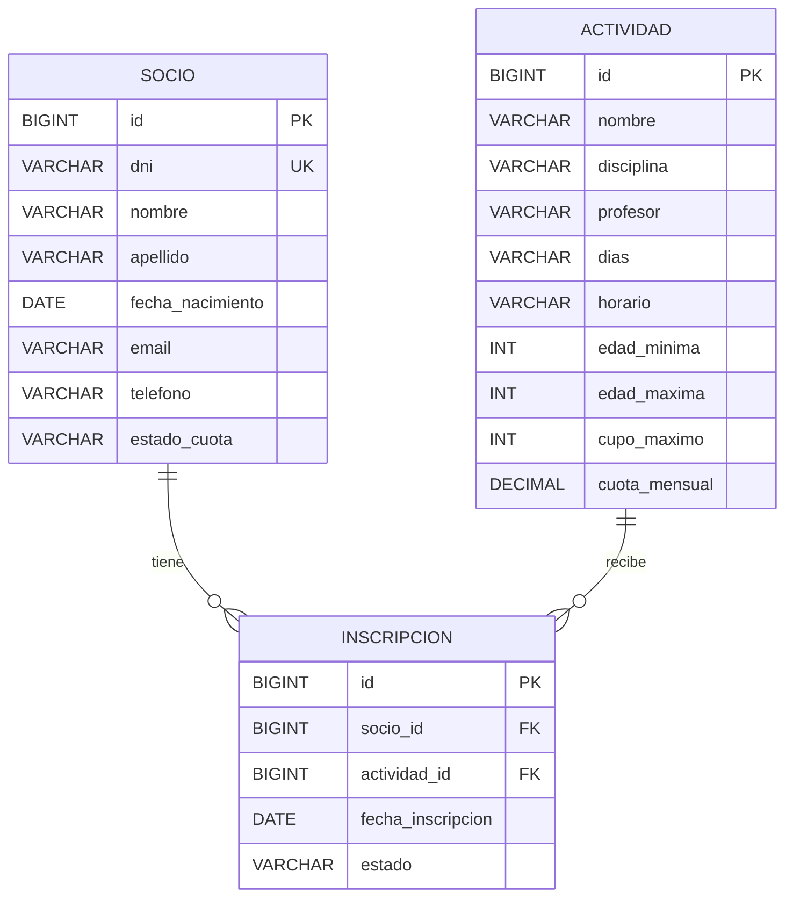

# Guía de defensa técnica — modelo y persistencia

> Cierre actualizado: el usuario confirmó la carga manual mediante SQL convencional y el ensayo correcto desde Secretaría en testing:8081. Los procedimientos/delimitadores fallidos se conservan al final como historial, NO como instrucciones vigentes. HTTP 409/codigo, idempotencia, conservación exacta, cupos finales y Postman siguen pendientes de evidencia específica. No repetir MySQL/verify que exige testing vacío: ahora contiene el fixture.
> Actualización vigente — 2026-11-08: el usuario confirmó respaldos independientes mediante mysqldump, migración manual de socioclub_test, Maven verify con 128 aprobadas/0 fallos/0 errores/0 omitidas y migración posterior autorizada de socioclub mediante Workbench. Codex corroboró los diez XML, sin ejecutar Maven ni SQL. No hay evidencia de restauración de prueba. Auditoría detallada de datos de desarrollo, arranque/HTTP posteriores y recorrido manual de baja siguen pendientes. Procedimiento vigente: [validacion-manual-baja-socios.md](validacion-manual-baja-socios.md). No volver a ejecutar la migración para seguir ese procedimiento.

## Antecedentes previos a esta confirmación

Las referencias siguientes a migración no ejecutada/no autorizada y a 111 aprobadas/17 omitidas describen el estado anterior. Se conservan como historial, no como estado vigente. La confirmación actual y sus límites están registrados al final de este documento.

Actualización vigente: baja lógica de socios preparada por aprobación del usuario; ejecución de migraciones NO autorizada en ninguna base. Verify actual sin MySQL: 111 aprobadas, 0 fallos/errores, 17 omitidas. Código nuevo requiere migrar el catálogo antes de usar JPA. Script completo en database/migrations/001_estado_socio.sql y efectos/instrucciones en baja-logica-socios.md. Sin commit/push/merge.

Etapa REST actual: nueve endpoints del Anexo A comprobado en el PDF original, DTOs JSON y servicios compartidos con MVC. Verify: 95 aprobadas, 0 fallos/errores, 14 MySQL omitidas. Ver [API REST](api-rest.md) para contrato, pruebas y seguridad; no se afirma ejecución de Postman o integración Axios.

Etapa MVC: los reportes actuales acreditan 71 aprobadas sin fallos/errores/omisiones; Codex repitió las 58 pruebas sin MySQL con éxito. El resultado inicial 58/13 se conserva como histórico. No confundir con las 36 aprobadas de la etapa anterior del servicio. Rutas, recorrido y preguntas específicas en [modulo-mvc.md](modulo-mvc.md). Las pruebas MySQL nuevas figuran aprobadas en los reportes; falta confirmar verify completo y la revisión visual del navegador.

Etapa actual: capa Service RN1–RN5 implementada en feature/backend-reglas-negocio. La explicación completa, transacciones, excepciones, matriz de pruebas y comandos están en [reglas de negocio](reglas-negocio.md). Verify final de esta etapa: 36 aprobadas, 0 fallos, 0 errores y 0 omitidas; el usuario ejecutó y Codex inspeccionó los XML. El cierre de 13 aprobadas mencionado abajo corresponde a la etapa anterior integrada por PR #3, no a una validación autenticada del servicio nuevo.

Estado final 2026-11-08: los reportes Surefire locales acreditan 13 pruebas aprobadas (5 de integridad, 7 de persistencia MySQL y 1 MVC), 0 fallidas, 0 errores y 0 omitidas. El usuario confirmó Maven verify con BUILD SUCCESS y arranque completo contra socioclub: MySQL 8.4.13, EntityManagerFactory inicializado, Tomcat 8080 y Started SocioClubApplication. Codex revisó los reportes; no ejecutó el arranque con credenciales ni verificó HTTP GET /. Ver [instalación en otra computadora](instalacion-desde-cero.md).

Alcance de esta intervención (2026-11-07): entidades, repositorios, esquema y datos preparados. No hay servicios de inscripción ni API REST implementados. Las pruebas MySQL requieren un servidor operativo; no confundir preparación con ejecución.

## Conceptos con ejemplos del proyecto

1. **JPA** es la especificación de Java para persistir objetos y definir sus relaciones mediante anotaciones. Usamos `jakarta.persistence`. Hibernate es la implementación que incorpora Spring Data JPA.
2. Un **ORM** relaciona objetos con filas de tablas. Hibernate transforma, por ejemplo, un `Socio` en una fila de `socio`; evita escribir manualmente cada INSERT y SELECT.
3. Una **entidad** es una clase persistente con identidad. `@Entity` marca `Socio`, `Actividad` e `Inscripcion`; `@Table` fija nombres SQL. El constructor vacío permite que JPA reconstruya objetos.
4. Una **clave primaria** identifica una fila. `Long id`, `@Id` y `@GeneratedValue(IDENTITY)` corresponden a `BIGINT AUTO_INCREMENT`. El DNI tiene unicidad propia; no se usa como clave primaria porque no debe condicionar todas las relaciones.
5. Una **clave foránea** exige que el registro relacionado exista. `inscripcion.socio_id` referencia `socio.id` y `actividad_id` referencia `actividad.id`. MySQL rechaza referencias inexistentes.
6. Un socio y una actividad tienen muchas inscripciones. Cada inscripción tiene un socio y una actividad. El vínculo es una entidad porque tiene fecha y estado propios; un `@ManyToMany` simple no expresaría bien esos datos e historial.
7. **JpaRepository** aporta `save`, `findById`, `findAll`, `count` y otros métodos. Spring crea el objeto que implementa nuestras interfaces; no escribimos una clase de implementación.
8. Una **consulta derivada** se interpreta desde el nombre del método: `findByDni` busca el atributo `dni`, y `findByApellidoContainingIgnoreCase` busca una parte del apellido sin distinguir mayúsculas. `findByDisciplina` filtra el catálogo.
9. **@Query** permite expresar una consulta que queremos escribir explícitamente. `InscripcionRepository.contarActivasDeActividad` utiliza JPQL con `Inscripcion`, `actividad.id` y `EstadoInscripcion.ACTIVA`: son nombres Java, no nombres de columnas SQL.
10. **Pageable** indica número de página, tamaño y orden. `PageRequest.of(0, 10, Sort.by("apellido").and(Sort.by("id")))` pide la primera página con un orden estable. `Page` devuelve contenido y cantidad total; el listado de socios utilizará el método heredado `findAll(pageable)` o la búsqueda paginada por apellido.
11. Un **DTO** representará solo los datos necesarios en JSON. Serializar `Socio.inscripciones[*].socio.inscripciones...` podría recorrer un ciclo infinito y además acceder a relaciones diferidas fuera de una transacción. Los futuros servicios convertirán a DTO dentro de la transacción. No se crearon DTOs vacíos ni se afirma haber reproducido un error de serialización.
12. Una operación futura viajará así: controlador MVC/REST → servicio compartido con transacción y reglas → repositorio → Hibernate/JDBC → MySQL → resultado → DTO/vista. Actualmente están implementados el modelo y los repositorios; ese recorrido de negocio aún no está disponible.

## Relaciones reales del código



`Inscripcion.socio` y `Inscripcion.actividad` son los lados propietarios: sus `@JoinColumn` contienen las claves foráneas. En los otros dos lados, `mappedBy = "socio"` y `mappedBy = "actividad"` señalan atributos Java de Inscripcion. No crean tablas intermedias.

Las colecciones están inicializadas, son inversas y no tienen cascadas de borrado ni `orphanRemoval`. Para persistir un vínculo se asignan ambos padres en Inscripcion y se guarda esta entidad. Si se necesita recorrer ambos lados antes de recargar, el servicio deberá mantener también las listas en memoria; agregar solo a una lista inversa no guarda una inscripción. Los `ManyToOne` son LAZY para no cargar padres innecesariamente.

No existe UNIQUE absoluto sobre socio y actividad. Un vínculo BAJA y otro ACTIVA deben poder coexistir, incluso varias bajas históricas. Tampoco se implementó RN2 mediante un índice condicionado: el servicio futuro deberá decidir la política transaccional y de concurrencia junto con RN1/RN5.

## Tipos e integridad

- `LocalDate` representa fechas sin hora; `DATE` guarda nacimiento e inscripción.
- `BigDecimal` y `DECIMAL(10,2)` conservan importes decimales. Evitar `new BigDecimal(0.1)`; usar `new BigDecimal("0.10")`.
- `horario` es String y VARCHAR(5), compatible con el dato existente `9:00` de Yoga; se admiten H:mm y HH:mm.
- Los estados se guardan por su nombre con `EnumType.STRING`; reordenar las constantes no cambia el significado de lo almacenado. `JdbcTypeCode(VARCHAR)` explicita el mismo tipo del SQL, evitando depender del ENUM nativo del dialecto.
- Bean Validation comprueba campos obligatorios, tamaños, email, DNI, fechas, montos, cupo positivo y orden del rango de edades. No decide si un socio concreto puede inscribirse.
- SQL añade NOT NULL, DNI único, claves foráneas y CHECK de estados, horario y límites numéricos. Las validaciones de email y fechas relativas a hoy permanecen en Java. Hibernate `validate` revisa el mapeo de tablas y columnas, pero no reemplaza las pruebas de índices, CHECK ni datos.
- No se almacena cupoDisponible: será cupoMaximo menos las ACTIVAS consultadas. No se escribieron las reglas ni ese servicio.
- `ddl-auto=validate` no crea ni elimina tablas; el administrador ejecuta el esquema previamente. `spring.sql.init.mode=never` evita cargas automáticas al arrancar.

## Consultas disponibles

```java
// Ejemplo para la futura capa de servicio; todavía no hay un endpoint que lo ejecute.
var pagina = socioRepository.findByApellidoContainingIgnoreCase(
        "pé", PageRequest.of(0, 10, Sort.by("apellido").and(Sort.by("id"))));
var socio = socioRepository.findByDni("30111222"); // Optional<Socio>
long ocupadas = inscripcionRepository.contarActivasDeActividad(actividadId);
boolean duplicada = inscripcionRepository.existsBySocioIdAndActividadIdAndEstado(
        socioId, actividadId, EstadoInscripcion.ACTIVA);
```

`findBySocioIdAndEstado` y `findByActividadIdAndEstado` reciben Pageable; pasar ACTIVA para vigentes, BAJA para historial. `countBySocioIdAndEstado(socioId, ACTIVA)` apoya el futuro máximo de actividades. Estos métodos consultan; no rechazan una inscripción ni garantizan exclusión mutua entre dos peticiones simultáneas.

## Preguntas que pueden hacer

| Pregunta | Respuesta que puede explicar el equipo |
| --- | --- |
| ¿Dónde se valida que no quede cupo? | En el futuro servicio compartido; el repositorio ya cuenta ACTIVAS, pero todavía no implementamos RN1. |
| ¿Por qué no una tabla socio_actividad sin entidad? | Porque la inscripción tiene fecha, estado e historial propios. |
| ¿Qué significa mappedBy? | Indica qué atributo del otro objeto es dueño de la relación y de la clave foránea. |
| ¿Por qué hay un ID y además DNI único? | El ID relaciona registros; el DNI es una restricción del dato del socio. |
| ¿Borrar de la lista elimina una inscripción? | No: la lista es inversa y no tiene borrado en cascada. Las bajas futuras cambiarán el estado y preservarán la fila. |
| ¿Por qué no UNIQUE(socio_id, actividad_id)? | Impediría reinscribirse después de una baja y conservar el historial. |
| ¿existsBy impide duplicados concurrentes? | No. Dos solicitudes pueden consultar antes de guardar. Debemos resolverlo con transacciones y una política de bloqueo en la etapa de servicios. |
| ¿Cómo excluyen las bajas del cupo? | La @Query filtra expresamente EstadoInscripcion.ACTIVA. |
| ¿Pageable comienza en 1? | No: la primera página es 0. Conviene ordenar también por ID para desempatar. |
| ¿Por qué DTO y no devolver la entidad? | Para elegir campos, evitar ciclos y controlar cuándo se accede a relaciones LAZY. |
| ¿Por qué BigDecimal y no double? | Para conservar cantidades decimales monetarias sin aproximaciones binarias. |
| ¿Las pruebas verdes demuestran MySQL? | Solo las pruebas optativas conectadas lo demuestran; integridad en memoria y MVC no prueban persistencia. |
| ¿Qué pasa al ejecutar dos veces seed.sql? | El script agrega solo registros ausentes. No actualiza socios existentes ni reactiva vínculos; el test MySQL de seed repetible aprobó y conserva ediciones y bajas. |
| ¿Por qué el seed tiene más de quince socios? | Yoga necesita catorce personas habilitadas además de los seis escenarios, que incluyen menores y candidatos que deben comenzar sin Yoga. |
| ¿El modelo garantiza todas las reglas? | No. Garantiza integridad básica; RN1–RN5 y la concurrencia se implementarán una vez en servicios. |

Para demostrar resultados, usar [validación de esta etapa](validacion-modelo-datos.md). Para configurar la conexión, seguir [MySQL local](mysql-local.md). Practicar identificando en el código cada anotación y explicando el vínculo entre columna, atributo y consulta.

## Conexión real, scripts y pruebas aisladas

Actualización de preparación: el esquema de desarrollo y ensayo se crea manualmente con una cuenta administradora. La suite ahora desactiva toda inicialización SQL automática y mantiene Hibernate validate. La cuenta socioclub_tests conserva únicamente SELECT/INSERT/UPDATE/DELETE. Antes de cada test se comprueba que la base efectiva sea socioclub_test; los datos de ensayo se revierten con rollback. No se ejecuta seed manualmente en ensayo porque el test de reproducibilidad necesita tablas vacías.

Los scripts compartidos no contienen USE: la base se selecciona en la conexión o temporalmente en el editor de Workbench. El test rechaza USE dentro del seed antes de cargarlo. Esta precaución evita cambiar accidentalmente de ensayo a desarrollo durante una ejecución.

**¿Cómo se conecta Spring Boot a MySQL?** application.properties toma DB_URL, DB_USERNAME y DB_PASSWORD del entorno. La URL JDBC indica servidor, puerto y base, por ejemplo jdbc:mysql://localhost:3306/socioclub. El pool entrega conexiones al driver MySQL Connector/J y Hibernate usa esas conexiones para ejecutar SQL. El servicio Windows debe estar iniciado, la base debe existir y el usuario debe tener permisos. Tener mysql.exe instalado no demuestra que el servidor esté disponible.

**¿Qué hace ddl-auto=validate?** Al arrancar, Hibernate contrasta sus mapeos con las tablas y columnas de la base. Si faltan o tienen tipos incompatibles, el arranque falla. No crea, actualiza ni elimina tablas. No sustituye comprobar claves, índices, CHECK, datos o consultas; por eso hay pruebas reales adicionales.

**¿En qué se diferencian schema.sql y seed.sql?** schema.sql define tablas, columnas, PK, FK, índices y restricciones. seed.sql agrega las ocho actividades y personas/vínculos ficticios de la demostración. Se ejecuta primero schema y después seed sobre desarrollo. El schema no migra tablas antiguas; el seed conserva registros existentes en vez de sobrescribirlos.

**¿Cómo comprobamos que JPA persiste?** Guardamos y hacemos flush, vaciamos el contexto con EntityManager.clear() y recuperamos mediante findById. Así evitamos comprobar solamente el objeto que seguía en memoria. PersistenciaMySqlTests también lee columnas por JDBC, verifica fechas/montos/estados, navega las relaciones y ejecuta consultas de ACTIVAS. Esas comprobaciones solo acreditan MySQL cuando la suite se ejecuta y aprueba contra un servidor real; hasta entonces están preparadas.

**¿Por qué otra base para testing?** Las pruebas crean datos, provocan violaciones de integridad y ensayan bajas y ediciones. socioclub_test separa eso de socioclub. Se exige ese nombre en la URL y se comprueba SELECT DATABASE(); una cuenta restringida únicamente a ensayo refuerza el aislamiento. Los datos de cada test se revierten con rollback. Las tablas DDL y el avance de AUTO_INCREMENT pueden permanecer: no se debe usar una base con datos personales o trabajo de desarrollo.

**¿Una conexión fallida aparece como prueba omitida?** Con MYSQL_TEST_DB_URL configurada, la suite se activa aunque falte MYSQL_TEST_ENABLED. Una conexión rechazada produce errores y Maven falla. Sin configuración de ensayo, los tests se omiten con una razón expresa. En la revisión se ejecutaron controles negativos para comprobar esa diferencia; ninguno representa persistencia aprobada.

## Problemas reales encontrados y cómo los resolvimos

- Autenticación de pruebas: MySQL devolvió 1045/28000 para socioclub_tests. El usuario corrigió las claves locales. Codex diagnosticó el log y además exigió credenciales exclusivas de ensayo en el test; ese cambio evita heredar desarrollo, pero no arregla una contraseña incorrecta.
- Siete errores de contexto: el fallo de dialecto y el umbral de ApplicationContext eran consecuencias del rechazo de conexión. Buscamos la primera causa en Surefire, en vez de agregar un dialecto para esconderla. El verify final y los XML acreditan 13 pruebas aprobadas.
- CHECK y excepciones: MySQL rechazó cuota -1 con 3819/HY000 y ck_actividad_cuota. La base funcionaba, pero el test esperaba DataIntegrityViolationException y Spring devolvió UncategorizedSQLException. Codex corrigió las aserciones para exigir causa SQL, código, SQLSTATE y CHECK específico, conservando monto y estado inválidos. El usuario validó el resultado con Maven.
- Variables de PowerShell: viven en una terminal y sus procesos hijos. El usuario propuso .env para facilitar el trabajo entre equipos; Codex programó la plantilla y load-env.ps1. El usuario completó sus claves y probó. No se deben confundir propuesta humana, programación automática y validación humana.
- Arranque de desarrollo: verify usa socioclub_tests, mientras la aplicación usa socioclub_app. Esta última cuenta también devolvió 1045; tras corregir las claves locales, el usuario confirmó arranque completo conectado a socioclub. No hubo que modificar tablas.

Para explicarlo al profesor: Hibernate transforma entidades en operaciones SQL; ddl-auto=validate comprueba compatibilidad sin crear tablas. Los tests trabajan únicamente sobre socioclub_test con rollback y una comprobación del catálogo. .env guarda configuración local fuera de Git; el script la carga en el proceso PowerShell sin ejecutar su contenido ni mostrar claves. .env.example permite reproducir la configuración con claves propias en otra computadora.

Evidencia y autoría: [seis incidentes detallados](bitacora-ia.md#cierre-de-incidentes-y-supervisión-humana--2026-11-08), [resultados finales](validacion-modelo-datos.md) y [registro humano](registro-trabajo.md). Los cambios actuales aún no tienen commit; se comparan con 5217d1c5e301bd129719d829255c149255e9a5d4. La confirmación ampliada permite registrar AH-1, AH-2 y AH-3 como ajustes humanos de configuración, operación y diseño; no demuestra tres correcciones manuales de código fuente. Ver Cómo defender los tres ajustes humanos. La implementación Java/PowerShell fue de Codex. Confirmar HTTP GET / sigue pendiente antes de afirmar validación web completa.

## Cómo defender los tres ajustes humanos

La confirmación ampliada del usuario permite identificar tres ajustes en configuración, operación y diseño. Esta clasificación sustituye la frase anterior sobre no identificar tres ajustes generales; permanece la diferencia con tres correcciones manuales del código generado por IA. Ver la [tabla de trazabilidad](bitacora-ia.md#trazabilidad-de-tres-ajustes-humanos--confirmación-ampliada-del-2026-11-08).

**AH-1 — Configuración de testing.** «Cuando MySQL rechazó socioclub_tests con error 1045, revisé la cuenta en Workbench, restablecí su contraseña y comprobé la conexión con el cliente MySQL. Luego pudimos ejecutar las pruebas. Codex interpretó el error y agregó una protección para no heredar credenciales de desarrollo; ese código lo generó Codex. La suite final acredita siete pruebas aprobadas». La primera corrida tras resolver autenticación tuvo todavía un fallo de aserción CHECK, corregido por Codex; no afirmar que cambiar la contraseña resolvió ese otro problema.

**AH-2 — Corrección operativa de desarrollo.** «Los tests usaban otra cuenta. Al iniciar Spring Boot apareció 1045 para socioclub_app; revisé y corregí sus credenciales locales. Comprobé el arranque: conexión a socioclub, JPA inicializado y Tomcat en 8080». Evidencia: log del fallo y confirmación humana del arranque. No presentar una respuesta HTTP como verificada ni afirmar una modificación de Java para arreglar la contraseña.

**AH-3 — Decisión de diseño del entorno.** «Propuse conservar la configuración en un .env local, con una plantilla pública y un cargador, porque las variables se perdían al cerrar la terminal. Definí que no se versionaran claves y se mantuvieran separadas las dos bases. Codex programó el script y yo completé la configuración local». Evidencia: petición humana, archivos implementados, carga exitosa en el log y comprobaciones automáticas del parser con datos ficticios y de Git. No afirmar que el equipo escribió el script ni que se probó ya toda la migración en otra computadora.

**Riesgo académico.** Se pueden defender como tres ajustes humanos distintos por su objetivo y naturaleza. Si la rúbrica pide tres modificaciones manuales del código generado, estos casos no demuestran ese requisito. También puede agrupar los dos problemas de contraseñas o no contar una propuesta de diseño. Para las próximas etapas, aprovechar defectos reales detectados al revisar reglas, consultas o transacciones: un integrante debe realizar personalmente la corrección, explicar el cambio y guardar prueba antes/después y commit. No son ajustes ya realizados ni se fabricarán errores o autorías.

## Confirmación final de la página MVC — 2026-11-08

El usuario confirmó HTTP GET / con respuesta 200. Junto al arranque completo comunicado y las 13 pruebas aprobadas en los XML, completa la validación de esta etapa. La petición HTTP fue una comprobación humana, no una ejecución de Codex. Los pendientes HTTP mencionados anteriormente quedan cerrados. Antes de merge corresponde revisar el PR; RN1–RN5 y API quedan para una etapa posterior. Se mantienen las limitaciones académicas documentadas.

## Defensa de InscripcionService y RN1–RN5 — 2026-11-08

El servicio reúne las decisiones de inscripción que compartirán MVC y REST. inscribir recibe IDs, comprueba existencia, valida morosidad/edad/duplicado/máximo/cupo y crea una ACTIVA con fecha del reloj. validarSocio y validarInscripciones separan responsabilidades. No se implementaron nuevos controladores ni lógica de negocio en vistas.

RN1 cuenta solo ACTIVAS y acepta el último lugar; RN2 permite historial BAJA pero no otra ACTIVA; RN3 usa años completos entre mínimo y máximo inclusive, confirmado por el usuario; RN4 rechaza MOROSO; RN5 permite hasta tres ACTIVAS. Las excepciones distinguen referencias inexistentes de rechazos por regla y tienen códigos estables. El orden de validación informa el primer motivo de rechazo.

Preguntas para responder:

- ¿Por qué transacción y bloqueos? Dos solicitudes podrían contar el mismo cupo; PESSIMISTIC_WRITE de actividad serializa. Bloquear antes el socio también protege la tercera actividad y el duplicado. El orden fijo socio/actividad reduce ciclos de espera.
- ¿Qué aporta READ_COMMITTED? Los conteos ven lo confirmado por quien liberó el bloqueo, sin conservar una vista de lectura antigua. Todas las altas deben pasar por el bean Spring del servicio.
- ¿Cómo probamos edad? Clock fijo y Period, con casos antes/durante/después del cumpleaños, máximo inclusivo y 29/02. No se divide por 365.
- ¿Qué pasa con BAJA? No se reactiva: se guarda una inscripción nueva y solo se cuentan ACTIVAS.
- ¿Los 19 mocks acreditan concurrencia? No. Las cuatro nuevas pruebas MySQL compilaron pero siguen omitidas; deben ejecutarse con socioclub_test antes de afirmar esa validación.
- ¿Por qué esas pruebas MySQL no usan rollback global? Dos conexiones deben ver fixtures confirmadas. Al finalizar se retiran solamente sus IDs, nunca se vacía una base preexistente; se exige socioclub_test vacía y sin escritores ajenos.

Decisiones humanas nuevas: aplicar rango completo RN3 y continuar con mensajes de la consigna. Implementación de Java/tests por Codex; no se registra una edición humana de código que no ocurrió. Oportunidades reales de revisión: convención del 29/02, precedencia de errores y protocolo de bloqueos. Si un integrante cambia algo justificadamente, registrar diff, motivo y prueba; no generar errores artificiales. Detalle y comandos en reglas-negocio.md.

## Cierre validado de InscripcionService — 2026-11-08

Resultado vigente que sustituye el pendiente MySQL de la implementación inicial: 36 pruebas aprobadas, 0 fallos, 0 errores y 0 omitidas en XML Surefire inspeccionados por Codex. Desglose: 19 unitarias de servicio, 5 integridad, 1 MVC, 7 persistencia y 4 integración de servicio. El usuario confirmó ejecutar MySQL y verify con BUILD SUCCESS; Codex no abrió .env ni repitió esa ejecución. Las cuatro nuevas pruebas acreditan sus escenarios de BAJA y carreras por cupo/duplicado/tercera actividad.

La revisión no detectó impedimentos técnicos para presentar el PR: reglas en servicio, edad inclusiva calculada con Period y Clock, errores identificables y transacción READ_COMMITTED con orden de bloqueos socio/actividad. La garantía se limita a escritores que usan ese protocolo y al bean Spring sin transacción externa incompatible. No equivale a probar todas las situaciones concurrentes posibles ni elimina errores de bloqueo. Los futuros controladores reutilizarán el servicio; no se implementan aquí.

No hubo ajustes manuales de código confirmados en este cierre. El usuario validó las pruebas y autorizó auditoría/publicación; implementación y actualización documental de Codex. AH-1/AH-2/AH-3 conservan sus límites académicos. PR para revisión, sin merge.

## Defensa del módulo MVC — 2026-11-08

El recorrido es formulario HTML → Controller con @Valid y BindingResult → Service transaccional → Repository → Hibernate/JDBC → MySQL. El controlador no conoce repositorios ni repite RN1–RN5. Formularios y vistas planas limitan campos enlazables y evitan proxies/relaciones circulares. El alta reutiliza InscripcionService; el servicio nuevo darDeBaja cambia solo estado, mantiene fecha y vínculo, permite MOROSO y conserva el orden de bloqueos socio→actividad.

Un POST exitoso redirige al listado y lleva mensaje flash; una entrada inválida conserva formulario/opciones y muestra errores sin ejecutar el alta. Mensajes de validación y conversión están en español. Las consultas se paginan, las vistas vacías se explican y el panel mantiene GET / además de /secretaria. ActividadService bloquea la actividad al editar/eliminar: no permite reducir cupo por debajo de activas ni eliminar con inscripciones o historial. La FK no se modifica.

Pruebas actuales: 23 MVC nuevas, 10 unitarias administrativas, 19 unitarias previas, 5 integridad y 1 GET / aprobadas: 58; 13 MySQL omitidas (7 persistencia y 6 integración de servicio, dos de ellas nuevas). Verify BUILD SUCCESS y JAR generado. No se afirma una prueba visual ni SQL autenticado del módulo. MockMvc prueba renderizado, binding, códigos RN, redirecciones, estados y ausencia de SQL en errores públicos; no sustituye MySQL.

Dos puntos para revisión humana concreta: InscripcionService.darDeBaja (idempotencia, MOROSO y orden de bloqueos) y ActividadService.guardar/eliminar (cupo e historial frente a la consigna/FK). Si alguien modifica código, registrar motivo, diff y resultado antes/después. No ocurrió una edición manual humana durante esta implementación; el código y sus correcciones fueron de Codex. Preguntas y recorrido de navegador en modulo-mvc.md. No hay autenticación/CSRF específica; no se presenta como módulo público listo para producción.

## Cierre individual y seguridad real del MVC — 2026-11-08

El nuevo flujo acordado por el usuario conserva ramas feature/* y dev y elimina el PR obligatorio. La integración directa sigue condicionada a pruebas, auditoría y confirmación de verify; conflictos se informan antes de resolverlos. Los reportes disponibles acreditan 71 aprobadas y 0 fallos/errores/omisiones; el 58/13 anterior es histórico. No hay confirmación nueva del recorrido visual en navegador.

Para la defensa: @Controller, Bean Validation y PRG no son mecanismos de autenticación ni de CSRF. El proyecto no incluye Spring Security ni un mecanismo propio de tokens CSRF o control de acceso. Las rutas POST aceptan operaciones sin token. La configuración CORS para /api/** no protege formularios de Secretaría. El módulo es local/académico y necesita autenticación/autorización y protección CSRF antes de exposición pública. Esta limitación se documenta, no se presenta como implementada ni se cambia código de seguridad sin otra etapa.

La confirmación de pruebas no es una edición humana de código. AH-1/AH-2/AH-3 conservan sus límites; la revisión manual propuesta de baja y actividad continúa sin atribuirse como realizada.

## Confirmación de verify e integración autorizada — 2026-11-08

El usuario confirmó BUILD SUCCESS de Maven verify después de la auditoría. Codex volvió a inspeccionar los siete XML: 71 aprobadas, 0 fallos, 0 errores y 0 omitidas. Esto cierra la espera de confirmación de verify de las secciones anteriores. La ejecución autenticada fue del usuario; no se atribuye a Codex ni implica una revisión visual del navegador no comunicada.

Se continúa con el flujo individual autorizado: commit y push en feature/backend-mvc-thymeleaf, sincronización de dev, merge commit sin forzar y validación pertinente del árbol integrado antes de publicar origin/dev. Los hashes y resultados reales se informarán al completar cada operación; no se anticipa éxito en este registro. main queda fuera de alcance y la feature se conserva. No hay PR obligatorio.

Sin nuevas ediciones manuales de código confirmadas; AH-1/AH-2/AH-3 mantienen su alcance académico. Continúan los límites de seguridad: no hay autenticación/autorización ni protección CSRF implementada; el módulo no está preparado para exposición pública. La comprobación visual completa sigue pendiente. No se agregan funcionalidades ni se alteran bases o frontends.

## Defensa de la API REST — 2026-11-08

El Anexo A original (página 13) exige nueve endpoints: listado/detalle/alta/edición/eliminación de actividades, socio por DNI, ACTIVAS por socio, inscripción y baja por PUT. No se implementa CRUD de socios por suposición. Las respuestas de actividades incluyen cupoDisponible y las inscripciones llevan actividad anidada para React.

ApiController solo adapta HTTP. ApiConsultaService coordina transacciones/mapeo y delega escrituras a ActividadService e InscripcionService. Los DTOs de entrada reutilizan las restricciones de los formularios existentes; los de salida son records explícitos sin referencias inversas JPA. No se reproduce un ciclo para inventar un incidente: se evita serializar las entidades. RN1–RN5 y los bloqueos no se duplican.

GET/PUT devuelven 200, POST 201, DELETE de actividad 204 vacío, entrada inválida 400, ausencia 404 y conflicto de negocio 409 con error/regla/detalles. No se compara el texto del error para identificar RN. El advice JSON está limitado al controlador API y no reemplaza los errores HTML. SocioResponse omite contacto; la búsqueda por DNI no autentica identidad.

CORS usa únicamente los orígenes locales configurados y no se habilita *. No hay autenticación/autorización ni protección CSRF específica y no se desactivó protección alguna. Demostración local, sin exposición pública hasta incorporar seguridad.

Pruebas reales: 30 REST y 7 unitarias de fachada nuevas aprobadas; verify completo 95 aprobadas, 0 fallos, 0 errores y 14 MySQL omitidas. Las 24 MVC anteriores (23 Secretaría y 1 raíz) siguen aprobadas. Una prueba nueva MySQL del flujo de servicios API solo compiló; no se ejecutó autenticada. Postman tiene 18 requests y JSON válido, pero no fue ejecutado. React se revisó en lectura y permanece sin cambios.

Revisión humana propuesta: selección de campos personales de SocioResponse y contrato de error para Axios; política de eliminación con historial. Son oportunidades, no ajustes manuales ya realizados. AH-1/AH-2/AH-3 mantienen sus límites. Explicaciones y comandos en api-rest.md.

## Propuesta humana de baja de socios — 2026-11-08

El usuario confirmó manualmente que GET /api/actividades devuelve JSON y propuso incorporar baja lógica de socios al detectar que solo existía baja de inscripciones. Es una decisión funcional humana de mejora voluntaria: RF5 de la consigna exige alta/modificación/listado de socios y RF9 baja de inscripción; el Anexo A no exige baja del socio. Codex realizó el análisis, no una implementación aprobada de esta mejora.

Socio solo posee estadoCuota (AL_DIA/MOROSO). Para ACTIVO/INACTIVO se necesita una columna y enum separados. Se detiene la implementación dependiente por instrucción expresa del usuario; no se modifican entidades, esquema, seed, servicios, controladores o tests para la nueva baja. Diseño, SQL de migración conservadora, transacción, alternativas PUT/PATCH, impacto y pruebas propuestas en propuesta-baja-socios.md. No hay migración ejecutada ni endpoint nuevo disponible.

Los XML disponibles en esta auditoría acreditan 109 aprobadas, 0 fallos, 0 errores y 0 omitidas, incluidas las 14 MySQL. No son una ejecución autenticada nueva de Codex ni acreditan la funcionalidad propuesta. El verify anterior de Codex fue 95 aprobadas/14 omitidas. No se infiere el éxito del goal verify actual solo de los XML. Postman conserva nueve endpoints y 18 requests, sin runner confirmado. Se mantiene ausencia de autenticación/CSRF y uso local. AH-1/AH-2/AH-3 siguen con sus límites; propuesta funcional no se registra como edición manual de código.

Pendiente de aprobación: EstadoSocio y migración aditiva en socioclub/socioclub_test; baja atómica de ACTIVAS con INACTIVO; PUT idempotente y confirmación POST en MVC; rechazo 409 con código SOCIO_INACTIVO independiente de RN1–RN5. No se hace commit, push o merge ni se considera esta mejora lista para integrar.

## Baja lógica de socios aprobada y preparada — 2026-11-08

El usuario aprobó la mejora voluntaria que propuso al revisar la API: EstadoSocio ACTIVO/INACTIVO separado de cuota, baja automática atómica de ACTIVAS, rechazo de nuevas altas, PUT idempotente y confirmación MVC. Autorizó código, pruebas y scripts, pero NO ejecutar migraciones en socioclub ni socioclub_test. Codex implementó; no se atribuye al usuario programación manual y AH-1/AH-2/AH-3 conservan sus límites.

Implementación actual: SocioService bloquea socio y actividades distintas por ID, cambia solo ACTIVAS a BAJA e INACTIVO en una transacción READ_COMMITTED; conserva fechas/vínculos/cuota e historial. Edición general no reactiva; selector de nuevas altas excluye INACTIVOS. API agrega PUT /api/socios/{id}/baja, estadoSocio y codigo SOCIO_INACTIVO independiente de RN1–RN5. MVC agrega confirmación GET sin mutación y POST/PRG. React no se modifica y deberá tratar el campo/código nuevo al integrarse.

Evidencia nueva: verify offline con MySQL explícitamente desactivado, BUILD SUCCESS y JAR, 128 casos: 111 aprobadas, 0 fallos, 0 errores y 17 omitidas. Las pruebas MySQL nuevas de historial/liberación, rollback real y concurrencia, junto con el seed ampliado, solo compilaron. No se ejecutó SQL, backup, migración ni backend JPA contra las bases actuales. Los 109 aprobados previos no acreditan el modelo con estadoSocio.

Script completo preparado: database/migrations/001_estado_socio.sql. schema.sql actualizado solo para instalaciones nuevas; seed omite el campo y conserva registros existentes. Las bases actuales necesitan migración autorizada antes de usar el código nuevo con ddl-auto=validate. No ejecutar MySQL/Postman ni arrancar JPA antes de ese paso. Postman tiene 22 requests y diez endpoints (nueve obligatorios + mejora), JSON válido sin runner ejecutado.

Diseño, efectos, guardas SQL, respaldo, repetición e instrucciones controladas en baja-logica-socios.md; propuesta anterior conservada como histórica. Pendiente revisar script y aprobar explícitamente su ejecución por catálogo, luego validar ensayo y desarrollo. Sin autenticación/autorización/CSRF: sigue siendo demostración local. No está listo para integrar hasta validar el esquema y la suite autenticada. Sin commit, push o merge.

## Defensa del plan de migración — 2026-11-08

Plan operativo vigente: [plan-migracion-estado-socio.md](plan-migracion-estado-socio.md). Estado: auditado estáticamente y preparado, no ejecutado. No se generó ni restauró un respaldo y no se abrieron conexiones SQL durante esta revisión.

Para explicar al profesor: «Agregamos una columna de vigencia, independiente de la deuda, sin borrar socios ni inscripciones. Primero respaldamos estructura y datos y comprobamos una recuperación aislada; luego migramos testing y ejecutamos las pruebas reales. Solo si aprueban y se autoriza, repetimos en desarrollo». La conservación de historia fue propuesta y aprobada por el usuario; el código y el SQL fueron escritos por Codex.

Problema real detectado en revisión: el CHECK original comparaba usando una collation que podía considerar iguales ACTIVO y activo, aunque el enum Java necesita el nombre exacto. Codex preparó comparación binaria en el script y schema.sql y aserciones SQL para valores no canónicos, pendientes de MySQL. También exigió declarar el catálogo esperado en la misma conexión: una lista con ambas bases permitidas no bastaba para expresar la intención de migrar testing primero. No fueron errores observados al ejecutar la migración ni correcciones manuales humanas.

«¿Se puede deshacer con ROLLBACK?» No: ALTER tiene commits implícitos. Detenemos escritores y mantenemos respaldo recuperable; una restauración es otra operación que requiere autorización. «¿Repetir el script reactiva socios?» No, omite el ALTER si encuentra columna o CHECK; pero eso obliga a revisar su definición y no prueba por sí solo que la migración esté correcta. «¿Está validado?» Solo está revisado estáticamente; las 17 pruebas MySQL siguen omitidas y los 111 éxitos anteriores no prueban el nuevo esquema ni el CHECK endurecido.

Los respaldos y exportaciones con datos quedan fuera de Git. La prueba funcional de baja se planifica solo en testing, con datos ficticios y un proceso en puerto 8081 conectado expresamente a socioclub_test; no sobre socios de desarrollo. AH-1/AH-2/AH-3 conservan sus límites académicos y no se inventan ediciones manuales de código ni validaciones realizadas.

## Confirmación humana de migraciones y validación — 2026-11-08

La necesidad de EstadoSocio surgió de la propuesta funcional humana de dar de baja socios preservando el historial. No se podía reutilizar estadoCuota: vigencia ACTIVO/INACTIVO y deuda AL_DIA/MOROSO son independientes. Codex implementó el enum, transacción de servicio, API/MVC, scripts y pruebas; no se atribuye ese código al usuario.

Secuencia comunicada por el usuario:

1. Generó manualmente respaldos independientes de socioclub_test y socioclub mediante mysqldump antes de migrar. No se recibieron ni inspeccionaron los dumps y no consta una restauración de ensayo.
2. Aplicó y validó manualmente database/migrations/001_estado_socio.sql primero en socioclub_test.
3. Ejecutó Maven verify autenticado y confirmó BUILD SUCCESS: 128 aprobadas, 0 fallos, 0 errores, 0 omitidas.
4. Posteriormente autorizó expresamente migrar socioclub y ejecutó manualmente la migración mediante MySQL Workbench; comunicó que quedó todo en orden. No se atribuye ejecución de ninguna migración a Codex.

Codex inspeccionó los diez XML actuales de backend/target/surefire-reports: 34 ApiControllerTests, 26 SecretariaControllerTests, 5 IntegridadModeloTests, 10 InscripcionServiceMySqlTests, 7 PersistenciaMySqlTests, 7 ApiConsultaServiceTests, 20 InscripcionServiceTests, 10 SecretariaServiceTests, 8 SocioBajaServiceTests y 1 SocioClubApplicationTests: 128 aprobadas, cero fallos/errores/omisiones. Los XML corroboran resultados de pruebas, no el goal verify por sí solos: BUILD SUCCESS es confirmación humana. Codex no repitió Maven ni abrió .env o conexiones SQL en esta actualización. Los 111/17 anteriores quedan como evidencia histórica.

Pendientes independientes: ejecutar/compartir la auditoría de solo lectura de socioclub (columna/default/CHECK ENFORCED, 21 socios ACTIVO, 8 actividades, 19 inscripciones, 2 morosos y FK/relaciones conservadas); no se deducen esos números de los tests en testing. Confirmar arranque y HTTP posteriores a esta migración en desarrollo; realizar el recorrido MVC/API de baja exclusivamente en testing, puerto 8081. No consta aún prueba visual, HTTP 409/SOCIO_INACTIVO manual ni ejecución de Postman. Recuperabilidad de los respaldos no demostrada por una restauración de prueba.

Procedimiento exacto y fixtures controlados: [validacion-manual-baja-socios.md](validacion-manual-baja-socios.md). Incluye comparación de una BAJA histórica, dos ACTIVAS, confirmación GET sin mutación, POST, cupos, rechazo 409 e idempotencia. Los fixtures se crean solo después de verify en socioclub_test; no se borran ni reactivan. Si permanecen datos manuales, las suites que exigen testing vacío no deben ejecutarse sin acordar preparación segura. No usar desarrollo para pruebas que escriban.

Se mantienen los riesgos DDL: ALTER puede bloquear y genera commits implícitos; no se deshace con ROLLBACK. Haber aprobado testing no demuestra conservación de todos los campos en desarrollo: contrastar evidencia previa/posterior y respaldo. No reejecutar ni revertir migraciones automáticamente. Se conservan historial/fechas/vínculos y separación de vigencia y cuota como decisiones funcionales; la validación específica posterior sigue siendo necesaria.

Intervención humana adicional IH-MIG-01: respaldo, ejecución operativa de las dos migraciones y validación autenticada. Se vincula con AH-1 (credenciales de ensayo), AH-2 (configuración de desarrollo) y AH-3 (.env/cargador), conservando sus alcances y límites académicos. No se cuenta automáticamente como edición manual de código generado por IA ni se garantiza aceptación por la rúbrica. No consta un diff manual humano del SQL o Java. Esta actividad no reemplaza las tres intervenciones anteriores ni inventa ajustes de fuente.

La regresión automatizada cubre los nueve endpoints del Anexo A, MVC y RN1–RN5; la baja de socio es mejora adicional. Contrato React aditivo con estadoSocio independiente y codigo SOCIO_INACTIVO; integración Axios/React pendiente y sin cambios frontend. Sigue sin autenticación/autorización/CSRF; solo uso local. El cierre funcional/merge queda pendiente de las comprobaciones manuales preparadas. En esta actualización no se ejecutaron operaciones de datos, migraciones, bajas, commit, push ni merge.

## Cierre API y ensayo humano confirmado — 2026-11-08

El usuario confirmó carga del fixture mediante SQL convencional con transacción y COMMIT manual, y ensayo de baja correcto desde Secretaría con backend de testing en 127.0.0.1:8081. Se preservan como antecedentes los errores 1064 (near '' y luego near '//' en línea 127) al intentar el procedimiento. No existe evidencia suficiente para atribuir causa raíz definitiva al delimitador. La alternativa convencional funcionó según ejecución humana; Codex sustituyó database/fixtures/ensayo-baja-socio.sql para reflejarla, sin procedimientos/DDL, con guardas y decisión explícita COMMIT/ROLLBACK. Codex no ejecutó SQL ni alteró bases.

Pruebas completas válidas: 128 aprobadas, cero fallos/errores/omisiones, verify BUILD SUCCESS confirmado, ejecutado ANTES del fixture manual. Ahora socioclub_test contiene registros: NO repetir las suites que exigen vacío ni limpiar automáticamente. El ensayo correcto de Secretaría no demuestra por sí solo HTTP 409/SOCIO_INACTIVO, idempotencia, conservación exacta de filas, cupos finales o Postman; siguen pendientes de evidencia específica. La confirmación humana funcional es suficiente para continuar el cierre autorizado con estas limitaciones declaradas; no se inventa validación adicional.

Se mantienen IH-MIG-01 y AH-1–AH-3: migraciones/respaldos manuales y decisiones de configuración no equivalen automáticamente a ediciones de fuente. La alternativa SQL fue propuesta/aplicada por el usuario; el archivo versionable fue reescrito por Codex, no consta que el usuario lo editara. Sin autenticación/autorización/CSRF ni restauración de backups demostrada. Contrato y separación de capas en api-rest.md; fixture e instrucciones vigentes en validacion-manual-baja-socios.md. No es un despliegue público. Git se integra solo tras auditoría, sin PR y sin tocar main; hashes reales se registrarán después de ejecutarse.

## Defensa de la integración React con Axios

Se mantuvo el trabajo de Mateo: rutas, tarjetas, páginas, contexto, CSS y tests; Codex reemplazó la dependencia de datosLocales por servicios Axios. El cliente valida el DTO antes de renderizar, comunica errores propios sin exponer SQL y distingue una escritura exitosa con refresco fallido. RN1–RN5 son del backend; el bloqueo de botones es experiencia de usuario. RN6 utiliza las cuotas de ACTIVAS reales, calcula en centavos y aplica 0/10/15% de descuento. La baja muestra confirmación nativa y después consulta nuevamente las inscripciones; Cancelar no envía PUT.

Identificar por DNI no autentica: sessionStorage conserva solo ese identificador porque el contrato permite recuperar por DNI, mientras el DTO vive en memoria. Al recargar se vuelve a consultar y al salir se retira la clave; no hay contraseña/token ficticio ni datos completos persistidos. CORS limita orígenes, no sustituye autorización/CSRF. Pruebas actuales 58 Jest/RTL con mocks Axios, no prueba de MySQL ni navegador real. El backend previamente integrado tuvo 128 pruebas humanas y 111 de regresión segura por Codex. Documentación operativa en react-integracion-api.md. No se atribuye al usuario código generado por Codex; AH-1–AH-3/IH-MIG-01 mantienen sus límites.

## Ampliaciones propuestas: FE-ADMIN-01 y RN8 — Prompt 21

El usuario propuso administración React con autenticación/rol ADMIN y prevención de conflictos horarios como EXTRAS, sin reemplazar RF1–RF10/RN1–RN7. Auditoría/diseño/SQL revisables en [propuesta-admin-rn8.md](propuesta-admin-rn8.md). Se comprobó que dias es texto libre, horario solo contiene inicio y no existe parser/duración; tampoco hay seguridad administrativa ni CSRF. No se consultaron datos vivos ni se asumieron horas de fin.

Codex preparó 002_cuenta_administrativa.sql y 003_actividad_horario.sql, sin ejecutarlas ni agregar código de aplicación o dependencias. La condición expresa del pedido obliga a detenerse porque la integración necesita alterar el esquema. Administración protegida y RN8 NO están implementadas todavía; la aplicación actual conserva sus limitaciones de seguridad. Pendiente aprobación humana del modelo, inventario real y horas fin, provisión privada de cuenta y pruebas de las funciones nuevas. Los éxitos anteriores de tests no acreditan estas EXTRAS. Propuesta humana; diseño/DDL/documentación Codex, sin ediciones manuales ficticias ni cambio de AH-1–AH-3/IH-MIG-01. Sin commit/push/merge ni modificación de bases.

## Cierre obligatorio — decisión de alcance del usuario

Se postergan FE-ADMIN-01/RN8, sin implementarlas ni ejecutar su SQL. Se conserva auditoría; archivos reubicados en database/propuestas y detalles en [mejoras-futuras.md](mejoras-futuras.md). La decisión de priorizar requisitos/entrega es humana; reubicación/documentación de Codex. Las aprobaciones de tests anteriores son antecedentes, no pruebas nuevas de este cierre. No se borra trabajo del equipo.

## Cierre obligatorio — implementación y evidencia actuales (Prompt 22)

React integrado en dev por merge bb7d51fd6bdada67d02f646503c02e6064b8090a, feature publicada en e09dffe. Rama de sitio creada desde ese dev: feature/sitio-publico-cierre. Conservados componentes/commits del equipo; se completó la Parte A pendiente con DOM/Actividad/filtros/formulario local, estilo existente e ilustración explícitamente no fotográfica. FE-ADMIN-01/RN8 se postergaron por decisión humana; SQL reubicado en database/propuestas, sin ejecutarlo ni agregar seguridad parcial.

Pruebas ACTUALES de Codex: backend 111/0/0/0 sin MySQL, React 58 aprobadas/0 fallidas/0 omitidas y build exit 0; sitio 25 aprobadas/0 fallos/omisiones, sintaxis JS correcta y seis recursos HTTP 200 desde servidor temporal ya detenido. GET reales de backend/Secretaría/React/API/socio/ACTIVAS/detalle comprobados; API 400/404 y preflight CORS para localhost:3000 comprobados. No se ejecutaron escrituras HTTP, SQL, migraciones, limpieza o runner Postman. 201/204/409 son evidencia MockMvc; no nuevas respuestas de escritura real. Los 128 autenticados previos quedan como antecedente anterior al fixture, no resultado nuevo.

El formulario público valida en navegador y comunica que no se envía/guarda: no inventar recepción MySQL. Requisitos/estados y ese límite en requerimientos.md; Parte A en sitio-publico.md. Los seis casos de sistema tienen esperado, observado automático auténtico y E2E pendiente en pruebas-sistema.md. Capturas y revisión móvil/consola/teclado reales siguen pendientes. Veredicto técnico: LISTO CON VALIDACIONES MANUALES PENDIENTES; no se certifica exposición pública ni se ocultaría una interpretación docente adicional de RF3.

Material de entrega: cierre-desarrollo.md y preparacion-informe-defensa.md, estructura para PDF 8–12 páginas y futura guía integral, no un documento de estudio enorme ni capturas/PDF ficticios. AH-1–AH-3/IH-MIG-01 y propuesta de alternativa SQL son intervenciones reales con alcance operativo/diseño; no prueban automáticamente tres ediciones manuales de Java/React. Codex implementó este JS/tests/docs; no se atribuye al usuario como fuente manual. Los hashes finales efectivos del sitio se registrarán al ejecutar Git; no anticipar merge/push en este texto.
